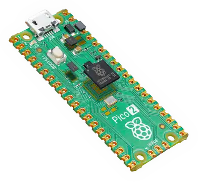

{{#title Начало работы с Rust на Raspberry Pi Pico 2 | impl Rust для RP2350}}

# impl Rust для RP2350 — введение

В этой книге мы используем Raspberry Pi Pico 2 и программируем его на Rust, чтобы исследовать интересные проекты. Вы будете выполнять упражнения вроде плавного изменения яркости светодиода, управления сервоприводом, измерения расстояния ультразвуковым датчиком, вывода изображения Ferris (🦀) на OLED-дисплей, работы с RFID-считывателем, воспроизведения мелодий на пищалке, включения светодиода, когда в комнате погас свет, измерения температуры и многого другого.

## Знакомство с железом — Pico 2

Мы будем использовать Raspberry Pi Pico 2 на базе нового чипа RP2350. Он сочетает гибкость двухъядерной архитектуры с поддержкой ядер ARM Cortex-M33 и необязательных ядер RISC-V Hazard3. По умолчанию плата работает на стандартных ядрах ARM, но при желании можно поэкспериментировать с архитектурой RISC-V.

Подробнее — на [официальном сайте](https://www.raspberrypi.com/products/raspberry-pi-pico-2/).

    
    
Raspberry Pi Pico 2

> [!NOTE]
> Существует более старая плата Raspberry Pi Pico на чипе RP2040. В этой книге мы используем более новую **Pico 2** с чипом **RP2350**. При покупке оборудования убедитесь, что берёте правильную плату!
>
> Если вы ищете версию этой книги для RP2040, она доступна здесь: [impl Rust для Pico](http://rp2040.implrust.com/)

Существует также вариант Pico 2 W, который включает Wi‑Fi и Bluetooth и тоже построен на чипе RP2350. Однако он не полностью совместим с нашими примерами. Если вы хотите повторять их без изменений, рекомендуем стандартную Pico 2 (без беспроводных модулей). Если вы уже купили Pico 2 W или собираетесь её купить, всё равно сможете следовать книге. Будут небольшие отличия: например, по умолчанию Wi‑Fi использует встроенный светодиод. Но основные идеи остаются прежними.

Версии **H** обеих плат поставляются с установленными штыревыми разъёмами, что немного упрощает работу.

## Документация

Подробные технические характеристики и рекомендации см. в официальных даташитах:

- [Даташит Pico 2](https://datasheets.raspberrypi.com/pico/pico-2-datasheet.pdf)
- [Даташит чипа RP2350](https://datasheets.raspberrypi.com/rp2350/rp2350-datasheet.pdf)

## Лицензия

Книга «impl Rust для RP2350» (этот проект) распространяется под следующими лицензиями:

* Примеры кода и самостоятельные Cargo-проекты в книге распространяются по лицензиям [MIT License] и [Apache License v2.0].
* Текст книги распространяется по лицензии Creative Commons [CC-BY-SA v4.0].
* Схемы подключения в книге созданы в Fritzing.
* Русский перевод выполнен участниками проекта и распространяется на тех же условиях, что и оригинал, автор которого — ImplFerris.

[MIT License]: https://opensource.org/licenses/MIT
[Apache License v2.0]: http://www.apache.org/licenses/LICENSE-2.0
[CC-BY-SA v4.0]: https://creativecommons.org/licenses/by-sa/4.0/legalcode

## Поддержать проект

Поддержать книгу можно, поставив звезду проекту на [GitHub](https://github.com/r007/EmbeddedRust-Rus/tree/main/pico-pico) или рассказав о ней другим 😊

### Отказ от ответственности

Эксперименты и проекты, описанные в этой книге, работали у автора, но результаты могут отличаться. Автор не несёт ответственности за любые проблемы или повреждения, которые могут возникнуть при экспериментах. Действуйте осторожно и соблюдайте необходимые меры безопасности.
