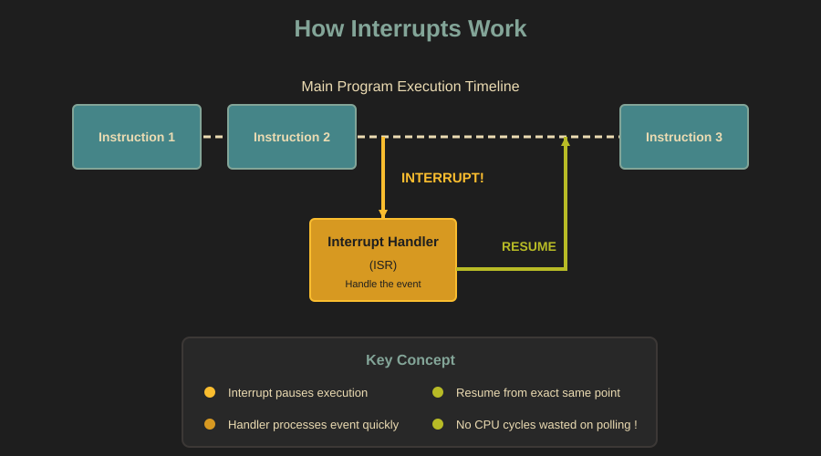
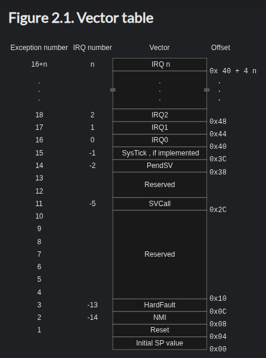
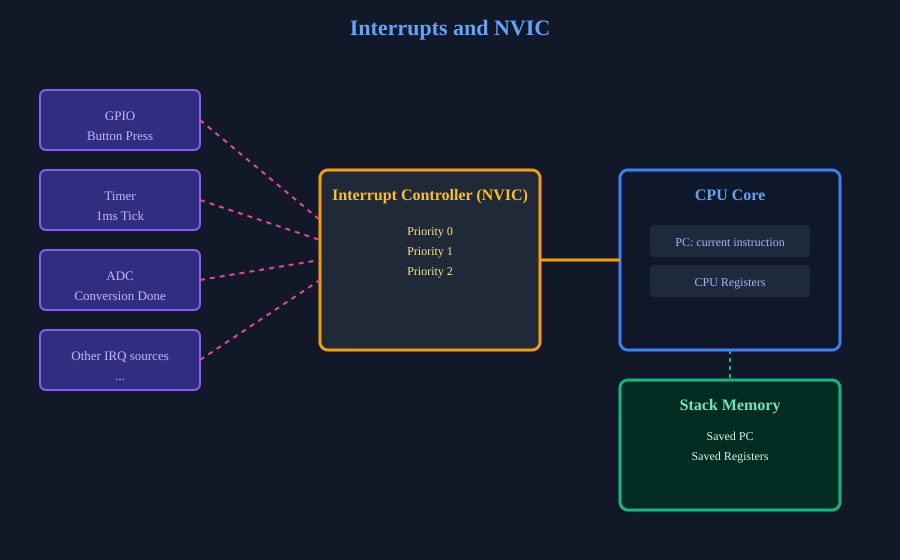

{{#title Прерывания в embedded Rust на Raspberry Pi Pico 2}}

# Прерывания

<style>
.interrupt-demo-container {
    background-color: #282828;
    border: 2px solid #3c3836;
    border-radius: 8px;
    padding: 32px;
    max-width: 80%;
    box-shadow: 0 8px 24px rgba(0, 0, 0, 0.4);
    margin: 20px auto;
    font-family: 'Segoe UI', Tahoma, Geneva, Verdana, sans-serif;
}

.interrupt-demo-explain {
    color: #83a598;
    font-weight: 500;
    line-height: 1.6;
}

.interrupt-demo-interrupt {
    color: #fabd2f;
    line-height: 1.6;
}

.interrupt-demo-comment {
    color: #a89984;
    line-height: 1.6;
}

.interrupt-demo-container br {
    display: block;
    content: "";
    margin-top: 8px;
}
</style>

<div class="interrupt-demo-container">
    <span class="interrupt-demo-explain">
        В этом разделе я объясню, что такое прерывание.
    </span><br/><br/>
    <span class="interrupt-demo-interrupt">
        Одну минуту, звонит мой партнёр.
    </span><br/>
    <span class="interrupt-demo-interrupt">
        Да, солнышко. Конечно, сделаю.
    </span><br/><br/>
    <span class="interrupt-demo-comment">
        Ну вот, я вернулся. Так на чём я остановился?
    </span><br/><br/>
    <span class="interrupt-demo-explain">
        Когда происходит прерывание, процессор приостанавливает текущее выполнение.
    </span><br/><br/>
    <span class="interrupt-demo-interrupt">
        Секунду, кто-то звонит в дверь.
    </span><br/>
    <span class="interrupt-demo-interrupt">
        Отлично, Pico W наконец пришла.
    </span><br/><br/>
    <span class="interrupt-demo-comment">
        Итак, вернёмся к объяснению.
    </span><br/><br/>
    <span class="interrupt-demo-explain">
        Выполнение продолжается с той же инструкции, на которой оно было прервано.
    </span><br/><br/>
    <span class="interrupt-demo-comment">
        Тот телефонный звонок и звонок в дверь были прерываниями.<br/>
        Я (в роли процессора) приостановил объяснение, обработал эти прерывания и затем продолжил.
    </span>
</div>

Это была простая попытка объяснить прерывания с помощью аналогии. Надеюсь, суть понятна. Прерывание — это сигнал, который заставляет процессор приостановить обычное выполнение, чтобы обработать событие. Идея вдохновлена отличным объяснением Патрика на YouTube. [Оригинальное видео](https://www.youtube.com/watch?v=cKBqA7IDNpA) ещё веселее и очень познавательно — его стоит посмотреть.

## Зачем нужны прерывания

В простой программе процессор выполняет инструкции одну за другой по прямой линии. Для простых программ это работает нормально, но встраиваемым системам часто нужно реагировать на внешние события: нажатие кнопки, данные от датчика, истечение таймера.

Без прерываний единственный способ заметить такие события — опрос (polling): постоянная проверка регистра состояния или входного вывода в цикле, чтобы узнать, произошло ли что-то. Это похоже на то, что вы снова и снова спрашиваете:

«Кнопка изменилась?»

«Таймер истёк?»

«Появились ли новые данные?»

Чаще всего ответ «нет». Процессор тратит время ЦП на бесконечные проверки, даже когда ничего не происходит. Из-за этого система работает неэффективно и медленнее реагирует.

Вместо этого периферия может вызвать прерывание, чтобы привлечь внимание процессора. Когда происходит прерывание, процессор временно приостанавливает текущий код, переходит к специальному фрагменту кода — обработчику прерывания, обрабатывает событие и затем продолжает выполнение с того самого места, где оно было прервано.

> [!Tip]
> Представьте разницу между тем, чтобы стоять у стиральной машины и каждую минуту проверять, закончила ли она, и тем, чтобы заниматься своими делами, пока она работает, а она подаст сигнал по окончании программы.

С прерываниями процессор свободно выполняет основной код и останавливается, только когда что-то действительно требует внимания.

<div class="image-with-caption" style="text-align:center; ">
    
</div>

## Как процессор помнит, чем занимался

Когда происходит прерывание, процессор должен уметь продолжить выполнение позже, не потеряв место, где остановился.

Для этого процессор сохраняет своё текущее состояние. Сюда входят, например, счётчик команд (program counter) и важные регистры.

На большинстве микроконтроллеров это состояние автоматически помещается в стек аппаратно. Затем выполняется обработчик прерывания. Когда обработчик завершается, сохранённое состояние восстанавливается из стека, и выполнение продолжается так, будто ничего не произошло.

## Процедуры обслуживания прерываний

Код, который выполняется в ответ на прерывание, называется процедурой обслуживания прерывания (ISR, Interrupt Service Routine).

ISR должна быть короткой и быстрой. Пока выполняется ISR, обычное выполнение программы приостановлено. Долгие или блокирующие операции внутри ISR могут привести к пропуску событий и проблемам с таймингом.

## Таблица векторов прерываний

Когда происходит прерывание, как процессор узнаёт, какую процедуру ISR нужно выполнить? Ответ — таблица векторов прерываний.

Таблица векторов прерываний — это таблица в памяти, которая содержит адреса функций-обработчиков прерываний. Каждому источнику прерываний назначается фиксированная позиция в этой таблице, которая называется номером вектора. Когда срабатывает прерывание, процессор использует этот номер, чтобы найти соответствующую запись в таблице, и переходит по адресу обработчика, записанному там.

Таблица векторов не ограничивается прерываниями от периферии. В ней также есть записи для системных исключений, таких как сброс, аппаратные сбои и системные таймеры. С точки зрения процессора эти события обрабатываются так же, как прерывания: переходом по адресу, указанному в таблице векторов.

На процессорах ARM Cortex-M, таких как RP2350, таблица векторов обычно расположена в начале флеш-памяти при загрузке. Первая запись содержит начальное значение указателя стека, а вторая — обработчик сброса, то есть первый код, который выполняется при запуске процессора.

<div class="image-with-caption" style="text-align:center; ">
    
    <div class="caption" style="font-size:0.9em; color:#555; margin-top:6px;">Таблица векторов для Cortex-M0 — источник: <a href="https://developer.arm.com/documentation/dui0497/a/BABIFJFG">Arm</a></div>
</div>

## Уровни приоритета прерываний

Микроконтроллеры позволяют задавать прерываниям уровни приоритета. Прерывание с более высоким приоритетом может вытеснить прерывание с более низким приоритетом. Так обеспечивается обработка критичных по времени событий в первую очередь.

## NVIC: контроллер прерываний

Вложенный векторный контроллер прерываний (NVIC, Nested Vectored Interrupt Controller) — аппаратный компонент процессоров ARM Cortex-M, который управляет прерываниями.

NVIC отвечает за включение и выключение отдельных прерываний, соблюдение уровней приоритета и обработку ситуаций, когда одновременно возникает несколько прерываний. Когда приходит прерывание с более высоким приоритетом, NVIC может приостановить обработчик с более низким приоритетом, чтобы сначала разобраться с более срочным событием.

<div class="image-with-caption" style="text-align:center; ">
    
    <div class="caption" style="font-size:0.9em; color:#555; margin-top:6px;">NVIC</div>
</div>

Номера приоритетов в ARM Cortex-M работают в обратном порядке: меньшее число означает более высокий приоритет. Среди настраиваемых прерываний приоритет 0 — самый срочный, а большие числа, например приоритет 15, — менее срочные. Это значит, что обработчик с приоритетом 0 может вытеснить обработчик с приоритетом 2, но не наоборот.

## Критические секции

Критическая секция — небольшой фрагмент кода, который нельзя прерывать, чтобы сохранить согласованность данных или состояния аппаратуры.

Представьте ситуацию, когда основной код обновляет общую переменную или настраивает периферию в несколько шагов. Если в середине этой последовательности происходит прерывание и обработчик обращается к тем же данным или аппаратуре, система может оказаться в несогласованном состоянии.

Во встраиваемых системах это обычно решается временным отключением прерываний перед входом в критическую секцию и их немедленным включением после выхода из неё.

Цель не в том, чтобы блокировать прерывания на долгое время, а в том, чтобы защитить очень маленькие и чувствительные участки кода, где важна согласованность.

В экосистеме embedded Rust крейт [`critical-section`](https://docs.rs/critical-section/latest/critical_section/) предоставляет универсальный переносимый API для входа в критические секции на многих платформах и в разных окружениях. Он определяет функции `acquire`, `release` и `with`, которые библиотеки и приложения могут использовать, чтобы выполнять код при отключённых прерываниях или с другой защитой.

Пример:

```rust
use core::cell::Cell;
use critical_section::Mutex;

static MY_VALUE: Mutex<Cell<u32>> = Mutex::new(Cell::new(0));

critical_section::with(|cs| {
    // Этот код выполняется внутри критической секции.

    // `cs` — это токен, с помощью которого можно «доказать» это некоторому API,
    // например, `Mutex`:
    MY_VALUE.borrow(cs).set(42);
});
```

## Типы прерываний

В микроконтроллерах прерывания обычно приходят из нескольких распространённых источников.

### Внешние прерывания

Они вызываются внешними сигналами, например нажатием кнопки или изменением на выводе GPIO. Их часто используют для пользовательского ввода или реакции на внешние аппаратные события.

### Прерывания таймера

Таймеры могут генерировать прерывания через фиксированные промежутки времени. Они широко используются для задержек, планирования задач, мигания светодиодами или отсчёта времени. Да, мы фактически уже использовали прерывания таймера. Каждый раз, когда мы вызываем `Timer::after_millis(100).await` в Embassy, именно это и происходит за кулисами: периферия таймера настраивается так, чтобы сработать прерыванием через 100 миллисекунд. Наша задача засыпает, а когда срабатывает прерывание таймера, она пробуждается. Процессор не сидит и не считает — он свободен заниматься другими делами или спать, пока ждёт.

### Прерывания периферии

Многие периферийные модули могут генерировать прерывания. Например:

- Периферия SPI и I2C может вызывать прерывания, чтобы сигнализировать о завершении передачи или ошибках.
- Периферия ADC может генерировать прерывание по окончании преобразования.

### Системные исключения

Некоторые прерывания генерирует сам процессор, например при сбоях или от системных таймеров. Обычно они предназначены для задач системного уровня.
