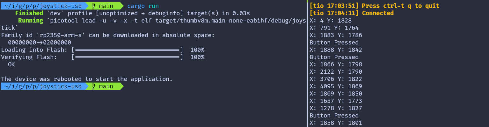

{{#title Чтение позиций джойстика на Raspberry Pi Pico 2 во встраиваемом Rust}}

# Отправка значений АЦП джойстика в USB Serial (RP-HAL)

В предыдущей главе мы использовали Embassy, чтобы читать значения АЦП джойстика и выводить их через логирование. В первой версии этой книги я работал с RP-HAL, когда изучал экосистему. Я не хочу выбрасывать этот материал, потому что он может пригодиться для понимания старого кода или других подходов.

В этой главе показан тот же пример работы с джойстиком и АЦП, но реализованный с помощью RP-HAL и USB Serial. Если версия на RP-HAL вам не интересна, эту главу можно пропустить.

## Проект из шаблона

Чтобы настроить проект, выполните:

```sh
cargo generate --git https://github.com/ImplFerris/pico2-template.git --tag v0.1.0
```

Когда появится запрос, задайте проекту имя, например «joystick-usb», и выберите `RP-HAL` в качестве HAL.

Затем перейдите в папку проекта:

```sh
cd PROJECT_NAME
# Например, если вы назвали проект «joystick-usb»:
# cd joystick-usb
```

## Дополнительные крейты

Добавьте в Cargo.toml эти дополнительные крейты вместе с уже существующими зависимостями.

```rust
usb-device = "0.3.2"
usbd-serial = "0.2.2"
heapless = "0.8.0"

embedded_hal_0_2 = { package = "embedded-hal", version = "0.2.5", features = [
  "unproven",
] }
```

Первые три должны быть уже знакомы: они настраивают связь через USB Serial, чтобы передавать данные между Pico и компьютером. heapless — вспомогательная библиотека для буферов.

embedded_hal_0_2 — новый крейт. В вашем Cargo.toml, возможно, уже есть embedded-hal версии «1.0.0», поэтому можно задаться вопросом, зачем нужна эта версия. Причина в том, что Embedded HAL 1.0.0 не содержит трейта АЦП для чтения значений, а RP-HAL использует трейт из версии 0.2. (Не удаляйте существующий embedded-hal 1.0.0, просто добавьте эту версию рядом с ним.)

## Дополнительные импорты

```rust
/// Этот трейт — интерфейс АЦП, который настроен на чтение конкретного канала
/// в момент запроса (в отличие от непрерывной асинхронной выборки).
use embedded_hal_0_2::adc::OneShot;

// Для USB Serial
use usb_device::{class_prelude::*, prelude::*};
use usbd_serial::SerialPort;
use heapless::String;
```

## USB Serial

Убедитесь, что вы выполнили раздел про USB Serial и добавили в проект шаблонный код из него.

```rust
    let usb_bus = UsbBusAllocator::new(hal::usb::UsbBus::new(
        pac.USB,
        pac.USB_DPRAM,
        clocks.usb_clock,
        true,
        &mut pac.RESETS,
    ));

    let mut serial = SerialPort::new(&usb_bus);

    let mut usb_dev = UsbDeviceBuilder::new(&usb_bus, UsbVidPid(0x16c0, 0x27dd))
        .strings(&[StringDescriptors::default()
            .manufacturer("implRust")
            .product("Ferris")
            .serial_number("12345678")])
        .unwrap()
        .device_class(2) // 2 для CDC, см.: https://www.usb.org/defined-class-codes
        .build();

    let mut buff: String<64> = String::new();
```

## Настройка АЦП и выводов

Подключение джойстика такое же, как и раньше. GPIO 27 и GPIO 26 подключены к выводам VRX и VRY джойстика и настроены как входы АЦП. GPIO 15 используется для кнопки джойстика с внутренним подтягивающим резистором.

```rust
let mut adc = hal::Adc::new(pac.ADC, &mut pac.RESETS);

//Вывод VRX
let mut adc_pin_1 = hal::adc::AdcPin::new(pins.gpio27).unwrap();
// Вывод VRY
let mut adc_pin_0 = hal::adc::AdcPin::new(pins.gpio26).unwrap();

let mut btn = pins.gpio15.into_pull_up_input();
```

## Вывод координат

Как и в версии на Embassy, мы не выводим значения АЦП непрерывно. Мы запоминаем предыдущие показания и выводим их, только когда изменение пересекает порог. Тот же подход применяется и к кнопке: нажатие определяем по переходу состояния, поэтому сообщение выводится один раз за нажатие.

```rust
let mut prev_vrx: u16 = 0;
let mut prev_vry: u16 = 0;
let mut print_vals = true;
```

**Чтение значений АЦП:**

Сначала считываем значения АЦП для vrx и vry. Если при чтении возникает ошибка, мы её игнорируем и продолжаем цикл:

```rust
let Ok(vry): Result<u16, _> = adc.read(&mut adc_pin_0) else {
    continue;
};
let Ok(vrx): Result<u16, _> = adc.read(&mut adc_pin_1) else {
    continue;
};
```

**Проверка изменений относительно порога:**

Далее проверяем, превышает ли абсолютная разница между текущим и предыдущим значением vrx или vry порог (например, 100). Если да, обновляем предыдущее значение и выставляем флаг print_vals в true:

```rust
if vrx.abs_diff(prev_vrx) > 100 {
    prev_vrx = vrx;
    print_vals = true;
}

if vry.abs_diff(prev_vry) > 100 {
    prev_vry = vry;
    print_vals = true;
}
```

Использование порога отфильтровывает небольшие колебания АЦП, исключает ненужный вывод и гарантирует обновления только при значимых изменениях.

**Вывод координат**

Если print_vals равен true, сбрасываем его в false и выводим координаты X и Y через USB Serial:

```rust
if print_vals {
    print_vals = false;

    buff.clear();
    write!(buff, "X: {} Y: {}\r\n", vrx, vry).unwrap();
    let _ = serial.write(buff.as_bytes());
}
```

### Определение нажатия кнопки по переходу состояния

Обычно кнопка находится в высоком состоянии. Когда вы нажимаете на ручку, она переключается из высокого состояния в низкое. Однако, поскольку программа работает в цикле, простая проверка, что кнопка находится в низком состоянии, может приводить к множественным срабатываниям на одно нажатие. Чтобы этого избежать, мы регистрируем нажатие один раз, определяя переход из высокого состояния в низкое, которое означает, что кнопку нажали.

Для этого мы сохраняем предыдущее состояние кнопки и сравниваем его с текущим перед выводом сообщения «Button pressed». Если кнопка сейчас в низком состоянии (нажата), а предыдущее состояние было высоким (не нажата), мы считаем это новым нажатием и выводим сообщение. Затем обновляем предыдущее состояние, что обеспечивает корректное определение будущих переходов.

```rust
let btn_state = btn.is_low().unwrap();
if btn_state && !prev_btn_state {
    let _ = serial.write("Button Pressed\r\n".as_bytes());
    print_vals = true;
}
prev_btn_state = btn_state;
```

### Полный код

```rust
#![no_std]
#![no_main]

use core::fmt::Write;
use embedded_hal::{delay::DelayNs, digital::InputPin};
use embedded_hal_0_2::adc::OneShot;
use hal::block::ImageDef;
use heapless::String;
use panic_halt as _;
use rp235x_hal as hal;

use usb_device::{class_prelude::*, prelude::*};
use usbd_serial::SerialPort;

#[link_section = ".start_block"]
#[used]
pub static IMAGE_DEF: ImageDef = hal::block::ImageDef::secure_exe();

const XTAL_FREQ_HZ: u32 = 12_000_000u32;

#[hal::entry]
fn main() -> ! {
    let mut pac = hal::pac::Peripherals::take().unwrap();
    let mut watchdog = hal::Watchdog::new(pac.WATCHDOG);

    let clocks = hal::clocks::init_clocks_and_plls(
        XTAL_FREQ_HZ,
        pac.XOSC,
        pac.CLOCKS,
        pac.PLL_SYS,
        pac.PLL_USB,
        &mut pac.RESETS,
        &mut watchdog,
    )
    .ok()
    .unwrap();
    let mut timer = hal::Timer::new_timer0(pac.TIMER0, &mut pac.RESETS, &clocks);

    let sio = hal::Sio::new(pac.SIO);
    let pins = hal::gpio::Pins::new(
        pac.IO_BANK0,
        pac.PADS_BANK0,
        sio.gpio_bank0,
        &mut pac.RESETS,
    );
    // let mut led = pins.gpio25.into_push_pull_output();

    let usb_bus = UsbBusAllocator::new(hal::usb::UsbBus::new(
        pac.USB,
        pac.USB_DPRAM,
        clocks.usb_clock,
        true,
        &mut pac.RESETS,
    ));

    let mut serial = SerialPort::new(&usb_bus);

    let mut usb_dev = UsbDeviceBuilder::new(&usb_bus, UsbVidPid(0x16c0, 0x27dd))
        .strings(&[StringDescriptors::default()
            .manufacturer("implRust")
            .product("Ferris")
            .serial_number("12345678")])
        .unwrap()
        .device_class(2) // 2 для CDC, см.: https://www.usb.org/defined-class-codes
        .build();

    let mut btn = pins.gpio15.into_pull_up_input();

    let mut adc = hal::Adc::new(pac.ADC, &mut pac.RESETS);

    //Вывод VRX
    let mut adc_pin_1 = hal::adc::AdcPin::new(pins.gpio27).unwrap();
    // Вывод VRY
    let mut adc_pin_0 = hal::adc::AdcPin::new(pins.gpio26).unwrap();

    let mut prev_vrx: u16 = 0;
    let mut prev_vry: u16 = 0;
    let mut prev_btn_state = false;
    let mut buff: String<64> = String::new();
    let mut print_vals = true;
    loop {
        let _ = usb_dev.poll(&mut [&mut serial]);

        let Ok(vry): Result<u16, _> = adc.read(&mut adc_pin_0) else {
            continue;
        };
        let Ok(vrx): Result<u16, _> = adc.read(&mut adc_pin_1) else {
            continue;
        };

        if vrx.abs_diff(prev_vrx) > 100 {
            prev_vrx = vrx;
            print_vals = true;
        }

        if vry.abs_diff(prev_vry) > 100 {
            prev_vry = vry;
            print_vals = true;
        }

        let btn_state = btn.is_low().unwrap();
        if btn_state && !prev_btn_state {
            let _ = serial.write("Button Pressed\r\n".as_bytes());
            print_vals = true;
        }
        prev_btn_state = btn_state;

        if print_vals {
            print_vals = false;

            buff.clear();
            write!(buff, "X: {} Y: {}\r\n", vrx, vry).unwrap();
            let _ = serial.write(buff.as_bytes());
        }

        timer.delay_ms(50);
    }
}

#[link_section = ".bi_entries"]
#[used]
pub static PICOTOOL_ENTRIES: [hal::binary_info::EntryAddr; 5] = [
    hal::binary_info::rp_cargo_bin_name!(),
    hal::binary_info::rp_cargo_version!(),
    hal::binary_info::rp_program_description!(c"JoyStick USB"),
    hal::binary_info::rp_cargo_homepage_url!(),
    hal::binary_info::rp_program_build_attribute!(),
];
```

## Клонируйте существующий проект

Можно клонировать проект, который я создал, и перейти в папку `joystick-usb`.

```sh
git clone https://github.com/ImplFerris/pico2-rp-projects
cd pico2-rp-projects/joystick-usb/
```

## Как запустить?

Прошивка (запуск кода) на Pico выполняется как обычно. Однако нужно настроить tio для взаимодействия с Pico через последовательный порт (/dev/ttyACM0). Это позволит читать данные с Pico и отправлять их на него.

### tio

Убедитесь, что в вашей системе установлен tio. Если нет, его можно установить командой:

```sh
apt install tio
```

### Подключение к последовательному порту

Выполните следующую команду, чтобы подключиться к последовательному порту Pico:

```sh
tio /dev/ttyACM0
```

Откроется сеанс терминала для общения с Pico.

### Прошивка и запуск кода

Откройте другой терминал, перейдите в папку проекта и прошейте код на Pico как обычно:

```sh
cargo run
```

Если всё настроено правильно, в терминале tio вы увидите сообщение «Connected». Когда вы двигаете джойстик, будут выводиться координаты. Нажатие ручки вниз также покажет сообщение «Button pressed».


