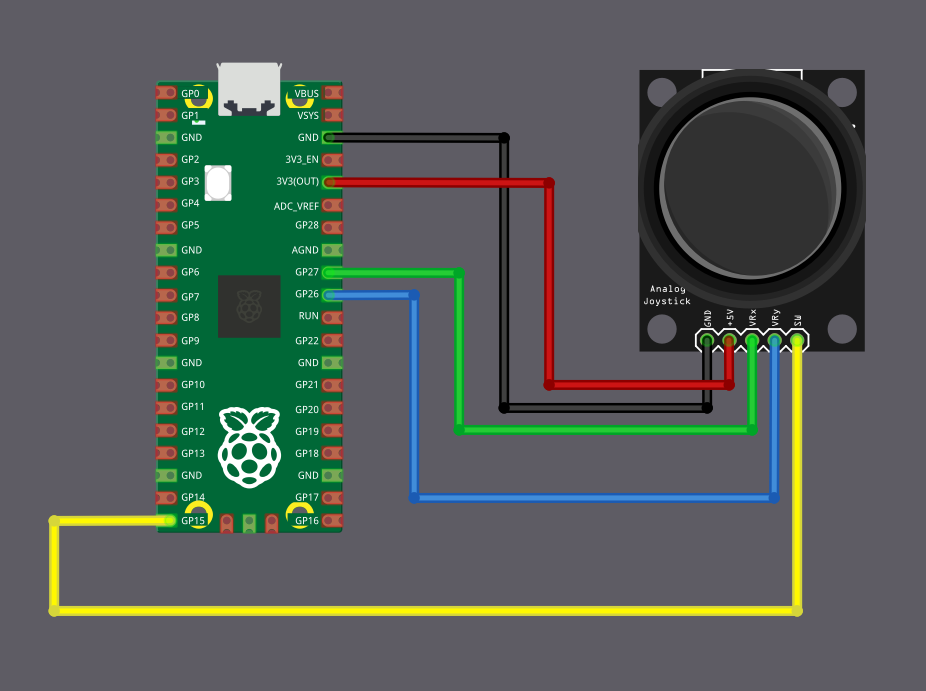

# Подключение джойстика к Raspberry Pi Pico

Подключим джойстик к Raspberry Pi Pico. Выводы VRX и VRY нужно подключить к выводам АЦП Pico. Джойстик будем питать от 3,3 В, а не от 5 В, потому что выводы GPIO Pico рассчитаны только на 3,3 В. Подключение к 5 В может повредить выводы Pico. К счастью, джойстик работает и от 3,3 В.

<table>
  <thead>
    <tr>
      <th>Вывод Pico</th>
      <th style="width: 250px; margin: 0 auto;">Провод</th>
      <th>Вывод джойстика</th>
    </tr>
  </thead>
  <tbody>
    <tr>
      <td>GND</td>
      <td style="text-align: center; vertical-align: middle; padding: 0;">
        

          

          

        

      </td>
      <td>GND</td>
    </tr>
    <tr>
      <td>3.3 V</td>
      <td style="text-align: center; vertical-align: middle; padding: 0;">
        

          

          

        

      </td>
      <td>VCC</td>
    </tr>
    <tr>
      <td>GPIO 27 (ADC1)</td>
      <td style="text-align: center; vertical-align: middle; padding: 0;">
        

          

          

        

      </td>
      <td>VRX</td>
    </tr>
    <tr>
      <td>GPIO 26 (ADC0)</td>
      <td style="text-align: center; vertical-align: middle; padding: 0;">
        

          

          

        

      </td>
      <td>VRY</td>
    </tr>
    <tr>
      <td>GPIO 15</td>
      <td style="text-align: center; vertical-align: middle; padding: 0;">
        

          

          

        

      </td>
      <td>SW</td>
    </tr>
  </tbody>
</table>

