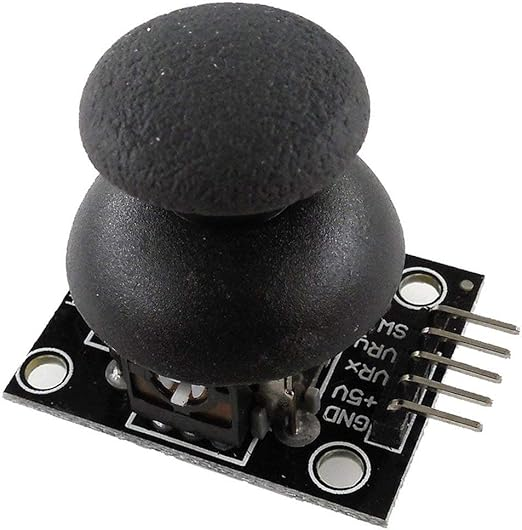
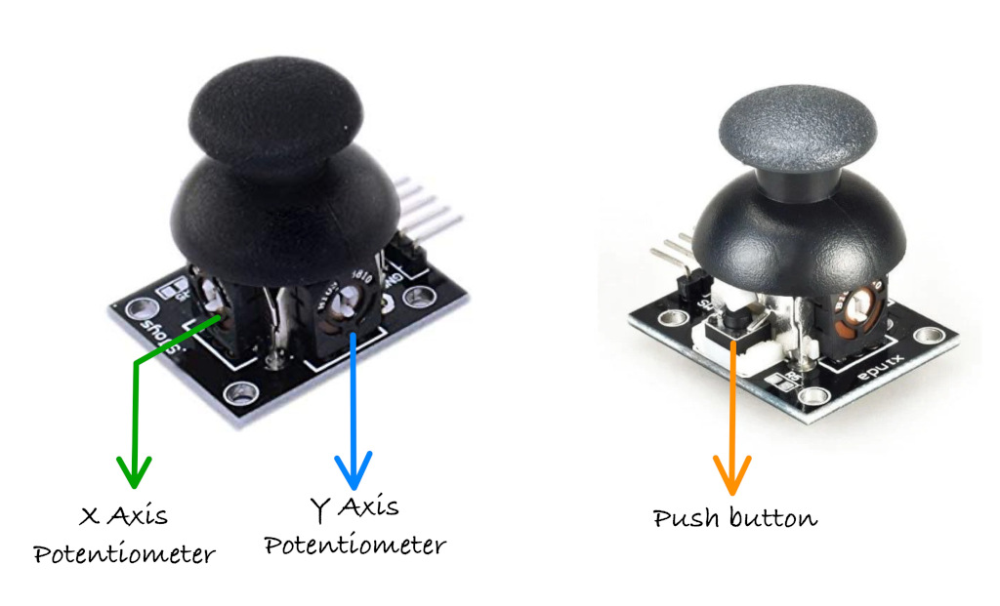

# Джойстик

В этом разделе мы разберём, как использовать модуль джойстика. Он похож на джойстики контроллеров PS2 (PlayStation 2). Их часто применяют в играх, а также для управления дронами, радиоуправляемыми машинками, роботами и другими устройствами, чтобы менять положение или направление.

## Знакомство с железом — модуль джойстика

Ручку джойстика можно перемещать по вертикали и по горизонтали, а её положение (оси X и Y) передаётся в микроконтроллер (например, Pico). Кроме того, ручку можно нажать вниз, как кнопку. Джойстик обычно работает от 5 В, но его также можно подключить к 3,3 В.

## Как это работает?

Модуль джойстика содержит два потенциометра на 10 кОм: один для оси X и другой для оси Y. Также в нём есть кнопка, которая видна сверху.

Когда вы перемещаете джойстик слева направо или справа налево (ось X), можно увидеть, как один из потенциометров двигается соответственно. Аналогично, когда вы двигаете его вверх и вниз (ось Y), движется другой потенциометр.

Также можно увидеть, как срабатывает кнопка, когда вы нажимаете на ручку.
