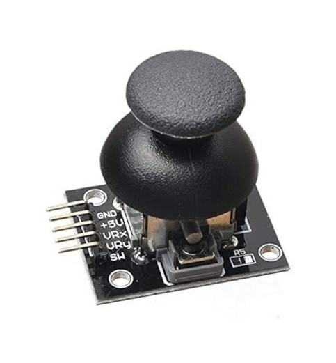

# Распиновка

У джойстика всего 5 выводов: питание, земля, выход оси X, выход оси Y и выход переключателя.

<table border="1" style="border-collapse: collapse; width: 100%;">
  <thead>
    <tr>
      <th style="width:14%">Вывод джойстика</th>
      <th>Описание</th>
    </tr>
  </thead>
  <tbody>
    <tr>
      <td>GND</td>
      <td>Вывод земли. Должен быть подключён к земле схемы.</td>
    </tr>
    <tr>
      <td>VCC</td>
      <td>Вывод питания (обычно 5 В или 3,3 В).</td>
    </tr>
    <tr>
      <td>VRX</td>
      <td>Аналоговый выход оси X: его напряжение меняется в зависимости от горизонтального положения джойстика и изменяется от 0 В до VCC при движении влево и вправо.</td>
    </tr>
    <tr>
      <td>VRY</td>
      <td>Аналоговый выход оси Y: его напряжение меняется в зависимости от вертикального положения джойстика и изменяется от 0 В до VCC при движении вверх и вниз.</td>
    </tr>
    <tr>
      <td>SW</td>
      <td>Вывод переключателя. Когда ручку джойстика нажимают, этот вывод обычно притягивается к низкому уровню (к GND).</td>
    </tr>
  </tbody>
</table>
