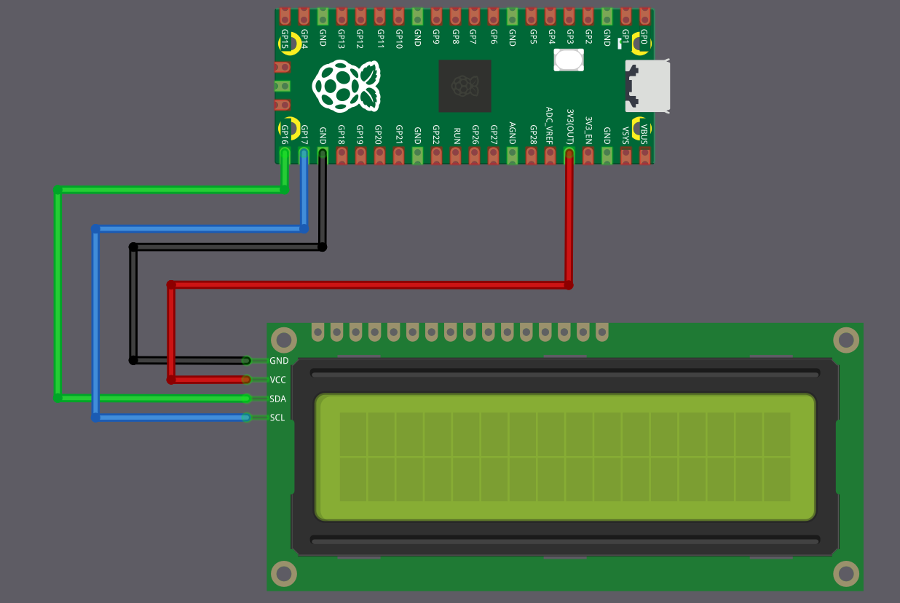
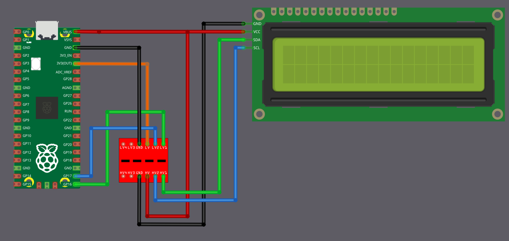

# Подключение ЖК-дисплея (LCD1602) к Raspberry Pi Pico

Мы подключим символьный ЖК-дисплей LCD1602 с адаптером I2C к Raspberry Pi Pico. С точки зрения проводки схема выглядит простой, потому что нужны всего четыре соединения: питание, земля, SDA и SCL. Однако, несмотря на небольшое количество проводов, есть важная деталь по напряжению, которую нужно правильно учесть до подключения.

## Проблема совместимости по напряжению

Выводы GPIO Raspberry Pi Pico рассчитаны на 3,3 В. Всё, что существенно выше 3,3 В на SDA или SCL, может повредить Pico — сразу или постепенно, со временем.

Большинство модулей LCD1602 с адаптером I2C рассчитаны на работу от 5 В. Адаптер I2C обычно имеет подтягивающие резисторы, подключённые к его напряжению питания. При питании от 5 В это означает, что в состоянии покоя SDA и SCL находятся на уровне 5 В.

Если подключить SDA и SCL такого модуля напрямую к Pico, выводы GPIO Pico окажутся под напряжением 5 В. Именно эту основную проблему нам и нужно решить.

## Распространённый обходной путь, который вы увидите в интернете

Многие онлайн-руководства предлагают питать LCD1602 и его адаптер I2C от 5 В и подключать SDA и SCL напрямую к Pico. Я сам проверял эту схему, и она работает. Однако с точки зрения электрики это небезопасно, и долговременное использование может повредить выводы GPIO Pico.

По этой причине, хотя такая схема работает, её нельзя считать безопасной или рекомендованной.

## Простой, но достаточно безопасный способ: питание всего от 3,3 В

Для демонстраций, экспериментов и учебных проектов самый простой и безопасный подход — питать модуль LCD1602 с I2C от шины 3,3 В Pico, а не от 5 В.

Когда адаптер питается от 3,3 В, его подтягивающие резисторы I2C подтягивают SDA и SCL к 3,3 В вместо 5 В. Это сразу убирает проблему совместимости по напряжению, и SDA и SCL можно подключить напрямую к Pico.

Компромисс в том, что контраст и яркость подсветки ЖК-дисплея будут ниже. В большинстве помещений дисплей остаётся читаемым и обычно вполне подходит для демонстраций и тестирования.

Такой подход не требует дополнительных компонентов и не нагружает выводы GPIO Pico.

<table>
  <thead>
    <tr>
      <th style="width: 250px;">Вывод LCD</th>
      <th style="width: 250px; text-align: center;">Провод</th>
      <th>Вывод Pico</th>
      <th>Примечания</th>
    </tr>
  </thead>
  <tbody>
    <tr>
      <td>GND</td>
      <td style="text-align: center; vertical-align: middle; padding: 0;">
        

          

          

        

      </td>
      <td>GND</td>
      <td>Общая земля</td>
    </tr>
    <tr>
      <td>VCC</td>
      <td style="text-align: center; vertical-align: middle; padding: 0;">
        

          

          

        

      </td>
      <td>3.3 V</td>
      <td>Питание ЖК-дисплея 3,3 В</td>
    </tr>
    <tr>
      <td>SCL</td>
      <td style="text-align: center; vertical-align: middle; padding: 0;">
        

          

          

        

      </td>
      <td>GPIO 17</td>
      <td>Линия тактирования I2C (SCL I2C0)</td>
    </tr>
    <tr>
      <td>SDA</td>
      <td style="text-align: center; vertical-align: middle; padding: 0;">
        

          

          

        

      </td>
      <td>GPIO 16</td>
      <td>Линия данных I2C (SDA I2C0)</td>
    </tr>
  </tbody>
</table>

 

## Лучший вариант: использование преобразователя уровней

Если нужна полная яркость подсветки или если ваш ЖК-модуль не работает надёжно при 3,3 В, его придётся питать от 5 В. Но тогда нужно защитить Pico от сигналов 5 В.

Решение — двунаправленный преобразователь логических уровней (также называемый level shifter). Этот небольшой модуль преобразует сигналы между 3,3 В и 5 В в обоих направлениях. Такие модули продаются как «2-Channel» или «4-Channel I2C/SPI Logic Level Converter».

Pico подключается к стороне 3,3 В преобразователя, а ЖК-дисплей — к стороне 5 В. Преобразователь гарантирует, что Pico видит только сигналы 3,3 В, а ЖК-дисплей получает сигналы 5 В, которые ему нужны.

Это электрически правильный и безопасный способ, но он добавляет несколько проводов и требует дополнительного модуля.

 

На первый взгляд схема может показаться немного запутанной, но идея проста, если разобрать её по частям.

### Подключение питания (сначала подключите эти провода)

Сначала подключите выход 3,3 В Pico к выводу, помеченному LV (Low Voltage), на преобразователе. Подключите VBUS Pico (5 В) к выводу, помеченному HV (High Voltage), на преобразователе. Вывод VCC ЖК-дисплея также питается напрямую от VBUS Pico. Земля должна быть общей, поэтому соедините вместе GND Pico, GND преобразователя и GND ЖК-дисплея.

<table>
  <thead>
    <tr>
      <th style="width: 180px;">От</th>
      <th style="width: 120px;">Вывод</th>
      <th style="width: 160px; text-align: center;">Провод</th>
      <th style="width: 180px;">К</th>
      <th style="width: 120px;">Вывод</th>
      <th>Назначение</th>
    </tr>
  </thead>
  <tbody>
    <tr>
      <td>Raspberry Pi Pico</td>
      <td>GND</td>
      <td style="text-align: center; vertical-align: middle; padding: 0;">
        

          

          

        

      </td>
      <td>Преобразователь уровней</td>
      <td>GND</td>
      <td>Общая земля</td>
    </tr>
    <tr>
      <td>Преобразователь уровней</td>
      <td>GND</td>
      <td style="text-align: center; vertical-align: middle; padding: 0;">
        

          

          

        

      </td>
      <td>ЖК-дисплей</td>
      <td>GND</td>
      <td>Общая земля</td>
    </tr>
    <tr>
      <td>Raspberry Pi Pico</td>
      <td>3.3 V</td>
      <td style="text-align: center; vertical-align: middle; padding: 0;">
        

          

          

        

      </td>
      <td>Преобразователь уровней</td>
      <td>LV</td>
      <td>Питание низкого уровня (сторона 3,3 В)</td>
    </tr>
    <tr>
      <td>Raspberry Pi Pico</td>
      <td>VBUS (5 V)</td>
      <td style="text-align: center; vertical-align: middle; padding: 0;">
        

          

          

        

      </td>
      <td>Преобразователь уровней</td>
      <td>HV</td>
      <td>Питание высокого уровня (сторона 5 В)</td>
    </tr>
    <tr>
      <td>Raspberry Pi Pico</td>
      <td>VBUS (5 V)</td>
      <td style="text-align: center; vertical-align: middle; padding: 0;">
        

          

          

        

      </td>
      <td>ЖК-дисплей</td>
      <td>VCC</td>
      <td>Питание ЖК-дисплея 5 В</td>
    </tr>
  </tbody>
</table>

### Линии данных (обмен по I2C)

Теперь о линиях I2C. Выводы Pico всегда должны подключаться к выводам преобразователя с маркировкой LVx, а выводы ЖК-дисплея — к соответствующим выводам с маркировкой HVx. Вывод GPIO 16 Pico (SDA) подключается к LV1, а вывод SDA ЖК-дисплея — к HV1. Вывод GPIO 17 Pico (SCL) подключается к LV2, а вывод SCL ЖК-дисплея — к HV2.

<table>
  <thead>
    <tr>
      <th style="width: 180px;">От</th>
      <th style="width: 120px;">Вывод</th>
      <th style="width: 160px; text-align: center;">Провод</th>
      <th style="width: 180px;">К</th>
      <th style="width: 120px;">Вывод</th>
      <th>Назначение</th>
    </tr>
  </thead>
  <tbody>
    <tr>
      <td>Raspberry Pi Pico</td>
      <td>GPIO 16</td>
      <td style="text-align: center; vertical-align: middle; padding: 0;">
        

          

          

        

      </td>
      <td>Преобразователь уровней</td>
      <td>LV1</td>
      <td>SDA (данные) — сторона Pico</td>
    </tr>
    <tr>
      <td>Преобразователь уровней</td>
      <td>HV1</td>
      <td style="text-align: center; vertical-align: middle; padding: 0;">
        

          

          

        

      </td>
      <td>ЖК-дисплей</td>
      <td>SDA</td>
      <td>SDA (данные) — сторона ЖК-дисплея</td>
    </tr>
    <tr>
      <td>Raspberry Pi Pico</td>
      <td>GPIO 17</td>
      <td style="text-align: center; vertical-align: middle; padding: 0;">
        

          

          

        

      </td>
      <td>Преобразователь уровней</td>
      <td>LV2</td>
      <td>SCL (тактирование) — сторона Pico</td>
    </tr>
    <tr>
      <td>Преобразователь уровней</td>
      <td>HV2</td>
      <td style="text-align: center; vertical-align: middle; padding: 0;">
        

          

          

        

      </td>
      <td>ЖК-дисплей</td>
      <td>SCL</td>
      <td>SCL (тактирование) — сторона ЖК-дисплея</td>
    </tr>
  </tbody>
</table>

### Как это работает?

Если говорить просто: когда Pico обменивается данными по линии I2C, сторона LVx работает на 3,3 В, а преобразователь выдаёт сигнал 5 В на соответствующей стороне HVx для ЖК-дисплея. Когда ЖК-дисплей обменивается данными на 5 В, преобразователь переводит этот сигнал обратно, так что Pico видит на стороне LVx только 3,3 В. Таким образом, оба устройства работают на нужном им напряжении, и выводы GPIO Pico не перегружаются.
