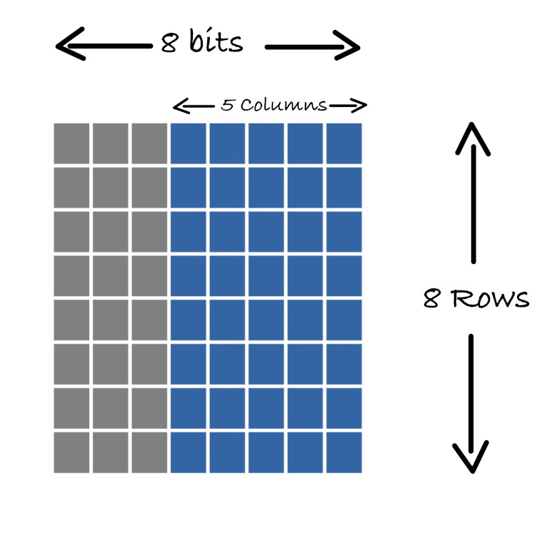

# Пользовательские символы

Помимо поддерживаемых символов, можно создавать собственные символы (глифы), например смайлики или значки сердца. В модуле есть 64 байта памяти для генератора символов (CGRAM), что позволяет хранить до 8 пользовательских глифов.

Контроллер предоставляет 64 байта CGRAM (Character Generator RAM). Каждый пользовательский глиф занимает 8 байтов, поэтому одновременно можно сохранить до 8 пользовательских глифов.

Каждый глиф — это сетка 8x8, где каждая строка представлена одним 8-битным значением (`u8`). Получается 8 байтов на глиф (8 строк × 1 байт на строку). Именно поэтому при общем объёме 64 байта можно сохранить только до 8 пользовательских глифов (8 глифов × 8 байтов = 64 байта).

> [!NOTE]
> Если помните, в нашем ЖК-модуле каждый символ представлен сеткой 5 × 8. Но подождите, разве мы не говорили, что для символов нужна сетка 8 × 8? Да, всё верно: нужна память 8 × 8 (8 байтов), но в каждой строке мы используем только 5 битов. Три старших бита в каждой строке остаются нулями.
