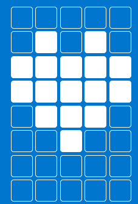
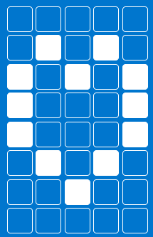
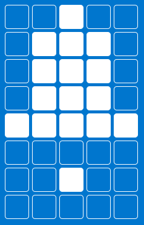
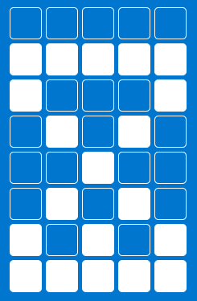
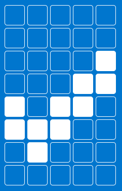
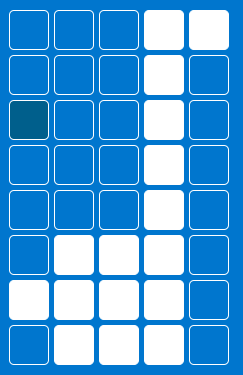

# Индекс символов

Ниже приведён список пользовательских символов с соответствующими массивами байтов. Если вы придумали интересный символ и хотите добавить его в этот список, отправляйте pull request. Пожалуйста, используйте [генератор пользовательских символов](./lcd-custom-char-generator.md), чтобы результаты были единообразными.

<table>
    <thead>
        <tr>
            <th>Название</th>
            <th>Превью</th>
            <th>Массив байтов</th>
        </tr>
    </thead>
    <tbody>
        <tr>
            <td>Сердце</td>
            <td></td>
            <td>[ 0b00000, 0b01010, 0b11111, 0b11111, 0b01110, 0b00100, 0b00000, 0b00000,]</td>
        </tr>
        <tr>
            <td>Замок</td>
            <td></td>
            <td>[ 0b01110, 0b10001, 0b10001, 0b11111, 0b11011, 0b11011, 0b11011, 0b11111, ]</td>
        </tr>
        <tr>
            <td>Контурное сердце</td>
            <td></td>
            <td>[ 0b00000, 0b01010, 0b10101, 0b10001, 0b10001, 0b01010, 0b00100, 0b00000, ]</td>
        </tr>
        <tr>
            <td>Батарея</td>
            <td></td>
            <td>[ 0b01110, 0b11011, 0b10001, 0b10001, 0b10001, 0b11111, 0b11111, 0b11111, ]</td>
        </tr>
        <tr>
            <td>Автобус</td>
            <td></td>
            <td>[ 0b01110, 0b11111, 0b10001, 0b10001, 0b11111, 0b10101, 0b11111, 0b01010, ]</td>
        </tr>
        <tr>
            <td>Колокольчик</td>
            <td></td>
            <td>[ 0b00100, 0b01110, 0b01110, 0b01110, 0b11111, 0b00000, 0b00100, 0b00000, ]</td>
        </tr>
        <tr>
            <td>Песочные часы</td>
            <td></td>
            <td>[ 0b00000, 0b11111, 0b10001, 0b01010, 0b00100, 0b01010, 0b10101, 0b11111, ]</td>
        </tr>
        <tr>
            <td>Зарядка</td>
            <td></td>
            <td>[ 0b01010, 0b01010, 0b11111, 0b10001, 0b10001, 0b01110, 0b00100, 0b00100, ]</td>
        </tr>
        <tr>
            <td>Галочка</td>
            <td></td>
            <td>[ 0b00000, 0b00000, 0b00001, 0b00011, 0b10110, 0b11100, 0b01000, 0b00000, ]</td>
        </tr>
        <tr>
            <td>Нота</td>
            <td></td>
            <td>[ 0b00011, 0b00010, 0b00010, 0b00010, 0b00010, 0b01110, 0b11110, 0b01110, ]</td>
        </tr>
    </tbody>
</table>
