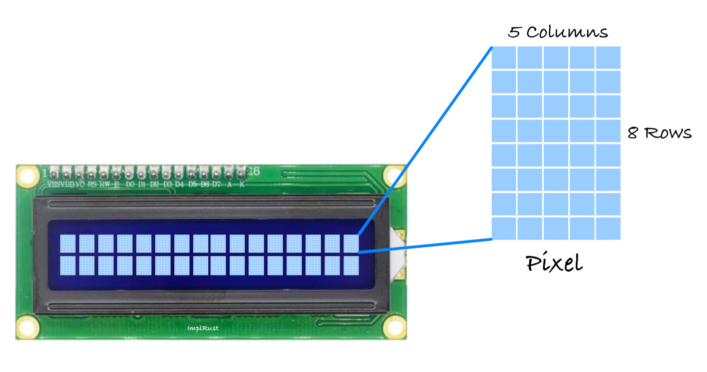

# Как это работает?

Жидкокристаллический дисплей (LCD, Liquid Crystal Display) работает, используя жидкие кристаллы, чтобы управлять прохождением света через экран. Когда мы подаём напряжение, жидкие кристаллы меняют свою ориентацию. Это изменение либо пропускает свет, либо блокирует его. Управляя тем, какие участки пропускают свет, а какие его блокируют, ЖК-дисплей может отображать символы и знаки.

Сам экран не излучает свет. Вместо этого подсветка за дисплеем обеспечивает освещение. Жидкие кристаллы выборочно перекрывают эту подсветку, создавая тёмные участки, которые образуют видимые на экране символы.

### ЖК-дисплей 16 × 2 и матрица пикселей 5 × 8

ЖК-дисплей 16 × 2 имеет 2 строки и 16 столбцов, поэтому он может одновременно отображать 32 символа. Каждый символ на экране построен из матрицы пикселей 5 × 8. Это значит, что каждый символ формируется из 5 вертикальных столбцов и 8 горизонтальных строк крошечных точек.

Эти точки включаются и выключаются, образуя буквы, цифры и символы.

### Вывод текста и пользовательских символов на ЖК-дисплее 16 × 2

При выводе обычного текста рисовать отдельные пиксели не нужно: это делает контроллер HD44780 автоматически. Когда мы отправляем символ ASCII, контроллер находит соответствующий шаблон 5 × 8 и выводит его на экран.

Если нужно вывести собственные символы, например иконки или специальные знаки, можно определить свои шаблоны пикселей 5 × 8. Эти шаблоны хранятся в памяти ЖК-дисплея, и после определения их можно выводить так же, как обычные символы. Одно важное ограничение: в дисплее одновременно может храниться только 8 пользовательских символов.

### Режим передачи данных

Контроллер HD44780 поддерживает два режима передачи данных: 8-битный и 4-битный.

При использовании параллельного интерфейса 8-битный режим передаёт целый байт за один раз, задействуя все линии данных. Это быстрее, но требует много выводов GPIO. В 4-битном режиме те же данные передаются в два приёма, используя только четыре линии данных. Это упрощает проводку ценой небольшого снижения быстродействия.

При использовании адаптера I2C плата адаптера внутри себя управляет ЖК-дисплеем через 4-битный параллельный интерфейс. Настраивать это самостоятельно не нужно: адаптер делает всё автоматически.

Чтобы проводка оставалась простой и практичной, мы будем использовать 4-битный режим.

## Регулировка контраста

Когда мы включаем ЖК-дисплей, на нём должна быть видна матрица точек. Если после запуска программы текст плохо виден, контраст нужно подрегулировать.

При использовании ЖК-модуля с I2C можно подстроить небольшой потенциометр на плате адаптера I2C, чтобы задать контраст.

Медленно поворачивая этот потенциометр, вы сделаете символы чётче или темнее, пока их не станет легко читать.
