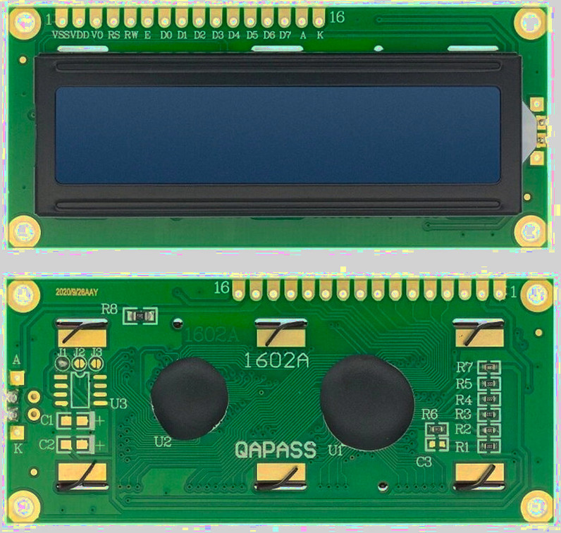

{{#title ЖК-дисплей HD44780 с I2C на Raspberry Pi Pico 2 в embedded Rust}}

# ЖК-дисплей

В этом разделе мы будем работать с ЖК-модулями (LCD, Liquid Crystal Display), совместимыми с Hitachi HD44780. Такие символьные ЖК-дисплеи очень распространены и уже десятилетия используются в повседневных устройствах: принтерах, цифровых часах, микроволновках, стиральных машинах, кондиционерах и других бытовых приборах. Их также можно встретить в офисной технике, например в копировальных аппаратах, факсах и сетевых маршрутизаторах.

Эти дисплеи предназначены для вывода символов ASCII, а также поддерживают до 8 пользовательских символов, которые вы можете определить сами.

## Варианты исполнения

ЖК-дисплеи, совместимые с HD44780, бывают разных физических форматов. Самые распространённые — дисплеи 16 × 2, с 16 столбцами и 2 строками, и 20 × 4, с 20 столбцами и 4 строками. Они также отличаются цветом подсветки, например синим, жёлтым или зелёным.

### Интерфейсы ЖК-дисплея

Дисплеи на базе HD44780 обычно используются одним из двух способов. Различие здесь не в самом дисплее, а в том, как управляющие сигналы доходят до контроллера.

По своей сути контроллер HD44780 работает через параллельный интерфейс. Это родной и самый прямой способ обмена с ЖК-дисплеем. Многие модули выводят этот интерфейс напрямую через свой 16-контактный разъём.

Чтобы упростить подключение, некоторые модули оснащаются платой-адаптером I2C. Эта плата стоит между микроконтроллером и ЖК-дисплеем и преобразует команды I2C в те же параллельные сигналы, которые ожидает контроллер HD44780.

### Параллельный интерфейс

При использовании параллельного интерфейса несколько выводов GPIO микроконтроллера подключаются напрямую к дисплею. Эти выводы передают управляющие сигналы и линии данных, а также питание и управление контрастом.

Такой подход требует больше проводов и задействует много выводов GPIO, но он точно отражает работу контроллера HD44780 изнутри. Он полезен для понимания временных диаграмм, команд и низкоуровневого поведения дисплея.

### Интерфейс I2C

Существуют варианты с адаптером I2C, установленным на обратной стороне, а также адаптер можно добавить позже, если понадобится.

С адаптером I2C обмен идёт всего по двум сигнальным линиям. Это уменьшает количество нужных соединений и делает проводку намного проще. В большинстве адаптеров I2C есть встроенный подстроечный потенциометр для регулировки контраста. Поэтому при использовании варианта с I2C нам не нужны внешний потенциометр или резисторы.

Вариант с I2C, конечно, немного дороже параллельного, но остаётся недорогим и широко доступным.

## В этой книге

В этой книге мы будем использовать версию с I2C. Изначально я использовал параллельный интерфейс, потому что не знал, что покупать. Однако проводка быстро стала сложной: мне пришлось подключить около 12 проводов, тогда как версии с I2C требуется всего 4.

Кроме того, параллельный интерфейс требует дополнительных действий, например настройки потенциометра или делителя напряжения для управления контрастом. С версией I2C эта дополнительная настройка не нужна.

## Требования к оборудованию

Нам понадобится ЖК-дисплей LCD1602. Рекомендуется модуль 16 × 2 с адаптером I2C, чтобы вы могли повторять примеры без изменений, хотя и другие размеры работают так же.

### Преобразователь уровней

Выводы GPIO Pico рассчитаны на 3,3 В, то есть они не предназначены для сигналов 5 В. Подача на них более высокого напряжения, например 5 В, может повредить плату. Многие LCD1602 с адаптером I2C рассчитаны на работу от 5 В, и при прямом подключении к Pico возникает несоответствие уровней напряжения.

Чтобы безопасно подключить Pico и дисплей, нужно учесть эту разницу напряжений. Для этого используется преобразователь уровней. Двунаправленный преобразователь логических уровней I2C позволяет устройствам на 3,3 В и 5 В безопасно обмениваться данными и защищает выводы GPIO Pico. Такие модули недороги и часто продаются как «4-Channel (I2C) 3.3 V-5 V Bi-Directional Logic Level Converter».

Также можно питать ЖК-дисплей от 3,3 В. Это избавляет от проблемы напряжения, но подсветка и контраст будут заметно слабее.

## Даташиты

- Даташит HD44780 можно найти на [Sparkfun](https://www.sparkfun.com/datasheets/LCD/HD44780.pdf) или на [сайте MIT](https://academy.cba.mit.edu/classes/output_devices/44780.pdf)
- [LCD Driver Data Book](https://www.crystalfontz.com/controllers/datasheet-viewer.php?id=433)
- [Даташит LCD-модуля 1602A](https://www.openhacks.com/uploadsproductos/eone-1602a1.pdf)
