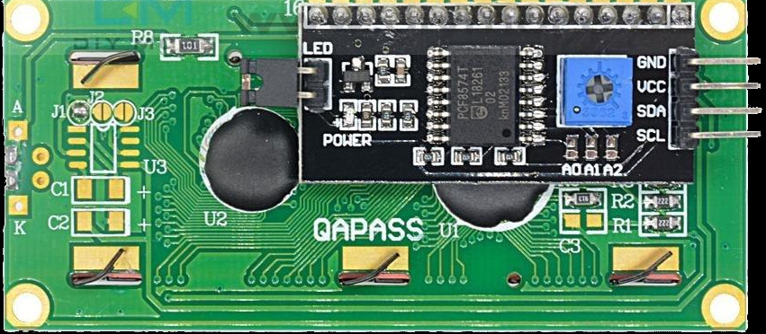
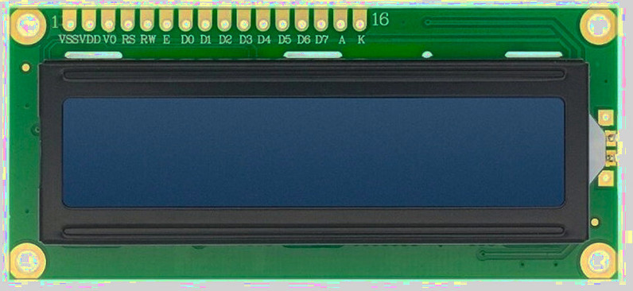

## Распиновка

При использовании параллельного интерфейса ЖК-дисплей имеет в общей сложности 16 выводов. Эти выводы обеспечивают питание, управление контрастом, управляющие сигналы, линии данных и подключение подсветки.

В интерфейсе I2C эти сигналы упрощены и выведены на меньшее число контактов. Сначала рассмотрим вариант с I2C, а затем параллельный интерфейс.

## Распиновка I2C

Адаптер I2C упрощает подключение, внутри себя преобразуя команды I2C в параллельные сигналы. Со стороны микроконтроллера нужны только питание и две линии I2C.

 
<table border="1" style="border-collapse: collapse; width: 100%; text-align: center;">
  <thead>
    <tr>
      <th>Вывод</th>
      <th>Обозначение</th>
      <th>Описание</th>
    </tr>
  </thead>
  <tbody>
    <tr>
      <td>1</td>
      <td>VCC</td>
      <td>Питание (обычно 5 В)</td>
    </tr>
    <tr>
      <td>2</td>
      <td>GND</td>
      <td>Земля</td>
    </tr>
    <tr>
      <td>3</td>
      <td>SDA</td>
      <td>Линия данных для связи по I2C</td>
    </tr>
    <tr>
      <td>4</td>
      <td>SCL</td>
      <td>Линия тактирования для связи по I2C</td>
    </tr>
  </tbody>
</table>

## Распиновка параллельного интерфейса

В параллельном интерфейсе микроконтроллер общается непосредственно с контроллером HD44780. Это даёт больше контроля, но требует больше проводов и аккуратной работы с временными диаграммами.

 

<table border="1" style="border-collapse: collapse; width: 100%;">
  <thead>
    <tr>
      <th>Номер вывода</th>
      <th style="width:14%">Вывод LCD</th>
      <th>Описание</th>
    </tr>
  </thead>
  <tbody>
    <tr>
      <td>1</td>
      <td>VSS</td>
      <td>
        Земля (GND).
      </td>
    </tr>
    <tr>
      <td>2</td>
      <td>VDD</td>
      <td>
        Питание логики ЖК-дисплея, обычно 5 В.
      </td>
    </tr>
    <tr>
      <td>3</td>
      <td>Vo</td>
      <td>
        Вывод регулировки контраста. 
        - Этот вывод принимает аналоговое напряжение между GND и VDD. 
        - Рекомендуется: использовать потенциометр 10 кОм как делитель напряжения, с движком, подключённым к Vo, и двумя другими выводами — к VDD и GND. 
        - Альтернатива: использовать постоянные резисторы как делитель напряжения между VDD и GND, а среднюю точку подключить к Vo.
      </td>
    </tr>
    <tr>
      <td>4</td>
      <td>RS</td>
      <td>
        Выбор регистра: 
        - LOW (RS = 0): регистр инструкций или команд. 
        - HIGH (RS = 1): регистр данных.
      </td>
    </tr>
    <tr>
      <td>5</td>
      <td>RW</td>
      <td>
        Управление чтением или записью: 
        - LOW (RW = 0): запись в ЖК-дисплей. 
        - HIGH (RW = 1): чтение из ЖК-дисплея. 
        - Обычно подключается к GND для работы только на запись.
      </td>
    </tr>
    <tr>
      <td>6</td>
      <td>E</td>
      <td>
        Вывод разрешения (Enable). Данные или команды защёлкиваются при переходе этого вывода с HIGH на LOW.
      </td>
    </tr>
    <tr>
      <td>7–10</td>
      <td>D0–D3</td>
      <td>
        Младшие биты данных. Используются только в 8-битном режиме.
        В 4-битном режиме оставляйте их неподключёнными.
      </td>
    </tr>
    <tr>
      <td>11–14</td>
      <td>D4–D7</td>
      <td>
        Старшие биты данных. Используются для передачи данных и в 4-битном, и в 8-битном режимах.
        В 4-битном режиме все данные передаются только через эти выводы.
      </td>
    </tr>
    <tr>
      <td>15</td>
      <td>A</td>
      <td>
        Анод подсветки.
        Часто подключается к 5 В.
        Некоторые модули содержат встроенный резистор ограничения тока.
      </td>
    </tr>
    <tr>
      <td>16</td>
      <td>K</td>
      <td>
        Катод подсветки. Подключается к GND.
      </td>
    </tr>
  </tbody>
</table>

## Регулировка контраста

Вывод Vo управляет контрастом ЖК-дисплея, задавая разность напряжений между VDD и Vo.
Более низкие значения Vo повышают контраст, а более высокие — уменьшают его.

Рекомендуемый способ — использовать потенциометр, подключённый между VDD и GND, с движком, соединённым с Vo. Так регулировка легко выполняется, пока дисплей включён.

Если потенциометра нет, можно использовать постоянные резисторы как делитель напряжения между VDD и GND, с средней точкой, соединённой с Vo.

## Вывод выбора регистра (RS)

Вывод RS определяет, интерпретирует ли ЖК-дисплей поступающие значения как команды или как данные символов.

- RS = LOW: режим команд
- RS = HIGH: режим данных

## Вывод разрешения (E)

Вывод Enable управляет моментом, когда данные защёлкиваются в ЖК-дисплее.

Чтобы отправить данные или команду, выставьте значение на линиях данных, установите RS нужным образом, затем на короткое время переведите E в HIGH и верните обратно в LOW. ЖК-дисплей считывает данные при переходе с HIGH на LOW.

Вывод E обычно держат в низком уровне (E=0), но на короткое время переводят в высокий уровень (E=1), чтобы начать передачу данных, а затем возвращают в низкий. Данные защёлкиваются в ЖК-дисплее при переходе с высокого уровня на низкий.
