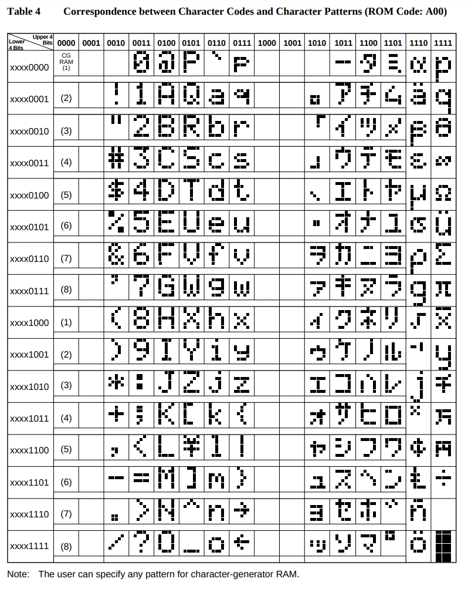

# Поддерживаемые символы

В даташите HD44780 вы найдёте две таблицы символов, которые соответствуют двум версиям ПЗУ (ROM) — `A00` и `A02`. Чтобы определить, какое ПЗУ использует ваш дисплей, попробуйте вывести уникальные символы из обеих таблиц. Тот, который отобразится правильно, и укажет на версию ПЗУ. После этого нужно смотреть только на соответствующую таблицу.

В моём случае ЖК-модуль основан на ПЗУ версии `A00`. Я приведу таблицу `A00` и объясню, как её читать, хотя логика интерпретации одинакова для обеих версий.



Это 8-битный символ, в котором сначала идут старшие 4 бита, а затем младшие 4 бита — они вместе образуют полный байт символа. В справочной таблице старшие 4 бита соответствуют столбцам, а младшие 4 бита — строкам.

Например, чтобы получить двоичное представление символа «#», старшие 4 бита равны `0010`, а младшие 4 бита — `0011`. Объединив их, получаем полное двоичное значение 00100011. В Rust это значение можно записать либо в двоичном виде (`0b00100011`), либо в шестнадцатеричном (`0x23`).

### Крейт hd44780-driver

В используемом нами крейте `hd44780-driver` символы можно выводить напрямую: как один байт или как последовательность байтов.

#### Запись одного байта

```rust
lcd.write_byte(0x23, &mut timer).unwrap();
lcd.write_byte(0b00100011, &mut timer).unwrap();
```

#### Запись нескольких байтов

```rust
lcd.write_bytes(&[0x23, 0x24], &mut timer).unwrap();
```
