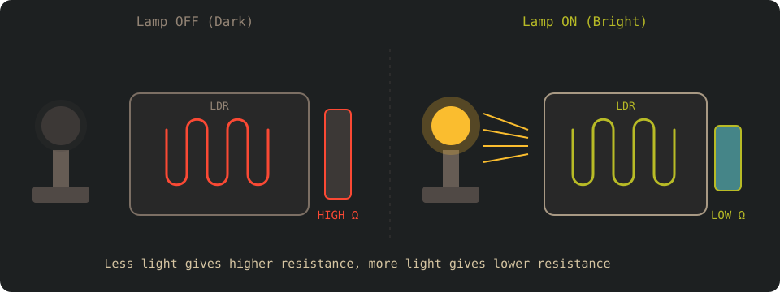

# Фоторезисторы (LDR)

Фоторезисторы (LDR, Light Dependent Resistors), также известные как светочувствительные резисторы, — одни из самых простых датчиков, которые можно использовать с микроконтроллером. Их сопротивление меняется в зависимости от количества света, падающего на них. Больше света — ниже сопротивление, меньше света — выше сопротивление.

Благодаря такому поведению LDR часто используют в проектах вроде автоматических уличных фонарей, регулировки яркости экрана, люксметров и простого определения дня и ночи.

    

## Как работает LDR

LDR изготавливается из фоточувствительного полупроводникового материала. Когда свет попадает на его поверхность, фотоны передают энергию материалу и высвобождают носители заряда. В результате сопротивление LDR уменьшается.

> [!TIP]
> Представьте, что LDR — это Дракула. На солнце он слабеет, так же как сопротивление уменьшается. В темноте он становится сильнее, так же как сопротивление растёт.

Изменение сопротивления нелинейно, и точные значения различаются у разных LDR. Для большинства embedded-задач это не проблема. Обычно нас интересуют относительные уровни освещённости, а не точные измерения.

Мы не будем углубляться в детали полупроводниковых материалов, из которых делают LDR, и физику процессов. Если вам интересно и хочется разобраться глубже, можно прочитать эту статью и провести дополнительное исследование: [https://www.elprocus.com/ldr-light-dependent-resistor-circuit-and-working/](https://www.elprocus.com/ldr-light-dependent-resistor-circuit-and-working/)

## Необходимые компоненты

    
    
LDR

Вам понадобятся следующие компоненты:

- LDR (фоторезистор)
- Резистор (обычно 10 кОм), нужен для создания делителя напряжения
- Перемычки (как обычно)

## Предварительные знания

Прежде чем работать с LDR, вы должны понимать, что такое делитель напряжения и как он работает, а также что такое АЦП и как он превращает аналоговое напряжение в цифровое значение.

Если нужно быстро освежить знания, можно обратиться к разделам:

- [Делитель напряжения](../core-concepts/voltage-divider.md).
- [АЦП](../adc/index.md)
