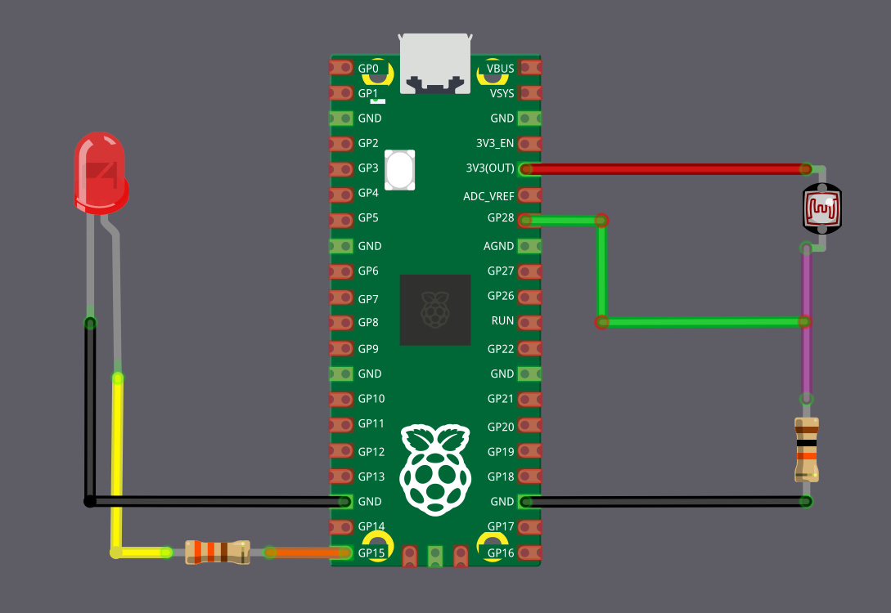

# Включаем светодиод при слабом освещении с Raspberry Pi Pico

В этом упражнении мы соберём небольшой, но практичный проект с LDR. Pico будет автоматически включать светодиод, когда уровень освещённости опускается ниже определённого значения, то есть светодиод загорается по мере того, как темнеет. Эту идею можно расширить, чтобы управлять настоящей лампой, но это выходит за рамки упражнения и требует соблюдения правил безопасности.

Попробовать можно в закрытой комнате, выключая и включая верхний свет. Когда свет выключен и в комнате становится достаточно темно, светодиод должен включиться, а при включении верхнего света — снова погаснуть. Также можно изменить порог чувствительности или закрыть LDR рукой или другим предметом, чтобы имитировать разные уровни освещённости.

> [!Tip]
> Возможно, придётся подстроить порог АЦП в зависимости от освещения вашей комнаты и конкретного используемого LDR.

## Требования к оборудованию

Для этого упражнения понадобятся следующие компоненты:

- Светодиод
- LDR
- **Резисторы**
  - 330 Ом: используется со светодиодом, чтобы ограничить ток и защитить его. Возможно, понадобится другой номинал в зависимости от светодиода.
  - 10 кОм: используется с LDR для создания делителя напряжения. Возможно, понадобится изменить этот номинал в зависимости от характеристик LDR.
- Перемычки: нужны, чтобы соединить всё на макетной плате или напрямую с микроконтроллером.

## Схема подключения светодиода и LDR к Pico

### Подключение LDR (АЦП)

Мы подключим LDR как делитель напряжения и подадим выход делителя на вывод АЦП Pico. Здесь LDR выступает в роли R1 и подключён к питанию 3,3 В, поэтому значение АЦП уменьшается по мере падения уровня освещённости.

<table>
  <thead>
    <tr>
      <th>Вывод Pico</th>
      <th style="width: 250px; margin: 0 auto;">Провод</th>
      <th>Компонент</th>
    </tr>
  </thead>
  <tbody>
    <tr>
      <td>3.3 V</td>
      <td style="text-align: center; vertical-align: middle; padding: 0;">
        

          

          

        

      </td>
      <td>Один вывод LDR</td>
    </tr>
    <tr>
      <td>GPIO 28 (ADC2)</td>
      <td style="text-align: center; vertical-align: middle; padding: 0;">
        

          

          

        

      </td>
      <td>Точка соединения LDR и резистора 10 кОм</td>
    </tr>
    <tr>
      <td>Резистор 10 кОм</td>
      <td style="text-align: center; vertical-align: middle; padding: 0;">
        

          

          

        

      </td>
      <td>Другой вывод LDR</td>
    </tr>
    <tr>
      <td>GND</td>
      <td style="text-align: center; vertical-align: middle; padding: 0;">
        

          

          

        

      </td>
      <td>Другой вывод резистора 10 кОм</td>
    </tr>
  </tbody>
</table>

### Подключение светодиода

Светодиод будет подключён к выводу GPIO 15 и автоматически включаться, когда уровень освещённости падает.

<table>
<thead>
  <tr>
    <th>Вывод Pico</th>
    <th style="width: 250px; margin: 0 auto;">Провод</th>
    <th>Компонент</th>
  </tr>
</thead>
<tbody>
  <tr>
    <td>GPIO 15</td>
    <td style="text-align: center; vertical-align: middle; padding: 0;">
      

        

        

      

    </td>
    <td>Резистор 330 Ом</td>
  </tr>
  <tr>
    <td>Резистор 330 Ом</td>
    <td style="text-align: center; vertical-align: middle; padding: 0;">
      

        

        

      

    </td>
    <td>Анод (длинная ножка) светодиода</td>
  </tr>
  <tr>
    <td>GND</td>
    <td style="text-align: center; vertical-align: middle; padding: 0;">
      

        

        

      

    </td>
    <td>Катод (короткая ножка) светодиода</td>
  </tr>
</tbody>
</table>
