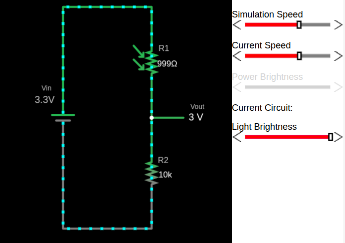
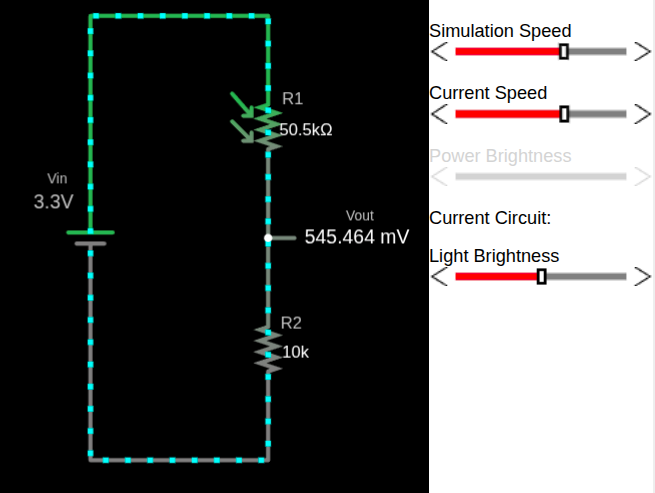
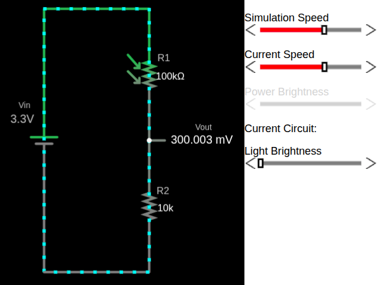

# Симуляция LDR в делителе напряжения

Чтобы понять, как ведёт себя LDR в делителе напряжения, я создал простую симуляцию в Falstad. На схеме LDR показан символом резистора со стрелками, направленными на него, что обозначает падающий свет.

Файл с созданной мной схемой, [`voltage-divider-ldr.circuitjs.txt`](./voltage-divider-ldr.circuitjs.txt), можно импортировать на [сайт Falstad](https://www.falstad.com/circuit/e-voltdivide.html) и поэкспериментировать. Также внизу страницы есть встроенный симулятор, так что можно использовать любой вариант.

В этой конфигурации LDR расположен в верхней части делителя напряжения (то есть как R1), а внизу — постоянный резистор (как R2). Такая схема широко используется, потому что при увеличении освещённости выходное напряжение растёт, что интуитивно понятно при чтении значения через АЦП.

Когда схема загружена, двигайте ползунок яркости и наблюдайте, как меняется сопротивление LDR. Одновременно видно, как выходное напряжение \\( V_{out} \\) реагирует на эти изменения.

> [!Important]
> Если поменять местами LDR и постоянный резистор, поведение выходного напряжения инвертируется.
> Если поставить LDR как R2 (нижний резистор) в делитель напряжения, связь между уровнем освещённости и \\( V_{out} \\) становится обратной, потому что меняется уравнение.

### Пример выхода при полной яркости

Когда LDR освещён сильным светом, его сопротивление низкое. Из-за этого большая часть напряжения питания оказывается на выходе, и выходное напряжение высокое.

### Пример выхода при слабом свете

По мере уменьшения освещённости сопротивление LDR растёт. Это снижает выходное напряжение.

### Пример выхода в полной темноте

В темноте сопротивление LDR становится очень высоким, из-за чего выходное напряжение падает почти до нуля.

## Симулятор делителя напряжения с LDR

    
⚡ Симулятор делителя напряжения с LDR

    <canvas id="ldrSimCanvas" class="ldr-sim-canvas" width="350" height="500"></canvas>
    

    <label class="ldr-sim-label">💡 Яркость света</label>
    

        <input type="range" class="ldr-sim-slider" id="ldrSimBrightness" min="0" max="100" value="50">
        50%
    

    

    

  
