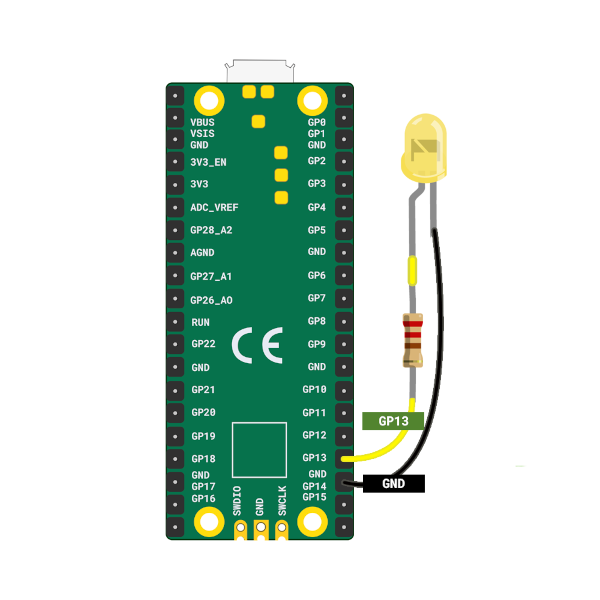
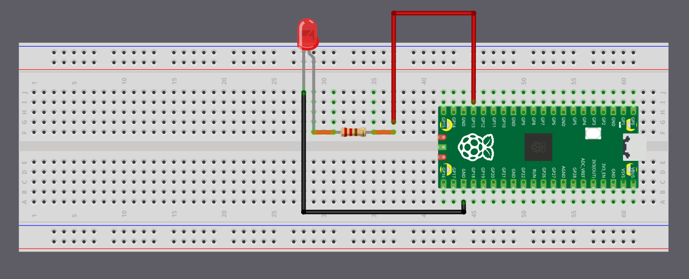

{{#title Мигание внешним светодиодом на Raspberry Pi Pico 2 на embedded Rust}}

# Мигание внешним светодиодом

Начиная с этого момента мы будем использовать с Pico больше внешних компонентов. Прежде чем перейти к ним, полезно освоиться с простыми схемами и научиться подключать компоненты к выводам Pico. В этой главе начнём с простого: будем мигать светодиодом, подключённым вне платы.

## Требования к оборудованию

- Светодиод
- Резистор
- Перемычки

## Обзор компонентов

1. Светодиод (LED, Light Emitting Diode) загорается, когда через него течёт ток. Длинная ножка (анод) подключается к плюсу, короткая (катод) — к земле. Мы подключим анод к GP13 (через резистор), а катод — к GND.

2. Резистор ограничивает ток в цепи, защищая такие компоненты, как светодиоды. Его номинал измеряется в омах (Ω). Мы будем использовать резистор 330 Ом, чтобы безопасно питать светодиод.

<table>
  <thead>
    <tr>
      <th>Вывод Pico</th>
      <th style="width: 250px; margin: 0 auto;">Провод</th>
      <th>Компонент</th>
    </tr>
  </thead>
  <tbody>
    <tr>
      <td>GPIO 13</td>
      <td style="text-align: center; vertical-align: middle; padding: 0;">
        

          

          

        

      </td>
      <td>Резистор</td>
    </tr>
    <tr>
      <td>Резистор</td>
      <td style="text-align: center; vertical-align: middle; padding: 0;">
        

          

          

        

      </td>
      <td>Анод (длинная ножка) светодиода</td>
    </tr>
    <tr>
      <td>GND</td>
      <td style="text-align: center; vertical-align: middle; padding: 0;">
        

          

          

        

      </td>
      <td>Катод (короткая ножка) светодиода</td>
    </tr>
  </tbody>
</table>

Подключить Pico к светодиоду можно напрямую перемычками или собрать всё на макетной плате. Если вы не уверены в настройке оборудования, можно обратиться к [руководству Raspberry Pi](https://projects.raspberrypi.org/en/projects/introduction-to-the-pico/7).

    
    
Схема на макетной плате

> [!TIP]
> На Pico подписи выводов нанесены на обратной стороне платы, и это может быть неудобно при подключении проводов. Я часто проверял схему распиновки, когда нужно было использовать вывод GPIO. Используйте логотип Raspberry Pi на лицевой стороне как ориентир и сверяйтесь со [схемой распиновки](../pico2-pinout.md), чтобы найти нужные выводы. Номера выводов 2 и 39 также напечатаны на лицевой стороне и могут служить дополнительными ориентирами.

## Мигание светодиодом — симуляция

В этой симуляции задержка по умолчанию установлена 5000 миллисекунд, чтобы анимация была спокойнее и её было легче проследить. Можно уменьшить её, например, до 500 миллисекунд, чтобы светодиод мигал быстрее. Когда мы будем запускать реальный код на Pico, используем задержку 500 миллисекунд.

  

    

      

      
<strong id="led-state">LOW</strong>

    

    

      

        

1

let mut led = Output::new(p.PIN_13, Level::Low);

        

2

loop {

        

3

    led.set_high(); // Включить светодиод

        

4

    Timer::after_millis(5000).await;

        

5

    led.set_low(); // Выключить светодиод

        

6

    Timer::after_millis(5000).await;

        

7

}

      

        

        

Простой

0 ms

      

      

        <label>Интервал (мс): <input id="interval" type="number" value="5000" min="50" step="50"></label>
        <button id="restart">Перезапуск</button>
        <button id="pause">Пауза</button>
        <button id="resume" style="display:none">Продолжить</button>
      

    

  

