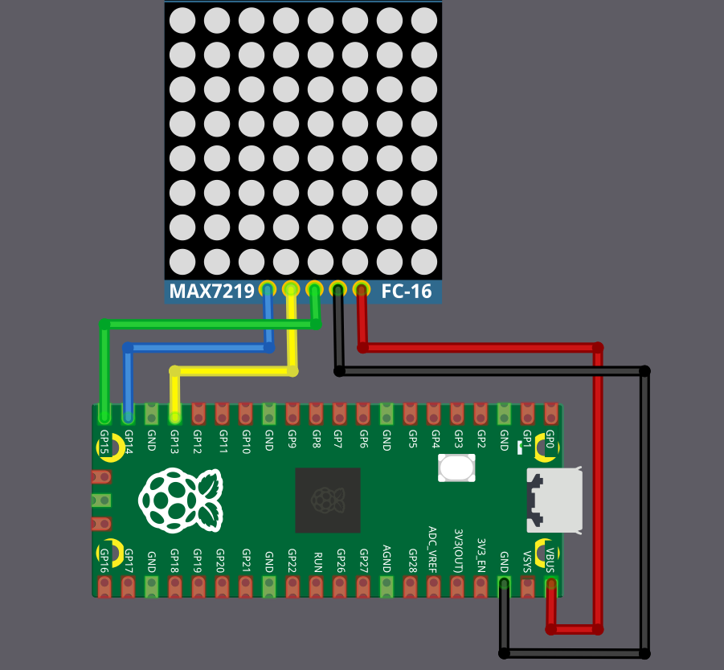

# Схема подключения

Для дисплея MAX7219 нужно пять соединений с Raspberry Pi Pico 2. В этом примере используется SPI1 с GPIO 13, 14 и 15, но можно взять любую допустимую пару выводов SPI на вашем Pico.

<table>
  <thead>
    <tr>
      <th>Вывод Pico</th>
      <th style="width: 250px; margin: 0 auto;">Провод</th>
      <th>Вывод MAX7219</th>
    </tr>
  </thead>
  <tbody>
    <tr>
      <td>GPIO 13 (SPI1 CS)</td>
      <td style="text-align: center; vertical-align: middle; padding: 0;">
        

          

          

        

      </td>
      <td>CS / LOAD</td>
    </tr>
    <tr>
      <td>GPIO 14 (SPI1 SCK)</td>
      <td style="text-align: center; vertical-align: middle; padding: 0;">
        

          

          

        

      </td>
      <td>CLK</td>
    </tr>
    <tr>
      <td>GPIO 15 (SPI1 MOSI)</td>
      <td style="text-align: center; vertical-align: middle; padding: 0;">
        

          

          

        

      </td>
      <td>DIN</td>
    </tr>
    <tr>
      <td>VBUS (5 V)</td>
      <td style="text-align: center; vertical-align: middle; padding: 0;">
        

          

          

        

      </td>
      <td>VCC</td>
    </tr>
    <tr>
      <td>GND</td>
      <td style="text-align: center; vertical-align: middle; padding: 0;">
        

          

          

        

      </td>
      <td>GND</td>
    </tr>
  </tbody>
</table>
 

