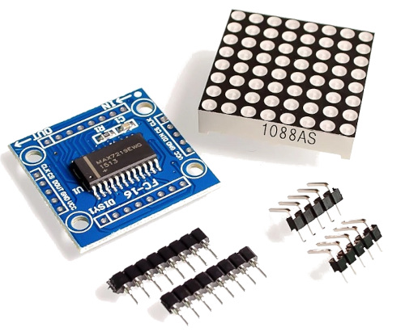
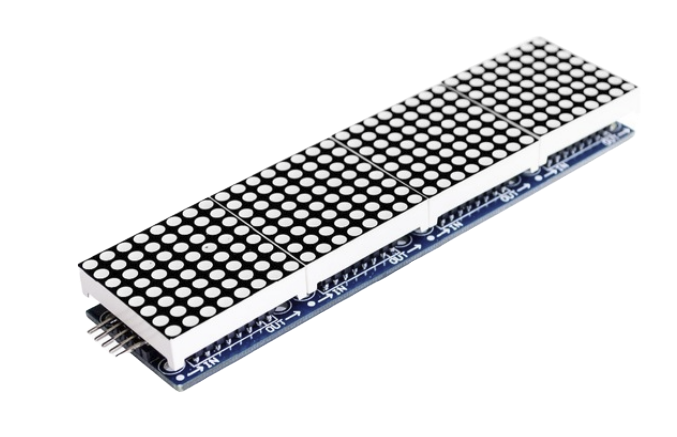
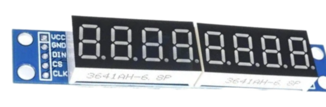

# Светодиодная матрица 8x8 на MAX7219

В этой главе мы будем работать с одним из интересных модулей дисплеев. Это светодиодная точечная матрица 8×8. Светодиодная точечная матрица — это по сути сетка светодиодов, расположенных строками и столбцами, которая позволяет выводить узоры, цифры, текст и простую графику. Модуль, с которым мы работаем, — матрица 8×8, то есть у нас 64 отдельных светодиода для управления.

Точечные матрицы часто встречаются в повседневной жизни. Их можно увидеть в автобусах и поездах, где они показывают номера маршрутов и сообщения о прибытии, в лифтах — с номерами этажей и стрелками направления, в цифровых часах — с временем и простыми символами. Их также используют на промышленном оборудовании и панелях управления, чтобы показывать состояние работы, предупреждения или сообщения об ошибках, а также в торговых центрах и аркадных играх.

## Знакомство с железом

Теперь посмотрим на само оборудование. Модуль построен вокруг микросхемы MAX7219. Эта микросхема отвечает за управление всеми 64 светодиодами матрицы 8x8.

    
    
Светодиодная матрица 8x8 на MAX7219

Без этой микросхемы понадобилось бы много выводов GPIO, потому что каждую строку и каждый столбец светодиодной матрицы пришлось бы подключать и управлять ими напрямую с микроконтроллера. MAX7219 берёт это на себя внутри, поэтому микроконтроллеру нужно лишь отправлять команды высокого уровня, а не управлять каждым светодиодом.

> [!Tip]
> В этой книге мы не будем разбирать внутреннее устройство MAX7219. Мы воспользуемся готовым драйвером и сосредоточимся на управлении дисплеем. Если вы хотите научиться писать драйвер MAX7219 с нуля, включая реализацию трейтов embedded-graphics, это можно найти в книге [RED (Rust Embedded Drivers)](https://red.implrust.com/max7219/index.html).

### Последовательное соединение (daisy chaining)

Одна полезная особенность MAX7219 — модули можно соединять последовательно (daisy chain). Это значит, что можно соединить несколько одинаковых модулей вместе и получить более крупный дисплей. Например, можно соединить 4 или 8 модулей рядом, чтобы получить более широкую точечную матрицу.

    
    
Светодиодная матрица MAX7219, соединённая последовательно

Некоторые модули поставляются с уже припаянными разъёмами, что упрощает последовательное соединение. При использовании нескольких модулей нужно внимательно относиться к проводке и питанию, потому что больше светодиодов означает больший ток потребления. Мы начнём с одного модуля и будем держать всё простым.

### 7-сегментные дисплеи

Та же микросхема MAX7219 часто используется и с 7-сегментными светодиодными дисплеями. Внутреннее устройство и способ обмена данными те же. В этой главе мы сосредоточимся только на светодиодной матрице 8x8. Когда вы поймёте это, работа с 7-сегментными дисплеями покажется очень похожей.

    
    
Восьмиразрядный 7-сегментный дисплей

## Обмен данными

MAX7219 использует последовательный интерфейс, похожий на SPI. Ему нужны три управляющих сигнала. DIN — линия данных, по которой информация отправляется в микросхему. CLK — тактовый сигнал, который сообщает микросхеме, когда считывать каждый бит. CS, иногда обозначаемый как LOAD, используется для защёлкивания данных в микросхеме.

На стороне микроконтроллера мы используем периферию SPI только на запись, чтобы отправлять данные в MAX7219. Микросхема ничего не отправляет обратно. Она только принимает команды и обновляет дисплей в соответствии с тем, что мы ей передаём.
