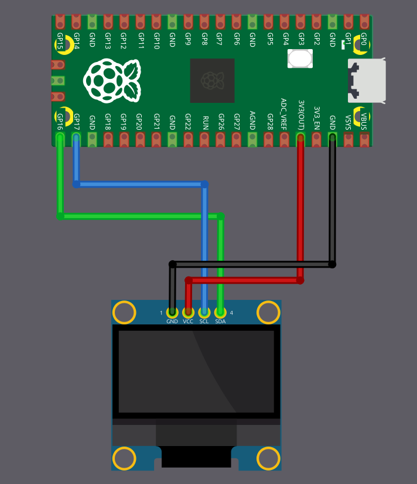

# Схема подключения

Для OLED-дисплея нужно четыре соединения с Raspberry Pi Pico. В этом примере используется I2C0 с GPIO 16 и 17, но можно выбрать любую допустимую пару выводов I2C на вашем Pico.

<table>
  <thead>
    <tr>
      <th>Вывод Pico</th>
      <th style="width: 250px; margin: 0 auto;">Провод</th>
      <th>Вывод OLED</th>
    </tr>
  </thead>
  <tbody>
    <tr>
      <td>GPIO 16</td>
      <td style="text-align: center; vertical-align: middle; padding: 0;">
        

          

          

        

      </td>
      <td>SDA</td>
    </tr>
    <tr>
      <td>GPIO 17</td>
      <td style="text-align: center; vertical-align: middle; padding: 0;">
        

          

          

        

      </td>
      <td>SCL</td>
    </tr>
    <tr>
      <td>3.3 V</td>
      <td style="text-align: center; vertical-align: middle; padding: 0;">
        

          

          

        

      </td>
      <td>VCC</td>
    </tr>
    <tr>
      <td>GND</td>
      <td style="text-align: center; vertical-align: middle; padding: 0;">
        

          

          

        

      </td>
      <td>GND</td>
    </tr>
  </tbody>
</table>

