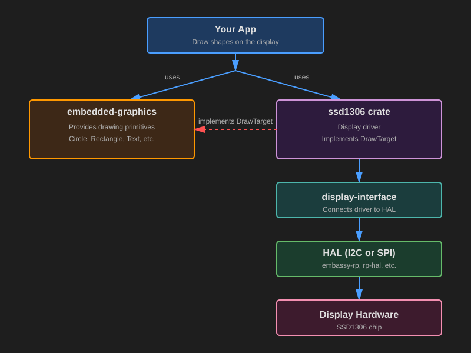

# Крейты, которые вы будете использовать

Теперь, когда вы понимаете, что такое SSD1306 и как работает связь по I2C, давайте посмотрим, как на самом деле рисовать графику на дисплее. Возможно, вы думаете, что для каждого пикселя нужно отправлять сырые команды. Хорошая новость в том, что этого делать не нужно. Экосистема Rust предоставляет отличные инструменты, которые сильно упрощают эту задачу.

## Рисование на дисплее

При работе с дисплеем SSD1306 на Rust вы будете использовать два основных крейта, которые работают вместе:

1. `embedded-graphics` — библиотека рисования, которая позволяет создавать фигуры, текст и изображения
2. `ssd1306` — драйвер, который управляет самим оборудованием



## Что такое embedded-graphics?

`embedded-graphics` — лёгкая библиотека двумерной графики, созданная для встраиваемых систем с ограниченной памятью. Вместо того чтобы самому устанавливать отдельные пиксели, вы используете команды рисования высокого уровня. Например:

```rust
Circle::new(Point::new(20, 20), 30)
    .into_styled(PrimitiveStyle::with_stroke(BinaryColor::On, 1))
    .draw(&mut display)?; // display реализует DrawTarget
```

Этот код рисует окружность, и вам не нужно вычислять позиции пикселей или разбираться, как дисплей хранит свои данные внутри.

Что предоставляет `embedded-graphics`:

- Графические примитивы, такие как окружности, прямоугольники, линии и треугольники
- Вывод текста — отображение текста разными шрифтами
- Поддержку изображений и иконок через совместимые крейты для изображений
- Параметры стиля для цвета, толщины линии и заливки

### Ключевой принцип дизайна

`embedded-graphics` полностью не зависит от дисплея. Он ничего не знает о вашем конкретном оборудовании (будь то SSD1306, ST7789 или любой другой дисплей). Он просто умеет описывать, что нужно нарисовать. А драйвер дисплея берёт на себя детали конкретного оборудования и превращает эти инструкции в реальные пиксели.

Такой дизайн означает, что код рисования можно написать один раз и использовать с разными дисплеями, просто поменяв драйвер.

Подробнее можно узнать в официальной документации:
[https://docs.rs/embedded-graphics/latest/embedded_graphics/](https://docs.rs/embedded-graphics/latest/embedded_graphics/)

## Что такое крейт ssd1306?

Крейт `ssd1306` — аппаратный драйвер для дисплеев, которые используют микросхему контроллера SSD1306. Он выполняет всю низкоуровневую работу, необходимую для связи с дисплеем. Это инициализация экрана, отправка правильных команд I2C или SPI, управление внутренним буфером при необходимости и обновление пикселей на аппаратуре.

### Графический режим

Драйвер `ssd1306` поддерживает несколько режимов, но для рисования графики вы будете использовать `BufferedGraphicsMode`. Чтобы войти в этот режим, вызовите:

```rust
let display = ssd1306::Ssd1306::new(i2c, size, rotation)
    .into_buffered_graphics_mode();
```

В этом режиме драйвер хранит внутренний буфер в RAM и реализует трейт `DrawTarget` из `embedded-graphics-core`. Именно это позволяет двум крейтам работать вместе.

## Как они работают вместе: трейт DrawTarget

Если вы дошли до этого места, то, вероятно, уже понимаете трейты Rust. Трейт в общих чертах описывает, что что-то умеет делать, а реализация решает, как именно это делается.

`DrawTarget` — трейт, который позволяет `embedded-graphics` отправлять команды рисования драйверу дисплея. Когда драйвер ssd1306 реализует этот трейт, по сути он говорит:

«Я могу принимать пиксели, которые создаёт embedded-graphics, и я знаю, как вывести эти пиксели на экран SSD1306».

Вот что на самом деле происходит, когда вы что-то рисуете:

1. Вы создаёте фигуры, текст или изображения с помощью примитивов embedded-graphics.
2. Вы вызываете `.draw(&mut display)`, чтобы их отрисовать.
3. `embedded-graphics` генерирует пиксели, которые нужно нарисовать.
4. Драйвер `ssd1306` берёт эти пиксели и сохраняет их во внутреннем буфере.
5. Когда вы вызываете `display.flush()`, драйвер отправляет обновлённые пиксели на OLED-аппаратуру.

Вот простой пример:

```rust
// Создаём окружность с помощью embedded-graphics
let circle = Circle::new(Point::new(64, 32), 20)
    .into_styled(PrimitiveStyle::with_fill(BinaryColor::On));

// Рисуем её на драйвере дисплея
circle.draw(&mut display)?; // Записываем данные пикселей в буфер драйвера

display.flush()?; // Отправляем буфер на настоящий экран
```

## Асинхронный режим

Крейт `ssd1306` также поддерживает асинхронную работу, если включить feature `async`. Это полезно, если вы используете Embassy.

Чтобы использовать асинхронный режим, добавьте feature в `Cargo.toml`:

```toml
ssd1306 = { version = "0.10.0", features = ["async"] }
```

Когда feature `async` включён, драйвер использует трейты `embedded-hal-async` вместо обычных блокирующих трейтов `embedded-hal`. Это позволяет выполнять обмен по I2C/SPI асинхронно, что удобно, когда вы хотите заниматься другими задачами, пока обновляется дисплей.

Главное отличие в том, что такие методы, как `.init()` и `.flush()`, становятся асинхронными и их нужно вызывать с `.await`:

```rust
// Асинхронная версия
let mut display = Ssd1306Async::new(interface, DisplaySize128x64, DisplayRotation::Rotate0)
    .into_buffered_graphics_mode();

display.init().await?;  // Обратите внимание на .await

// Рисование работает так же
circle.draw(&mut display)?;

display.flush().await?;  // Теперь это тоже асинхронно
```
