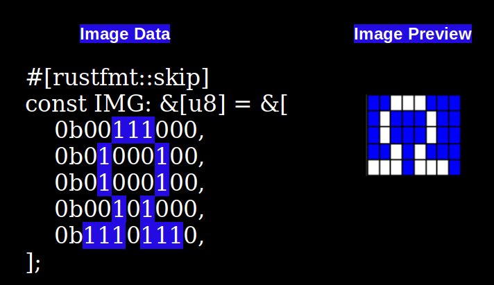

{{#title Вывод растрового изображения на OLED-дисплей с Raspberry Pi Pico 2 во встраиваемом Rust}}

# Вывод растрового изображения на OLED-дисплей на Raspberry Pi Pico

В этом упражнении мы выведем растровое изображение, используя только массивы байтов. Мы создадим символ Ом (Ω) в формате 1BPP (1 бит на пиксель).

## Изображение 1BPP

Формат 1BPP (1 бит на пиксель) использует один бит для каждого пикселя. Он может представлять только два цвета, обычно чёрный и белый. Если значение бита равно 0, обычно это полностью чёрный пиксель. Если значение бита равно 1, обычно это полностью белый пиксель.

Мы создадим символ Ом на сетке 8 × 5 пикселей в формате 1bpp. Я выделил единицы в массиве байтов, чтобы показать, как они включают пиксели и формируют символ Ом.

Я выбрал ширину 8, чтобы сделать пример простым. Это позволяет представить ширину 8 пикселей одним байтом (8 битов). Но если увеличить ширину, она уже не поместится в один байт, и изображение придётся разнести по нескольким элементам массива байтов. Я объясню это в следующих главах. А пока давайте держать всё простым.

## Символ Ом на OLED-дисплее (128x64)

Покажу, как выглядит символ Ом, выведенный на OLED-дисплей (разрешение 128 × 64) в позиции ноль (x = 0 и y = 0).

Это увеличенная иллюстрация. Когда вы увидите символ на реальном модуле дисплея, он будет маленьким.

## Ссылки

- [Документация ImageRaw в embedded-graphics](https://docs.rs/embedded-graphics/latest/embedded_graphics/image/struct.ImageRaw.html)
- [Image2Bytes](https://implferris.github.io/image2bytes/): преобразование изображения в шестнадцатеричный массив байтов
