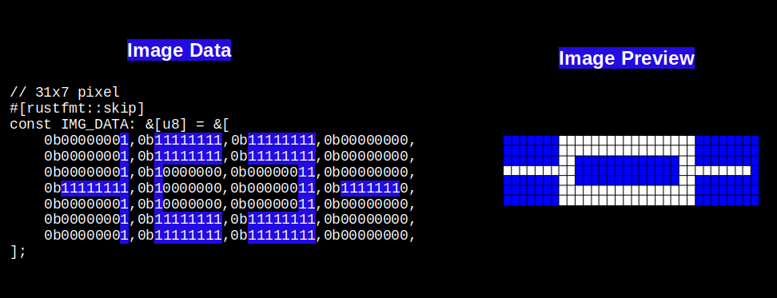

# Использование нескольких байтов для представления более широких строк пикселей

В предыдущем примере мы оставались простыми и использовали изображение шириной 8 пикселей. Это было удобно, потому что каждая строка идеально помещалась в один байт. Однако настоящим изображениям часто нужно больше пикселей. Как же их представить, если одного байта недостаточно? Ответ простой: используем несколько байтов. Но тогда возникает проблема. Если используется несколько байтов, как система поймёт, где заканчивается одна строка и начинается следующая?

Именно поэтому нужно точно сообщить крейту embedded-graphics ширину нашего изображения. Когда мы указываем ширину, система знает, сколько байтов использовать для каждой строки. Зная ширину и формат изображения, она может автоматически вычислить высоту.

## Разбираем математику

Рассмотрим пример с изображением шириной 31 пиксель и высотой 7 пикселей. Ширина составляет 31 пиксель, и каждый пиксель занимает 1 бит. Чтобы узнать, сколько байтов нужно для каждой строки, выполним простой расчёт. Поскольку в байте 8 битов, делим 31 на 8. Получаем 3 полных байта, которые покрывают 24 пикселя. Но у нас остаётся ещё 7 пикселей, поэтому нужен ещё один байт, чтобы их разместить. Итого на каждую строку из 31 пикселя нужно 4 байта. Если изображение содержит 7 строк, то общая длина данных составит 4 × 7 = 28 байтов.



## Как система вычисляет высоту

Крейт embedded-graphics внутри использует примерно такой код, чтобы вычислить высоту. Вам не нужно добавлять это в свой код. Я показываю его только для того, чтобы вы видели, как это работает за кулисами:

```rust
let height = data.len() / bytes_per_row(width, C::Raw::BITS_PER_PIXEL);
//...
//...
const fn bytes_per_row(width: u32, bits_per_pixel: usize) -> usize {
    (width as usize * bits_per_pixel + 7) / 8
}
```

В нашем примере массив данных содержит 28 элементов, каждый пиксель занимает 1 бит, а ширина изображения равна 31. Если выполнить этот расчёт, получится 4 байта на строку и высота 7 пикселей.

## Попробуйте сами

Можно запустить этот код прямо здесь или в Rust Playground, чтобы увидеть, как работает расчёт:

```rust
// 31x7 пикселей
#[rustfmt::skip]
const IMG_DATA: &[u8] = &[
    // 1-я строка
    0b00000001,0b11111111,0b11111111,0b00000000,
    // 2-я строка
    0b00000001,0b11111111,0b11111111,0b00000000,
    // 3-я строка
    0b00000001,0b10000000,0b00000011,0b00000000,
    // 4-я строка
    0b11111111,0b10000000,0b00000011,0b11111110,
    // 5-я строка
    0b00000001,0b10000000,0b00000011,0b00000000,
    // 6-я строка
    0b00000001,0b11111111,0b11111111,0b00000000,
    // 7-я строка
    0b00000001,0b11111111,0b11111111,0b00000000,
];

const fn bytes_per_row(width: u32, bits_per_pixel: usize) -> usize {
    (width as usize * bits_per_pixel + 7) / 8
}

fn main(){
    const BITS_PER_PIXEL: usize = 1;
    let width = 31;
    let data = IMG_DATA;

    println!("Bytes Per Row:{}", bytes_per_row(width,BITS_PER_PIXEL));
    let height = data.len() / bytes_per_row(width, BITS_PER_PIXEL);
    println!("Height: {}", height);
}
```

Эти массивы байтов не обязательно создавать вручную: можно воспользоваться онлайн-инструментом, например [image2bytes](https://implferris.github.io/image2bytes/), который сгенерирует массив байтов за вас.
