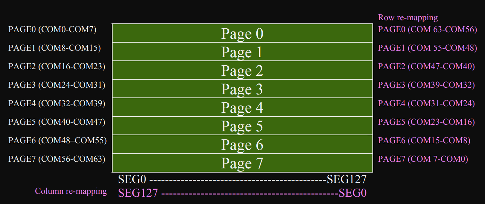
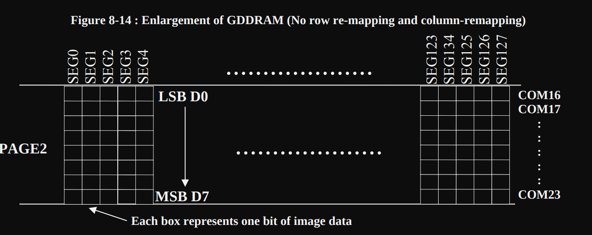
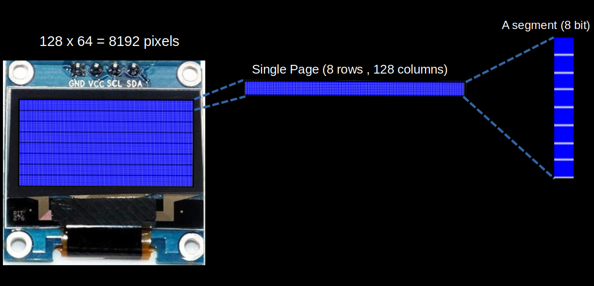

# Как работает OLED-модуль?

Мы не будем углубляться в детали технологии OLED. Вместо этого сосредоточимся на том, что важно для наших упражнений. Модуль имеет разрешение 128 × 64, то есть всего 128 × 64 = 8192 пикселя. Каждый пиксель можно включать и выключать независимо.

Не переживайте, если эти понятия пока не очень понятны, — вы всегда можете изучить их позже. Эти детали нужнее, если вы планируете написать собственный драйвер для SSD1306 или заниматься более сложными задачами. Сейчас же для этого уже есть хороший крейт, который берёт эти аспекты на себя и упрощает процесс.

В даташите 128 столбцов называются сегментами (segments), а 64 строки — общими линиями (commons). Будьте внимательны и не путайте «commons» с «columns» (столбцами), потому что слова похожи.

## Память

Пиксели OLED-дисплея организованы в страничную структуру внутри GDDRAM (Graphics Display DRAM, графическая DRAM дисплея). GDDRAM разделена на 8 страниц (от страницы 0 до страницы 7), каждая из которых состоит из 128 столбцов (сегментов) и 8 строк (общих линий).

(Изображение взято из даташита)

Сегмент — это 8 бит данных (один байт), где каждый бит отвечает за один пиксель. При записи данных вы записываете целый сегмент, то есть весь байт сразу.

(Изображение взято из даташита)

Сегменты и общие линии можно переназначить программно, что даёт механическую гибкость. Подробности см. на странице 25 даташита SSD1306.

## Страницы и сегменты

Я создал изображение, которое показывает, как 128 × 64 пикселя делятся на 8 страниц. Затем я сосредоточился на одной странице, которая содержит 128 сегментов (столбцов) и 8 строк. Наконец, я приблизил один сегмент, чтобы показать, что он представляет 8 пикселей, расположенных друг над другом, где каждый пиксель соответствует одному биту.

