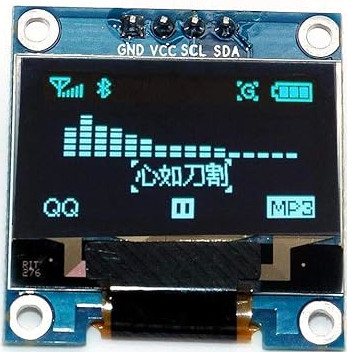
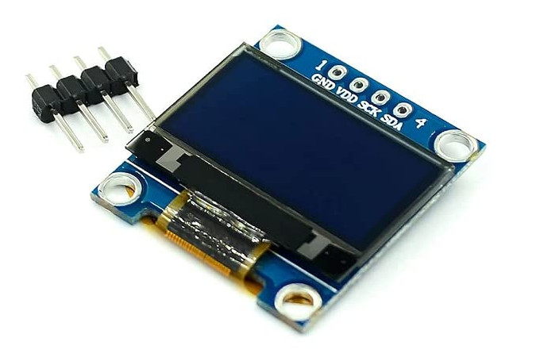

{{#title OLED-дисплей с Raspberry Pi Pico 2 (SSD1306, I2C) в embedded Rust}}

# OLED-дисплей

В этом разделе мы научимся подключать OLED-дисплей к Raspberry Pi Pico 2. OLED-дисплеи — один из самых интересных компонентов для работы, потому что они открывают много творческих возможностей. Можно делать игры, создавать панели мониторинга или наглядно выводить показания датчиков.

Чтобы вы представляли, что возможно, я сделал несколько игр с OLED-дисплеем. Одна из них — Pico Rex, маленькая игра с прыгающим динозавриком, вдохновлённая офлайн-динозавром из Chrome. Вы можете [посмотреть её проект на GitHub](https://github.com/ImplFerris/pico-rex).

Также я сделал небольшую игру в стиле flappy и игру-шутер (а также другие примеры): [смотрите здесь](https://github.com/implferris#embedded-rust-games).

Изучая работу с дисплеем, смело экспериментируйте и воплощайте собственные идеи. Даже простые анимации или обновления текста может быть удивительно интересно создавать.

В следующих нескольких главах мы создадим простые проекты, например выведем текст и изображение (картинку Ferris 🦀) на OLED-дисплей. Чтобы подключить OLED к Pico, мы будем использовать протокол I2C.

## Знакомство с железом

OLED, сокращение от Organic Light-Emitting Diode (органический светодиод), — популярный модуль дисплея. Такие дисплеи бывают разных размеров и могут поддерживать разные цвета. Они обмениваются данными по протоколу I²C или SPI.

В этом упражнении мы используем монохромный OLED-модуль 0,96 дюйма с разрешением 128 × 64. Он работает от 3,3 В. Для связи мы используем протокол I2C.

> [!TIP]
> Чаще всего OLED-дисплеи поставляются с штыревыми разъёмами, но не припаянными. Пайка — полезный навык, но для неё нужна аккуратность и подготовка. Прежде чем приступать, посмотрите побольше обучающих видео и почитайте материалы. Сначала это может казаться сложным, но с практикой становится легче. Если пайка вам пока не по силам, стоит поискать уже припаянную версию дисплея, хотя она может стоить немного дороже.

### SSD1306

SSD1306 — интегрированная микросхема контроллера, которая управляет многими небольшими OLED-дисплеями, включая модуль, который мы будем использовать (модуль 0,96 дюйма 128x64). Этот контроллер обеспечивает обмен данными между Pico и OLED-панелью, позволяя дисплею показывать текст, графику и многое другое.

**Даташит:** [даташит SSD1306](https://cdn-shop.adafruit.com/datasheets/SSD1306.pdf).
