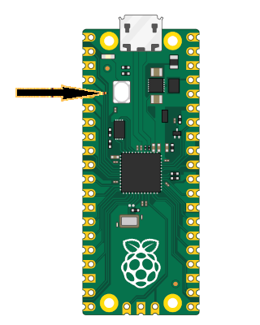

{{#title Быстрый старт: мигание светодиодом на Raspberry Pi Pico 2 | Embedded Rust}}

# Быстрый старт

Прежде чем погружаться в теорию и устройство всего, перейдём сразу к делу. Используйте этот простой код, чтобы включить встроенный светодиод Pico 2.

Мы будем использовать Embassy — фреймворк на Rust для микроконтроллеров вроде Raspberry Pi Pico 2. Embassy позволяет писать асинхронный код, который обрабатывает несколько задач одновременно: например, мигает светодиодом и одновременно считывает нажатия кнопки, не дожидаясь завершения одной задачи перед началом другой.

Следующий код создаёт эффект мигания, переключая уровень вывода между высоким (включено) и низким (выключено). Как мы упоминали в разделе о распиновке, встроенный светодиод Pico 2 подключён к выводу GPIO 25. В этой программе мы настраиваем вывод как выход (Output) — так делают всегда, когда нужно включать и выключать светодиоды, управлять моторами или посылать сигналы другим устройствам — с начальным низким уровнем (выключено).

## Фрагмент кода

Здесь показана только функция `main`. Для работы программы нужны также шаги инициализации и импорты. Мы подробно разберём их в следующей главе, чтобы понять, что они делают и зачем нужны. Сейчас наша цель — просто увидеть, как всё работает. Можно клонировать созданный мной проект быстрого старта и сразу его запустить.

> [!IMPORTANT]
> Этот код несовместим с вариантом Pico 2 W. На Pico 2 W вывод GPIO25 отвечает за беспроводной интерфейс, поэтому для управления встроенным светодиодом нужна другая процедура.

```rust
#[embassy_executor::main]
async fn main(_spawner: Spawner) {
    let p = embassy_rp::init(Default::default());

    // Встроенный светодиод на самом деле подключён к выводу 25
    let mut led = Output::new(p.PIN_25, Level::Low);

    loop {
        led.set_high(); // Включить светодиод
        Timer::after_millis(500).await;

        led.set_low(); // Выключить светодиод
        Timer::after_millis(500).await;
    }
}
```

## Клонируйте проект быстрого старта

```sh
git clone https://github.com/ImplFerris/pico2-quick
cd pico2-quick
```

## Как запустить?

Чтобы прошить приложение на Pico 2, нажмите и удерживайте кнопку BOOTSEL. Удерживая её, подключите Pico 2 к компьютеру micro USB-кабелем. Кнопку можно отпустить, как только USB подключён.



```sh
# Запустить программу
cargo run
```

Программа будет записана (прошита) в память Pico 2 и запущена автоматически. Если всё прошло успешно, встроенный светодиод начнёт мигать с регулярным интервалом. Если возникли ошибки, проверьте, что среда разработки настроена правильно и плата подключена как следует. Если проблема не решается, создайте issue на GitHub с подробным описанием, чтобы я смог обновить и улучшить это руководство.

### С отладочным зондом

Если вы используете отладочный зонд, нажимать кнопку BOOTSEL не нужно. Можно просто выполнить `cargo flash` или `cargo embed`. Эти команды подробно описаны дальше в книге, но если хотите познакомиться с ними сейчас, перейдите к главе [Отладочный зонд](./debugging/pico-debug-probe.md).
