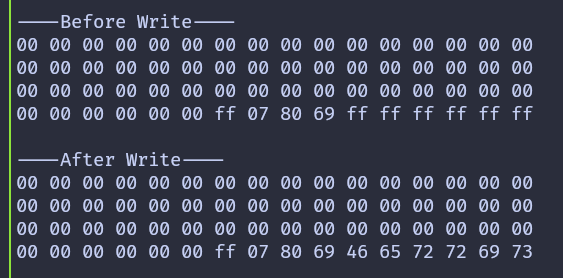

{{#title Код на embedded Rust для смены ключа аутентификации RFID на Raspberry Pi Pico 2}}

# Смена ключа аутентификации

В этой главе мы меняем ключ аутентификации для сектора. Точнее, мы обновим ключ A сектора 1. По умолчанию и ключ A, и ключ B на карте MIFARE Classic 1K установлены в FF FF FF FF FF FF. Мы заменим ключ A значением 52 75 73 74 65 64 — это шестнадцатеричное представление ASCII-строки «Rusted».

Чтобы поменять ключ, нужно записать данные в служебный блок сектора (trailer), то есть в блок 3 сектора. Остальные данные сектора должны остаться нетронутыми. Запись в служебный блок — операция чувствительная, поэтому нужно соблюдать осторожность.

Перед любыми изменениями настоятельно рекомендуется посмотреть текущее содержимое служебного блока сектора. Это можно сделать, запустив программу [Вывод всей памяти](./dump-memory.md) или [Чтение данных](./read-data.md) из предыдущих глав.

> [!NOTE]
> **Ключи по умолчанию:** на карте MIFARE Classic 1K и ключ A, и ключ B изначально установлены в FF FF FF FF FF FF. При чтении служебного блока ключ A не возвращается и отображается как 00 00 00 00 00 00, а ключ B возвращается так, как хранится.

В этом примере мы также обновим ключ B, чтобы было легко убедиться, что запись прошла успешно. Ключ B устанавливается в шестнадцатеричные байты ASCII-строки «Ferris», то есть 46 65 72 72 69 73.

Программа выводит содержимое сектора до и после записи. После смены ключа попытка аутентификации со старым ключом не пройдёт. Это ожидаемое поведение, которое подтверждает, что новый ключ теперь активен.

## Ключи и данные служебного блока

Данные, которые записываются в служебный блок, состоят из трёх частей. Первые шесть байтов — новое значение ключа A, затем идут биты доступа и байт служебного блока, а в конце — шесть байтов ключа B.

Текущий ключ аутентификации установлен в значение по умолчанию. Новый ключ извлекается из первых шести байтов массива данных, чтобы его можно было использовать повторно при чтении сектора после обновления.

```rust
let target_sector = 1;
let rel_block = 3;
const DATA: [u8; 16] = [
    0x52, 0x75, 0x73, 0x74, 0x65, 0x64, // Ключ A: "Rusted"
    0xFF, 0x07, 0x80, 0x69, // Биты доступа и байт служебного блока
    0x46, 0x65, 0x72, 0x72, 0x69, 0x73, // Ключ B: "Ferris"
];
let current_key = &[0xFF, 0xFF, 0xFF, 0xFF, 0xFF, 0xFF];
let new_key: &[u8; 6] = &DATA[..6].try_into().expect("have enough data");
```

## Запись служебного блока

Функция записи немного изменена, чтобы принимать ключ аутентификации в качестве аргумента. Это позволяет пройти аутентификацию со старым ключом перед записью, а после записи — с новым ключом.

```rust
fn write_block<E, COMM>(
    uid: &mfrc522::Uid,
    sector: u8,
    rel_block: u8,
    data: [u8; 16],
    key: &[u8; 6],
    rfid: &mut Mfrc522<COMM, mfrc522::Initialized>,
) -> Result<(), &'static str>
where
    COMM: mfrc522::comm::Interface<Error = E>,
{
    let block_offset = sector * 4;
    let abs_block = block_offset + rel_block;

    rfid.mf_authenticate(uid, block_offset, key)
        .map_err(|_| "Auth failed")?;

    rfid.mf_write(abs_block, data).map_err(|_| "Write failed")?;

    Ok(())
}
```

## Чтение сектора с пользовательским ключом

Функция чтения обновлена аналогичным образом. Теперь она принимает ключ как аргумент и использует его при аутентификации.

```rust
fn read_sector<E, COMM>(
    uid: &mfrc522::Uid,
    sector: u8,
    key: &[u8; 6],
    rfid: &mut Mfrc522<COMM, mfrc522::Initialized>,
) -> Result<(), &'static str>
where
    COMM: mfrc522::comm::Interface<Error = E>,
{
    let block_offset = sector * 4;
    rfid.mf_authenticate(uid, block_offset, key)
        .map_err(|_| "Auth failed")?;

    for abs_block in block_offset..block_offset + 4 {
        let data = rfid.mf_read(abs_block).map_err(|_| "Read failed")?;
        print_hex(&data);
    }
    Ok(())
}
```

## Главный цикл

Главный цикл имеет ту же структуру, что и в предыдущих главах. Сначала сектор читается с текущим ключом. Затем служебный блок записывается с новым ключом. Наконец, сектор читается снова, уже с новым ключом, чтобы подтвердить изменение.

Если вы используете USB Serial вместо отладочного зонда, замените `defmt::println!` и `defmt::error!` на `log::info!` и `log::error!`.

```rust
loop {
    if let Ok(atqa) = rfid.reqa() {
        if let Ok(uid) = rfid.select(&atqa) {
            defmt::println!("\r\n----Before Write----\r\n");
            if let Err(e) = read_sector(&uid, target_sector, current_key, &mut rfid) {
                defmt::error!("Error reading sector: {:?}", e);
            }
            Timer::after_millis(200).await;

            if let Err(e) =
                write_block(&uid, target_sector, rel_block, DATA, current_key, &mut rfid)
            {
                defmt::error!("Error writing block: {:?}", e);
            }
            Timer::after_millis(200).await;

            defmt::println!("\r\n----After Write----\r\n");
            if let Err(e) = read_sector(&uid, target_sector, new_key, &mut rfid) {
                defmt::error!("Error reading sector: {:?}", e);
            }

            let _ = rfid.hlta();
            let _ = rfid.stop_crypto1();
            Timer::after_millis(500).await;
        }
    }

    Timer::after_millis(200).await;
}
```

## Клонируйте существующий проект

Можно клонировать проект, который я создал, и перейти в папку `change-key`.

```sh
git clone https://github.com/ImplFerris/pico2-embassy-projects
cd pico2-embassy-projects/change-key/
```

## Результат

Когда программа работает, содержимое сектора выводится до и после записи. После смены ключа, если поднести метку к считывателю снова, аутентификация со старым ключом не пройдёт. Это подтверждает, что новый ключ 52 75 73 74 65 64 («Rusted») теперь активен.

> [!NOTE]
> После обновления ключа, если снова поднести метку к считывателю, аутентификация не пройдёт, потому что программа по-прежнему использует старый ключ, жёстко заданный в `current_key`.



Проверить это можно и дополнительно: обновите программу read-data, чтобы она использовала новый ключ, и запустите её снова.
