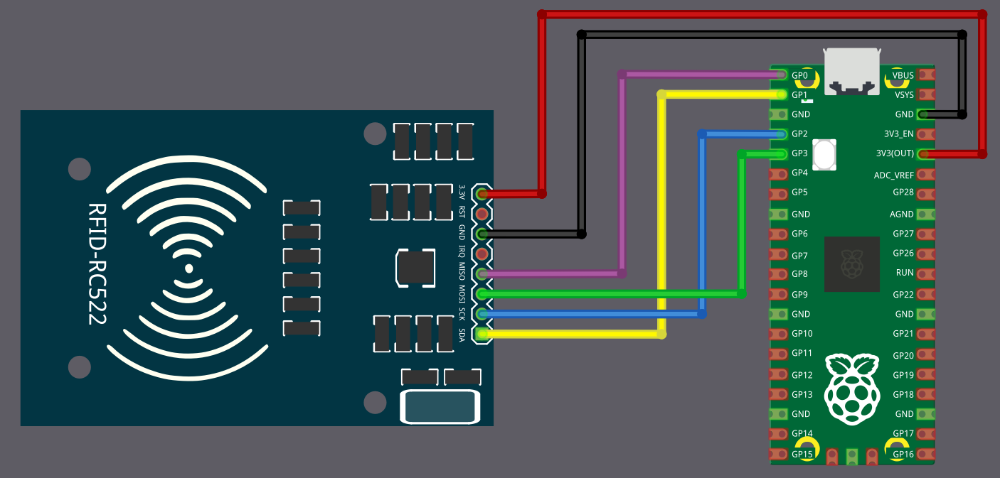

# Подключение RC522 к Raspberry Pi Pico

Сейчас мы посмотрим, как подключить RFID-считыватель к Pico 2. Но сначала быстро взглянем на распиновку модуля RC522.

## Схема выводов RC522

RFID-модуль RC522 имеет 8 выводов. Некоторые выводы выполняют разные функции в зависимости от того, используется ли модуль с SPI, I2C или UART. На схеме ниже показаны все доступные функции каждого вывода. В нашей схеме мы будем использовать SPI, но сначала полезно понять полную распиновку.

<table style="border-collapse: collapse; width: 100%; border: 1px solid black;">
  <tr style="border: 1px solid black;">
    <th style="background-color: #009B77; border: 1px solid black;">Вывод</th>
    <th style="border: 1px solid black;">Функция SPI</th>
    <th style="border: 1px solid black;">Функция I²C</th>
    <th style="border: 1px solid black;">Функция UART</th>
    <th style="border: 1px solid black;">Описание</th>
  </tr>
  <tr style="border: 1px solid black;">
    <td style="background-color: #ff0000; color: white; border: 1px solid black;">3.3 V</td>
    <td style="border: 1px solid black;">Питание</td>
    <td style="border: 1px solid black;">Питание</td>
    <td style="border: 1px solid black;">Питание</td>
    <td style="border: 1px solid black;">Питание (3,3 В).</td>
  </tr>
  <tr style="border: 1px solid black;">
    <td style="background-color: #000; color: white; border: 1px solid black;">GND</td>
    <td style="border: 1px solid black;">Земля</td>
    <td style="border: 1px solid black;">Земля</td>
    <td style="border: 1px solid black;">Земля</td>
    <td style="border: 1px solid black;">Подключение к земле.</td>
  </tr>
  <tr style="border: 1px solid black;">
    <td style="background-color: #7B3F00; color: white; border: 1px solid black;">RST</td>
    <td style="border: 1px solid black;">Сброс</td>
    <td style="border: 1px solid black;">Сброс</td>
    <td style="border: 1px solid black;">Сброс</td>
    <td style="border: 1px solid black;">Сброс модуля.</td>
  </tr>
  <tr style="border: 1px solid black;">
    <td style="background-color: #EFEFEF; border: 1px solid black;color:black;">IRQ</td>
    <td style="border: 1px solid black;">Прерывание (необязательно)</td>
    <td style="border: 1px solid black;">Прерывание (необязательно)</td>
    <td style="border: 1px solid black;">Прерывание (необязательно)</td>
    <td style="border: 1px solid black;">Запрос прерывания (IRQ) сообщает микроконтроллеру, когда обнаружена RFID-метка. Без использования IRQ микроконтроллеру пришлось бы постоянно опрашивать модуль.</td>
  </tr>
  <tr style="border: 1px solid black;">
    <td style="background-color: #FFC000; color: black; border: 1px solid black;">MISO</td>
    <td style="border: 1px solid black;">Master-In-Slave-Out</td>
    <td style="border: 1px solid black;">SCL</td>
    <td style="border: 1px solid black;">TX</td>
    <td style="border: 1px solid black;">В режиме SPI работает как Master-In-Slave-Out (MISO). В режиме I²C выполняет роль линии тактирования (SCL). В режиме UART — вывод передачи (TX).</td>
  </tr>
  <tr style="border: 1px solid black;">
    <td style="background-color: #008000; color: white; border: 1px solid black;">MOSI</td>
    <td style="border: 1px solid black;">Master-Out-Slave-In</td>
    <td style="border: 1px solid black;">-</td>
    <td style="border: 1px solid black;">-</td>
    <td style="border: 1px solid black;">В режиме SPI работает как Master-Out-Slave-In (MOSI).</td>
  </tr>
  <tr style="border: 1px solid black;">
    <td style="background-color: #0F52BA; color: white; border: 1px solid black;">SCK</td>
    <td style="border: 1px solid black;">Последовательное тактирование</td>
    <td style="border: 1px solid black;">-</td>
    <td style="border: 1px solid black;">-</td>
    <td style="border: 1px solid black;">В режиме SPI — линия тактирования, которая синхронизирует передачу данных.</td>
  </tr>
  <tr style="border: 1px solid black;">
    <td style="background-color: #FF5F1F; color: white; border: 1px solid black;">SDA</td>
    <td style="border: 1px solid black;">Выбор микросхемы (CS)</td>
    <td style="border: 1px solid black;">SDA</td>
    <td style="border: 1px solid black;">RX</td>
    <td style="border: 1px solid black;">В режиме SPI работает как выбор микросхемы (CS/SS, также называется Slave Select). В режиме I²C — линия данных (SDA). В режиме UART — вывод приёма (RX).</td>
  </tr>
</table>

## Подключение RFID-считывателя к Raspberry Pi Pico

Чтобы установить связь между Raspberry Pi Pico и RFID-считывателем, мы будем использовать протокол SPI. В этой схеме на Pico используется SPI0. Пока выводы RST и IRQ мы не используем.

В таблице ниже показано, как подключить модуль RC522 к Pico по SPI.

<table>
  <thead>
    <tr>
      <th>Вывод Pico</th>
      <th style="width: 250px; margin: 0 auto;">Провод</th>
      <th>Вывод RFID-считывателя</th>
    </tr>
  </thead>
  <tbody>
    <tr>
      <td>3.3 V</td>
      <td style="text-align: center; vertical-align: middle; padding: 0;">
        

          

          

        

      </td>
      <td>3.3 V</td>
    </tr>
    <tr>
      <td>GND</td>
      <td style="text-align: center; vertical-align: middle; padding: 0;">
        

          

          

        

      </td>
      <td>GND</td>
    </tr>
    <!-- <tr>
      <td>GPIO 22</td>
      <td style="text-align: center; vertical-align: middle; padding: 0;">
        

          

          

        

      </td>
      <td>RST</td>
    </tr> -->
    <tr>
      <td>GPIO 0</td>
      <td style="text-align: center; vertical-align: middle; padding: 0;">
        

          

          

        

      </td>
      <td>MISO</td>
    </tr>
    <tr>
      <td>GPIO 1</td>
      <td style="text-align: center; vertical-align: middle; padding: 0;">
        

          

          

        

      </td>
      <td>SDA (CS)</td>
    </tr>
    <tr>
      <td>GPIO 2</td>
      <td style="text-align: center; vertical-align: middle; padding: 0;">
        

          

          

        

      </td>
      <td>SCK</td>
    </tr>
    <tr>
      <td>GPIO 3</td>
      <td style="text-align: center; vertical-align: middle; padding: 0;">
        

          

          

        

      </td>
      <td>MOSI</td>
    </tr>
  </tbody>
</table>
 

