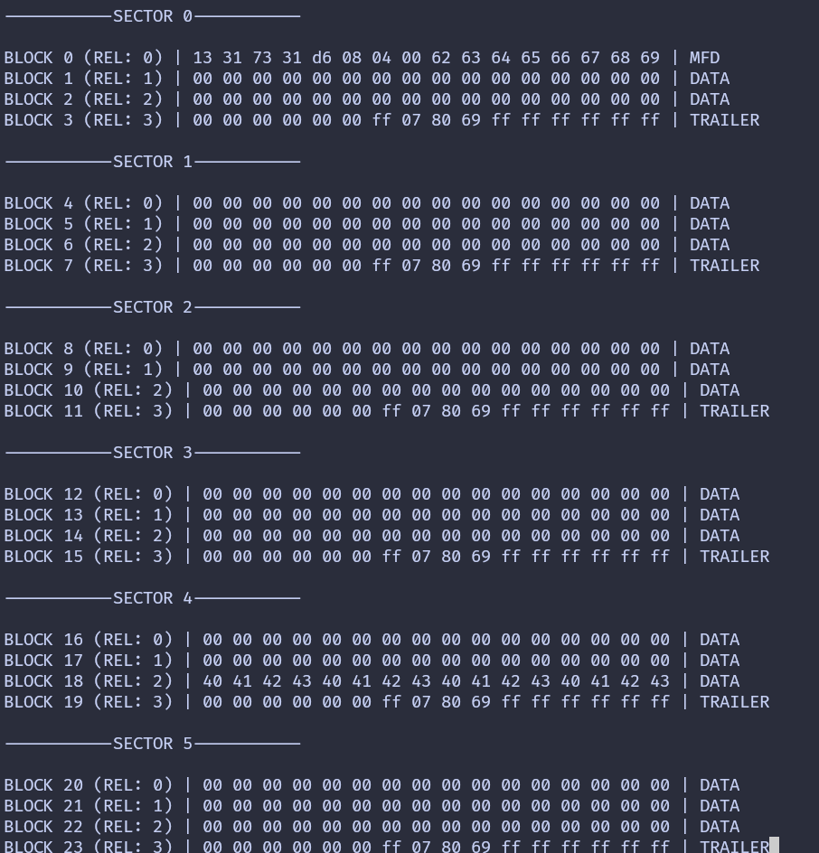

{{#title Вывод всей памяти карты MFRC522 на Raspberry Pi Pico 2 во встраиваемом Rust}}

# Вывод всей памяти

До сих пор вы научились проходить аутентификацию с сектором и читать блоки внутри него. В предыдущей главе мы ограничивались сектором 0. В этой главе мы расширим этот подход и выведем всю память метки.

Мы пройдём по всем секторам метки, аутентифицируем каждый сектор и прочитаем каждый блок внутри него. Поскольку аутентификация действительна только для одного сектора, при переходе к следующему сектору её нужно будет пройти заново.

Для каждого сектора мы прочитаем все четыре блока и выведем их содержимое в виде 16 байтов. Чтобы вывод было проще понять, добавим подписи, которые показывают:

- Номер сектора
- Абсолютный номер блока
- Номер блока относительно сектора
- Является ли блок данными производителя, служебным блоком сектора (trailer) или обычными данными

Чтобы сохранить фокус этой главы, мы не будем повторять шаги создания проекта и настройки зависимостей. К этому моменту вы уже должны уверенно работать с нужными крейтами и структурой проекта.

## Выберите способ вывода

Как и раньше, основная логика одинакова для обеих схем. Отличается только вид логирования.

Выберите вкладку, которая соответствует тому, как вы выводите результаты.
{{#tabs global="log-method" }}
{{#tab name="Отладочный зонд" }}
В этой схеме для вывода данных блоков мы используем defmt через RTT.
{{#endtab }}
{{#tab name="USB Serial" }}
В этой схеме для вывода данных блоков мы используем USB Serial.
{{#endtab }}
{{#endtabs }}

## Перебор секторов

Начнём с создания вспомогательной функции, которая перебирает все секторы метки. Для метки MIFARE Classic 1K это секторы с 0 по 15.

Для каждого сектора мы выводим заголовок, а затем вызываем `read_sector`, чтобы пройти аутентификацию и прочитать его блоки.

{{#tabs global="log-method" }}
{{#tab name="Отладочный зонд" }}

```rust
fn dump_memory<E, COMM>(
    uid: &mfrc522::Uid,
    rfid: &mut Mfrc522<COMM, mfrc522::Initialized>,
) -> Result<(), &'static str>
where
    COMM: mfrc522::comm::Interface<Error = E>,
{
    let mut buff: String<64> = String::new();
    for sector in 0..16 {
        // Выводим номер сектора
        write!(buff, "-----------SECTOR {}-----------", sector)
            .expect("failed to write into heapless buff");
        defmt::println!("{}", buff);
        buff.clear();

        read_sector(uid, sector, rfid)?;
    }
    Ok(())
}
```

{{#endtab }}
{{#tab name="USB Serial" }}

```rust
fn dump_memory<E, COMM>(
    uid: &mfrc522::Uid,
    rfid: &mut Mfrc522<COMM, mfrc522::Initialized>,
) -> Result<(), &'static str>
where
    COMM: mfrc522::comm::Interface<Error = E>,
{
    let mut buff: String<64> = String::new();
    for sector in 0..16 {
        // Выводим номер сектора
        write!(buff, "-----------SECTOR {}-----------", sector)
            .expect("failed to write into heapless buff");
        log::info!("{}", buff);
        buff.clear();

        read_sector(uid, sector, rfid)?;
    }
    Ok(())
}
```

{{#endtab }}
{{#endtabs }}

## Увеличиваем буфер логов

Вывод всей памяти даёт много данных. Увеличьте размер буфера логов, чтобы вывод не обрезался.

{{#tabs global="log-method" }}
{{#tab name="USB Serial" }}

```rust
#[embassy_executor::task]
async fn logger_task(usb: embassy_rp::Peri<'static, embassy_rp::peripherals::USB>) {
    let driver = embassy_rp::usb::Driver::new(usb, Irqs);

    embassy_usb_logger::run!(8192, log::LevelFilter::Info, driver);
}
```

{{#endtab }}
{{#endtabs }}

## Определяем тип блока

Далее добавим небольшую вспомогательную функцию, которая определяет тип блока по его положению внутри сектора.

```rust
fn get_block_type(sector: u8, rel_block: u8) -> &'static str {
    match rel_block {
        0 if sector == 0 => "MFD",
        3 => "TRAILER",
        _ => "DATA",
    }
}
```

## Чтение сектора с подписями

Функция `read_sector` похожа на ту, что вы использовали раньше, но теперь она добавляет к выводу больше контекста.

{{#tabs global="log-method" }}
{{#tab name="Отладочный зонд" }}

```rust
fn read_sector<E, COMM>(
    uid: &mfrc522::Uid,
    sector: u8,
    rfid: &mut Mfrc522<COMM, mfrc522::Initialized>,
) -> Result<(), &'static str>
where
    COMM: mfrc522::comm::Interface<Error = E>,
{
    const AUTH_KEY: [u8; 6] = [0xFF; 6];

    let mut buff: String<64> = String::new();

    let block_offset = sector * 4;
    rfid.mf_authenticate(uid, block_offset, &AUTH_KEY)
        .map_err(|_| "Auth failed")?;

    for abs_block in block_offset..block_offset + 4 {
        let rel_block = abs_block - block_offset;
        let data = rfid.mf_read(abs_block).map_err(|_| "Read failed")?;

        // Выводим данные блока
        for &d in data.iter() {
            write!(buff, "{:02x} ", d).expect("failed to write byte into buffer");
        }

        // Выводим тип блока
        let block_type = get_block_type(sector, rel_block);

        defmt::println!(
            "BLOCK {} (REL: {}) | {} | {}",
            abs_block,
            rel_block,
            buff,
            block_type
        );

        buff.clear();
    }
    defmt::println!("");
    Ok(())
}
```

{{#endtab }}
{{#tab name="USB Serial" }}

```rust
fn read_sector<E, COMM>(
    uid: &mfrc522::Uid,
    sector: u8,
    rfid: &mut Mfrc522<COMM, mfrc522::Initialized>,
) -> Result<(), &'static str>
where
    COMM: mfrc522::comm::Interface<Error = E>,
{
    const AUTH_KEY: [u8; 6] = [0xFF; 6];

    let mut buff: String<64> = String::new();

    let block_offset = sector * 4;
    rfid.mf_authenticate(uid, block_offset, &AUTH_KEY)
        .map_err(|_| "Auth failed")?;

    for abs_block in block_offset..block_offset + 4 {
        let rel_block = abs_block - block_offset;
        let data = rfid.mf_read(abs_block).map_err(|_| "Read failed")?;

        // Выводим данные блока
        for &d in data.iter() {
            write!(buff, "{:02x} ", d).expect("failed to write byte into buffer");
        }

        // Выводим тип блока
        let block_type = get_block_type(sector, rel_block);

        log::info!(
            "BLOCK {} (REL: {}) | {} | {}",
            abs_block,
            rel_block,
            buff,
            block_type
        );

        buff.clear();
    }
    log::info!("");
    Ok(())
}
```

{{#endtab }}
{{#endtabs }}

## Главный цикл

Главный цикл почти не меняется. Единственное отличие в том, что теперь мы вызываем `dump_memory` вместо чтения одного сектора.

{{#tabs global="log-method" }}
{{#tab name="Отладочный зонд" }}

```rust
loop {
    if let Ok(atqa) = rfid.reqa() {
        if let Ok(uid) = rfid.select(&atqa) {
            if let Err(e) = dump_memory(&uid, &mut rfid) {
                defmt::error!("Error reading sector: {:?}", e);
            }
            let _ = rfid.hlta();
            let _ = rfid.stop_crypto1();
            Timer::after_millis(500).await;
        }
    }

    Timer::after_millis(200).await;
}
```

{{#endtab }}
{{#tab name="USB Serial" }}

```rust
loop {
    if let Ok(atqa) = rfid.reqa() {
        if let Ok(uid) = rfid.select(&atqa) {
            if let Err(e) = dump_memory(&uid, &mut rfid) {
                log::error!("Error reading sector: {:?}", e);
            }
            let _ = rfid.hlta();
            let _ = rfid.stop_crypto1();
            Timer::after_millis(500).await;
        }
    }

    Timer::after_millis(200).await;
}
```

{{#endtab }}
{{#endtabs }}

## Клонируйте существующий проект

{{#tabs global="log-method" }}
{{#tab name="Отладочный зонд" }}
Можно клонировать проект, который я создал, и перейти в папку `memory-dump`.

```sh
git clone https://github.com/ImplFerris/pico2-embassy-projects
cd pico2-embassy-projects/rfid/memory-dump/
```

{{#endtab }}
{{#tab name="USB Serial" }}
Можно клонировать проект, который я создал, и перейти в папку `memory-dump-usb`.

```sh
git clone https://github.com/ImplFerris/pico2-embassy-projects
cd pico2-embassy-projects/rfid/memory-dump-usb/
```

{{#endtab }}
{{#endtabs }}

## Дамп

Когда вы запустите программу и поднесёте метку или брелок, вы увидите примерно такой вывод. Если вы заметили байты 0x40..0x43 в блоке 18 (это блок 2 сектора 4) и задались вопросом, откуда они там, — отличное наблюдение! Это пользовательские данные, которые я записал на метку.


