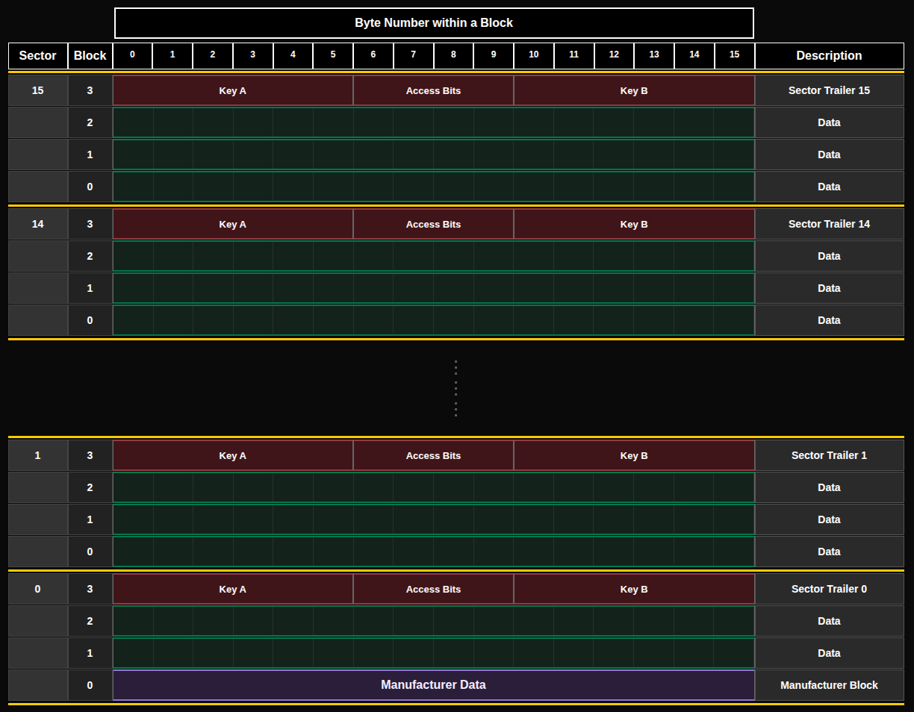

# MIFARE

MIFARE — семейство интегральных микросхем (IC), которые используются в бесконтактных смарт-картах и карточках близкого действия. Их разработала компания NXP Semiconductors. Карты MIFARE соответствуют стандарту ISO/IEC 14443A и используют методы шифрования, например алгоритм Crypto-1. Самое распространённое семейство — MIFARE Classic, у которого есть подтип [MIFARE Classic EV1](https://www.nxp.com/products/rfid-nfc/mifare-hf/mifare-classic/mifare-classic-ev1-1k-4k:MF1S50YYX_V1).

## Структура памяти

Карта MIFARE Classic 1K разделена на 16 секторов, и каждый сектор содержит 4 блока. Каждый блок может хранить до 16 байтов, что даёт общий объём памяти 1 КБ.

16 секторов × 4 блока/сектор × 16 байтов/блок = 1024 байта = 1 КБ

    
    
Организация памяти

Эта схема основана на структуре памяти из даташита. Я добавил цветовое кодирование и разделительные линии, чтобы структуру было легче читать. Каждый сектор отделён жёлтой горизонтальной линией. Служебный блок сектора (trailer) выделен тёмно-красным. Все обычные блоки данных показаны зелёным. Блок производителя выделен отдельно, чтобы отличать его от данных, доступных пользователю для записи.

### Служебный блок сектора (Sector Trailer)

Последний блок каждого сектора, известный как «trailer», содержит два секретных ключа и программируемые условия доступа для блоков этого сектора. У каждого сектора есть собственная пара ключей (KeyA и KeyB), что позволяет поддерживать несколько приложений с иерархией ключей.

> [!NOTE]
> **Ключи по умолчанию:** карта MIFARE Classic 1K предварительно настроена с ключом по умолчанию FF FF FF FF FF FF для обоих ключей, KeyA и KeyB. При чтении служебного блока значения KeyA возвращаются как нули (00 00 00 00 00 00), а KeyB возвращается как есть.

По умолчанию байты управления доступом (6, 7 и 8 служебного блока) установлены в FF 07 80h. Подробнее см. на 10-й странице [даташита](https://www.nxp.com/docs/en/data-sheet/MF1S50YYX_V1.pdf). Девятый байт можно использовать для хранения данных.

<table border="1" cellspacing="0" cellpadding="5" style="border-collapse: collapse; width: 100%; text-align: center;">
  <thead>
    <tr>
      <th rowspan="2" style="background-color: #607D8B; color: #000;">Номер байта</th>
    </tr>
    <tr>
      <th style="background-color: #1B5E20;">0</th>
      <th style="background-color: #1B5E20;">1</th>
      <th style="background-color: #1B5E20;">2</th>
      <th style="background-color: #1B5E20;">3</th>
      <th style="background-color: #1B5E20;">4</th>
      <th style="background-color: #1B5E20;">5</th>
      <th style="background-color: #FF6F00;">6</th>
      <th style="background-color: #FF6F00;">7</th>
      <th style="background-color: #FF6F00;">8</th>
      <th style="background-color: #FF6F00;">9</th>
      <th style="background-color: #2962FF;">10</th>
      <th style="background-color: #2962FF;">11</th>
      <th style="background-color: #2962FF;">12</th>
      <th style="background-color: #2962FF;">13</th>
      <th style="background-color: #2962FF;">14</th>
      <th style="background-color: #2962FF;">15</th>
    </tr>
  </thead>
  <tbody>
    <tr>
      <td style="background-color: #607D8B; color: #000;">Описание</td>
      <td colspan="6" style="background-color: #1B5E20; color: #000;">KEY A</td>
      <td colspan="3" style="background-color: #FF6F00; color: #000;">Биты доступа</td>
      <td style="background-color: #FF6F00; color: #000;">Данные пользователя</td>
      <td colspan="6" style="background-color: #2962FF; color: #000;">KEY B</td>
    </tr>
    <tr>
      <td style="background-color: #607D8B; color: #000;">Данные по умолчанию</td>
      <td style="background-color: #1B5E20;">FF</td>
      <td style="background-color: #1B5E20;">FF</td>
      <td style="background-color: #1B5E20;">FF</td>
      <td style="background-color: #1B5E20;">FF</td>
      <td style="background-color: #1B5E20;">FF</td>
      <td style="background-color: #1B5E20;">FF</td>
      <td style="background-color: #FF6F00;">FF</td>
      <td style="background-color: #FF6F00;">07</td>
      <td style="background-color: #FF6F00;">80</td>
      <td style="background-color: #FF6F00;">69</td>
      <td style="background-color: #2962FF;">FF</td>
      <td style="background-color: #2962FF;">FF</td>
      <td style="background-color: #2962FF;">FF</td>
      <td style="background-color: #2962FF;">FF</td>
      <td style="background-color: #2962FF;">FF</td>
      <td style="background-color: #2962FF;">FF</td>
    </tr>
  </tbody>
</table>

### Блок производителя

Первый блок (блок 0) первого сектора (сектора 0) содержит данные производителя микросхемы, включая UID. Этот блок защищён от записи.

### Блок данных

Поскольку у каждого сектора есть служебный блок, для хранения данных в каждом секторе можно использовать только 3 блока. Однако в первом секторе доступно только 2 блока, потому что первый блок хранит данные производителя.

Чтобы читать или писать данные, сначала нужно пройти аутентификацию с помощью KeyA или KeyB этого сектора.

Блоки данных можно дополнительно разделить на две категории в зависимости от битов доступа (мы объясним это позже).

- Блок чтения/записи: обычные блоки данных, которые позволяют выполнять базовые операции — чтение и запись данных.
- Блок значения (value block): такие блоки идеально подходят для приложений вроде электронных кошельков, где их обычно используют для хранения числовых значений, например остатка на счёте. Поэтому с ними можно выполнять инкремент (например, прибавить 10 к остатку) или декремент (например, списать 5 за покупку).

## Ссылки

- Даташит: [MIFARE Classic EV1 1K — бесконтактная смарт-карта массового применения для быстрой и простой разработки решений](https://www.nxp.com/docs/en/data-sheet/MF1S50YYX_V1.pdf)
