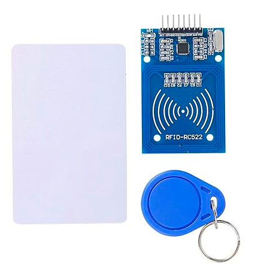

# Знакомство с модулем

Мы будем использовать RFID-модуль RC522, который построен на микросхеме MFRC522 (разработки NXP) и работает на частоте 13,56 МГц. Этот модуль широко доступен по невысокой цене и обычно поставляется с RFID-меткой (MIFARE Classic 1K) и брелоком, каждый из которых содержит 1 КБ памяти. Подробности см. в [даташите MFRC522](https://www.nxp.com/docs/en/data-sheet/MFRC522.pdf).

Микроконтроллер может обмениваться данными со считывателем по SPI, UART и I2C. Также у него есть вывод IRQ (Interrupt Request, запрос прерывания), который может генерировать прерывания, так что микроконтроллер (Pico) узнаёт о появлении метки рядом, вместо того чтобы постоянно спрашивать у считывателя (что-то вроде «Мы уже приехали?»).

К сожалению, библиотека, которую мы будем использовать, пока не поддерживает эту функцию, поэтому сейчас мы её не используем. Этот раздел мы обновим, когда поддержка появится. Так что — мы уже приехали?

### Дополнительная информация о модуле:

- **Поддерживаемые стандарты**: ISO/IEC 14443 A / MIFARE
- **Дальность считывания карт**: 0–50 мм
- **Ток в режиме ожидания**: 10–13 мА
- **Рабочий ток**: 13–26 мА
- **Рабочее напряжение**: 3,3 В постоянного тока (⚠️ не используйте 5 В и выше, это приведёт к поломке).
