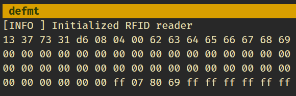
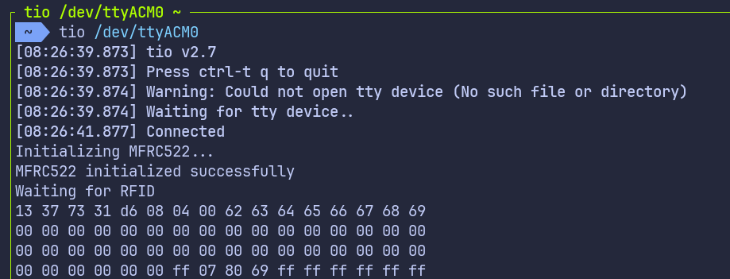

{{#title Чтение данных RFID-метки на Raspberry Pi Pico с embedded Rust}}

# Чтение данных RFID-метки на Raspberry Pi Pico с embedded Rust

В этой главе мы выходим за рамки чтения UID и начинаем читать данные, которые хранятся на RFID-метке. Мы прочитаем все блоки первого сектора, то есть сектора 0.

Как уже говорилось, читать или записывать данные на RFID-метку напрямую нельзя. Прежде чем обращаться к блоку, нужно пройти аутентификацию с сектором, в котором находится этот блок. Когда аутентификация прошла успешно, считывателю разрешается читать или записывать блоки этого сектора.

## Выберите способ вывода

В этой главе инструкции и код немного отличаются в зависимости от того, как вы выводите результаты. Выберите подходящую вкладку в зависимости от того, используете ли вы отладочный зонд или USB Serial.

{{#tabs global="log-method" }}
{{#tab name="Отладочный зонд" }}
В этой схеме для вывода данных блоков мы используем defmt через RTT.
{{#endtab }}
{{#tab name="USB Serial" }}
В этой схеме для вывода данных блоков мы используем USB Serial.
{{#endtab }}
{{#endtabs }}

## Проект из шаблона

Начнём с создания нового проекта из шаблона.

```sh
cargo generate --git https://github.com/ImplFerris/pico2-template.git --tag v0.3.2
```

{{#tabs global="log-method" }}
{{#tab name="Отладочный зонд" }}
Когда появится запрос, введите имя проекта, например «read-blocks», и выберите «Embassy» в качестве HAL. Обязательно включите «defmt» для логирования.
{{#endtab }}
{{#tab name="USB Serial" }}
Когда появится запрос, введите имя проекта, например «read-blocks», и выберите «Embassy» в качестве HAL. Для этой схемы включать defmt не нужно.
{{#endtab }}
{{#endtabs }}

## Требуемые дополнительные крейты

Обновите Cargo.toml и добавьте необходимые крейты вместе с существующими зависимостями.

{{#tabs global="log-method" }}
{{#tab name="Отладочный зонд" }}

```toml
mfrc522 = "0.8.0"
embedded-hal-bus = "0.3.0"
heapless = { version = "0.9.2", features = ["defmt"] }
```

{{#endtab }}
{{#tab name="USB Serial" }}

```toml
mfrc522 = "0.8.0"
embedded-hal-bus = "0.3.0"

embassy-usb-logger = "0.5.1"
log = "0.4"
heapless = "0.9.2"
```

{{#endtab }}
{{#endtabs }}

## Дополнительные импорты

{{#tabs global="log-method" }}
{{#tab name="Отладочный зонд" }}

```rust
// Для SPI
use embassy_rp::spi::Spi;
use embassy_rp::{self as hal, spi};
use embassy_time::Delay;
use embedded_hal_bus::spi::ExclusiveDevice;

// Для вывода CS
use embassy_rp::gpio::{Level, Output};

// Драйвер для MFRC522
use mfrc522::{Mfrc522, comm::blocking::spi::SpiInterface};

// Для подготовки буфера с данными перед логированием
use core::fmt::Write;
use heapless::String;
```

{{#endtab }}
{{#tab name="USB Serial" }}

```rust
// Для USB
use embassy_rp::{peripherals::USB, usb};

// Для SPI
use embassy_rp::spi;
use embassy_rp::spi::Spi;
use embassy_time::Delay;
use embedded_hal_bus::spi::ExclusiveDevice;

// Для вывода CS
use embassy_rp::gpio::{Level, Output};

// Драйвер для MFRC522
use mfrc522::{Mfrc522, comm::blocking::spi::SpiInterface};

// Для подготовки буфера с форматированным выводом
use core::fmt::Write;
use heapless::String;
```

{{#endtab }}
{{#endtabs }}

## Повторное использование существующей настройки

Оставшаяся инициализация SPI и RFID-считывателя такая же, как в предыдущей главе. Её можно повторно использовать здесь без изменений. В этой главе мы только добавляем несколько вспомогательных функций и изменяем главный цикл, чтобы читать блоки и выводить их содержимое.

## Аутентификация

Большинство меток MIFARE Classic поставляются с ключом сектора по умолчанию. Самый распространённый ключ по умолчанию — шесть байтов 0xFF. Если аутентификация не проходит, возможно, стоит посмотреть документацию метки или попробовать другой ключ.

Для аутентификации нужны три вещи:

- UID метки, который мы уже получаем с помощью шагов REQA и select
- Абсолютный номер блока, для которого проводится аутентификация
- Ключ, которым выполняется аутентификация; в этом примере он задан прямо в коде

## Вспомогательная функция для вывода байтов в виде hex-дампа

Эта функция преобразует сырые байты в шестнадцатеричный формат и выводит их.

{{#tabs global="log-method" }}
{{#tab name="Отладочный зонд" }}

```rust
fn print_hex(data: &[u8]) {
    let mut buff: String<64> = String::new();
    for &d in data.iter() {
        write!(buff, "{:02x} ", d).expect("failed to write byte into buffer");
    }
    defmt::println!("{}", buff);
}
```

{{#endtab }}
{{#tab name="USB Serial" }}

```rust
fn print_hex(data: &[u8]) {
    let mut buff: String<64> = String::new();
    for &d in data.iter() {
        write!(buff, "{:02x} ", d).expect("failed to write byte into buffer");
    }
    log::info!("{}", buff);
}
```

{{#endtab }}
{{#endtabs }}

## Чтение блока

Когда аутентификация с сектором прошла успешно, считывателю разрешается обращаться к блокам, принадлежащим этому сектору. С этого момента считыватель может отправлять команды чтения для этих блоков.

Каждый блок метки MIFARE Classic хранит ровно 16 байтов данных. Функция `mf_read` из крейта mfrc522 читает один блок за раз и при успехе возвращает эти 16 байтов. Если чтение не удалось, возвращается ошибка.

В этой главе мы сосредоточимся на секторе 0. В секторе 0 четыре блока. Аутентификация выполняется один раз для сектора, а затем все четыре блока читаются по порядку. Пока мы остаёмся в одном секторе, аутентификацию повторять не нужно.

```rust
fn read_sector<E, COMM>(
    uid: &mfrc522::Uid,
    sector: u8,
    rfid: &mut Mfrc522<COMM, mfrc522::Initialized>,
) -> Result<(), &'static str>
where
    COMM: mfrc522::comm::Interface<Error = E>,
{
    const AUTH_KEY: [u8; 6] = [0xFF; 6];

    let block_offset = sector * 4;
    rfid.mf_authenticate(uid, block_offset, &AUTH_KEY)
        .map_err(|_| "Auth failed")?;

    for abs_block in block_offset..block_offset + 4 {
        let data = rfid.mf_read(abs_block).map_err(|_| "Read failed")?;
        print_hex(&data);
    }
    Ok(())
}
```

При обращении к памяти метки нужно указывать абсолютные номера блоков. Метка рассматривает все блоки как часть одной непрерывной последовательности, а не использует нумерацию внутри сектора. Например, сектор 0 использует блоки 0–3, сектор 1 — блоки 4–7, а сектор 2 — блоки 8–11.

Чтобы превратить номер сектора в правильный номер блока, вычисляем смещение. Поскольку в каждом секторе четыре блока, умножение номера сектора на 4 даёт первый блок этого сектора. Это значение сохраняется в `block_offset` и затем используется как начальная точка для чтения всех блоков выбранного сектора.

Для первого сектора, то есть сектора 0, вычисление простое: смещение равно 0 × 4, что даёт блок 0. Это значит, что сектор 0 начинается с блока 0 и включает блоки 0, 1, 2 и 3. Именно эти блоки мы читаем, когда проходим аутентификацию и обращаемся к первому сектору.

## Главный цикл

Главный цикл работает похоже на то, что мы рассматривали в предыдущей главе. После выбора метки переходим к чтению её блоков. Когда данные блоков прочитаны, цикл отправляет команды HLTA и stop_crypto1, чтобы перевести карту в состояние HALT.

{{#tabs global="log-method" }}
{{#tab name="Отладочный зонд" }}

```rust
loop {
    if let Ok(atqa) = rfid.reqa() {
        if let Ok(uid) = rfid.select(&atqa) {
            if let Err(e) = read_sector(&uid, 0, &mut rfid) {
                defmt::error!("Error reading sector: {:?}", e);
            }
            let _ = rfid.hlta();
            let _ = rfid.stop_crypto1();
            Timer::after_millis(100).await;
        }
    }

    Timer::after_millis(100).await;
}
```

{{#endtab }}
{{#tab name="USB Serial" }}

```rust
loop {
    if let Ok(atqa) = rfid.reqa() {
        if let Ok(uid) = rfid.select(&atqa) {
            if let Err(e) = read_sector(&uid, 0, &mut rfid) {
                log::error!("Error reading sector: {:?}", e);
            }
            let _ = rfid.hlta();
            let _ = rfid.stop_crypto1();
            Timer::after_millis(100).await;
        }
    }

    Timer::after_millis(100).await;
}
```

{{#endtab }}
{{#endtabs }}

## Клонируйте существующий проект

{{#tabs global="log-method" }}
{{#tab name="Отладочный зонд" }}
Можно клонировать проект, который я создал, и перейти в папку `read-blocks`.

```sh
git clone https://github.com/ImplFerris/pico2-embassy-projects
cd pico2-embassy-projects/rfid/read-blocks/
```

{{#endtab }}
{{#tab name="USB Serial" }}
Можно клонировать проект, который я создал, и перейти в папку `blocks-over-usb`.

```sh
git clone https://github.com/ImplFerris/pico2-embassy-projects
cd pico2-embassy-projects/rfid/blocks-over-usb/
```

{{#endtab }}
{{#endtabs }}

## Как запустить?

{{#tabs global="log-method" }}
{{#tab name="Отладочный зонд" }}
Используйте `cargo embed`, чтобы прошить и запустить программу: шаблон уже настроен на RTT и defmt, и вывод появляется в терминале после завершения прошивки.

```sh
cargo embed --release
```

{{#endtab }}
{{#tab name="USB Serial" }}

Прошивка Pico выполняется как обычно. Кроме того, для просмотра вывода по USB нам понадобится последовательный терминал.

### Подключение к последовательному порту

Откройте терминал и подключитесь к Pico с помощью команды:

```sh
tio /dev/ttyACM0
```

Откроется сеанс терминала для связи с Pico.

### Прошивка и запуск кода

Откройте другой терминал, перейдите в папку проекта и прошейте код на Pico как обычно:

```sh
cargo run --release
```

Если всё настроено правильно, в терминале tio вы увидите сообщение «Connected».

{{#endtab }}
{{#endtabs }}

## Чтение данных блока

{{#tabs global="log-method" }}
{{#tab name="Отладочный зонд" }}

Поднесите RFID-метку к считывателю, и системная консоль покажет байты данных, прочитанные со всех блоков первого сектора (сектора 0).



{{#endtab }}
{{#tab name="USB Serial" }}

Поднесите RFID-метку к считывателю, и терминал USB Serial покажет байты данных, прочитанные с блоков первого сектора (сектора 0).



{{#endtab }}
{{#endtabs }}

## Версия на rp-hal

Если вас интересует версия этого примера на rp-hal, её можно найти в репозитории ниже. Клонируйте репозиторий и перейдите в проект read-blocks:

```sh
git clone https://github.com/ImplFerris/pico2-rp-projects
cd pico2-rp-projects/rfid/read-blocks/
```
