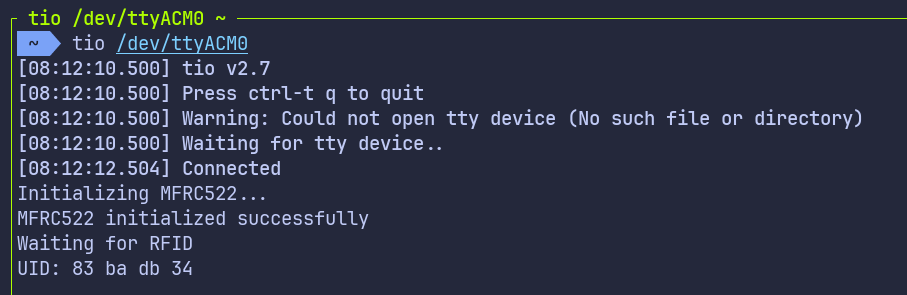

{{#title Чтение UID RFID-карты через USB Serial на Raspberry Pi Pico 2 во встраиваемом Rust}}

# Чтение UID RFID-карты через USB Serial

Прежде чем начать, обязательно посмотрите руководство по [USB Serial](../usb-serial/index.md) для настройки USB Serial на Pico. Здесь мы не будем заново рассказывать о настройке USB, чтобы не усложнять.

В этом разделе мы прочитаем UID RFID-карты и выведем его через USB Serial. Такой подход полезен, когда у вас нет отладочного зонда и вы хотите, чтобы Pico отображался на компьютере как последовательное устройство.

Логика работы с RFID остаётся такой же, как в предыдущем разделе. Единственное отличие — то, как мы выводим UID.

## Драйвер mfrc522

Для связи с RFID-считывателем RC522 мы продолжаем использовать крейт mfrc522. Драйвер отвечает за обнаружение карт и чтение UID. Со стороны RFID никаких изменений не требуется.

## Проект из шаблона

Начнём с создания нового проекта из шаблона.

```sh
cargo generate --git https://github.com/ImplFerris/pico2-template.git --tag v0.3.2
```

Когда появится запрос, введите имя проекта, например «uid-over-usb», и выберите «Embassy» в качестве HAL. Включать defmt для этой схемы не нужно.

## Требуемые дополнительные крейты

Обновите Cargo.toml и добавьте следующие крейты вместе с существующими зависимостями:

```toml
mfrc522 = "0.8.0"
embedded-hal-bus = "0.3.0"

embassy-usb-logger = "0.5.1"
log = "0.4"
heapless = "0.9.2"
```

Крейт embassy-usb-logger обеспечивает поддержку логирования через USB. Крейт log используется для макросов логирования, например `log::info!`. Крейт heapless нужен, чтобы форматировать UID без выделения памяти в куче (heap).

## Дополнительные импорты

```rust
// Для USB
use embassy_rp::{peripherals::USB, usb};

// Для SPI
use embassy_rp::spi;
use embassy_rp::spi::Spi;
use embassy_time::Delay;
use embedded_hal_bus::spi::ExclusiveDevice;

// Для вывода CS
use embassy_rp::gpio::{Level, Output};

// Драйвер для MFRC522
use mfrc522::{Mfrc522, comm::blocking::spi::SpiInterface};

// Для подготовки буфера с данными перед записью в USB Serial
use core::fmt::Write;
use heapless::String;
```

## Настройка USB-логгера

Сначала нужно привязать обработчик прерывания USB. Это говорит Embassy, какой обработчик прерываний использовать для связи по USB:

```rust
embassy_rp::bind_interrupts!(struct Irqs {
    USBCTRL_IRQ => usb::InterruptHandler<USB>;
});
```

Далее создаём асинхронную задачу, которая будет обрабатывать логирование через USB. Эта задача работает в фоне и управляет всей связью по USB Serial:

```rust
#[embassy_executor::task]
async fn logger_task(usb: embassy_rp::Peri<'static, embassy_rp::peripherals::USB>) {
    let driver = embassy_rp::usb::Driver::new(usb, Irqs);

    embassy_usb_logger::run!(1024, log::LevelFilter::Info, driver);
}
```

Атрибут `#[embassy_executor::task]` помечает эту функцию как асинхронную задачу, которую может запустить исполнитель Embassy. Задача принимает периферию USB как параметр и создаёт драйвер USB с нашей конфигурацией прерываний. Макрос `embassy_usb_logger::run!` настраивает USB-логгер с буфером 1024 байта и фильтрацией по уровню Info.

### Вспомогательная функция для вывода UID в hex

Эта вспомогательная функция преобразует массив байтов u8 (в нашем случае UID) в печатаемую шестнадцатеричную строку. Можно было бы передавать сырые байты и включить режим hex в tio (нужна последняя версия) или minicom, но мне этот способ кажется проще. В режиме hex всё выводится в шестнадцатеричном виде, включая обычный текст.

```rust
fn print_hex_to_serial(data: &[u8]) {
    let mut buff: String<64> = String::new();
    for &d in data.iter() {
        write!(buff, "{:02x} ", d).expect("failed to write byte into buffer");
    }
    log::info!("UID: {}", buff);
}
```

Эта функция создаёт буфер строки фиксированного размера на стеке (без выделения памяти в куче) и форматирует каждый байт как двузначное шестнадцатеричное число. Отформатированная строка затем отправляется через систему логирования.

## Запуск задачи логгера

В функции main нужно запустить задачу логгера и дать ей время на инициализацию:

```rust
spawner.must_spawn(logger_task(p.USB));
Timer::after_secs(3).await;
```

Метод `spawner.must_spawn()` запускает задачу логгера внутри исполнителя Embassy. Эта задача работает параллельно с нашим основным кодом и обеспечивает логирование через USB Serial. Затем ждём 3 секунды, чтобы компьютер успел распознать Pico как USB-устройство Serial, а логгер был готов. Эта задержка важна, потому что USB-соединение устанавливается постепенно, и сообщения, отправленные слишком рано, могут не появиться на компьютере.

## Настройка SPI для RFID-считывателя

Настройка SPI такая же, как раньше.

```rust
let miso = p.PIN_0;
let cs_pin = Output::new(p.PIN_1, Level::High);
let clk = p.PIN_2;
let mosi = p.PIN_3;

let mut config = spi::Config::default();
config.frequency = 1000_000;

let spi_bus = Spi::new_blocking(p.SPI0, clk, mosi, miso, config);
```

Это настраивает шину SPI на частоту 1 МГц, которая подходит для модуля RC522. Вывод выбора микросхемы (CS) инициализируется в высоком уровне (неактивное состояние), так как SPI chip select активен по низкому уровню.

## Получение `SpiDevice` из шины SPI

Драйвер mfrc522 ожидает SpiDevice, а не «голую» шину SPI. Чтобы создать такое устройство, используем крейт embedded-hal-bus:

```rust
let spi = ExclusiveDevice::new(spi_bus, cs_pin, Delay).expect("Failed to get exclusive device");
```

Мы используем ExclusiveDevice, поскольку в нашей схеме на шине SPI только одно устройство. Эта обёртка объединяет шину SPI и вывод CS, автоматически управляя линией chip select при каждой операции чтения или записи. Параметр задержки обеспечивает контроль времени между операциями.

## Инициализация mfrc522

Когда устройство SPI готово, можно инициализировать RFID-считыватель.

```rust
let itf = SpiInterface::new(spi);

log::info!("Initializing MFRC522...");
let mut rfid = match Mfrc522::new(itf).init() {
    Ok(rfid) => {
        log::info!("MFRC522 initialized successfully");
        rfid
    }
    Err(e) => {
        log::error!("Failed to initialize MFRC522: {:?}", e);
        loop {
            Timer::after_secs(1).await;
        }
    }
};
```

`SpiInterface` оборачивает наше устройство SPI для использования с драйвером mfrc522. Затем мы пытаемся инициализировать RFID-считыватель. Если инициализация прошла успешно, выводим сообщение об успехе и продолжаем работу. Если нет — выводим ошибку и входим в бесконечный цикл, так как без работающего RFID-считывателя продолжать нельзя.

## Чтение UID и вывод

Главный цикл постоянно проверяет наличие RFID-карт поблизости. Когда карта обнаружена, мы читаем её UID и выводим его:

```rust
log::info!("Waiting for RFID");
loop {
    if let Ok(atqa) = rfid.reqa() {
        if let Ok(uid) = rfid.select(&atqa) {
            print_hex_to_serial(uid.as_bytes());
            Timer::after_millis(500).await;
        }
    }
    Timer::after_millis(100).await;
}
```

Метод reqa отправляет команду Request, чтобы обнаружить карты поблизости. Когда карта отвечает своим ATQA (Answer To Request), мы вызываем select, чтобы выполнить протокол антиколлизии и получить UID. Байты UID форматируются в шестнадцатеричном виде и через систему логирования отправляются в консоль USB Serial.

Задержка 500 мс после успешного чтения не даёт заваливать вывод повторными чтениями одной и той же карты. Задержка 100 мс в главном цикле обеспечивает разумный интервал опроса без излишней нагрузки на процессор.

## Клонируйте существующий проект

Можно клонировать проект, который я создал, и перейти в папку `uid-over-usb`.

```sh
git clone https://github.com/ImplFerris/pico2-embassy-projects
cd pico2-embassy-projects/rfid/uid-over-usb/
```

## Как запустить?

Прошивка (запуск кода) на Pico выполняется как обычно. Однако нужно настроить tio для взаимодействия с Pico через последовательный порт (/dev/ttyACM0). Это позволит читать данные с Pico или отправлять их на него.

### tio

Убедитесь, что в вашей системе установлен tio. Если нет, его можно установить командой:

```sh
apt install tio
```

### Подключение к последовательному порту

Выполните следующую команду, чтобы подключиться к последовательному порту Pico:

```sh
tio /dev/ttyACM0
```

Откроется сеанс терминала для связи с Pico. Устройство /dev/ttyACM0 появляется, когда компьютер распознаёт Pico как USB-устройство CDC ACM.

### Прошивка и запуск кода

Откройте другой терминал, перейдите в папку проекта и прошейте код на Pico как обычно:

```sh
cargo run --release
```

Если всё настроено правильно, в терминале tio вы увидите сообщение «Connected».

### Чтение UID

Теперь поднесите RFID-метку к считывателю. В терминале USB Serial вы должны увидеть байты UID в шестнадцатеричном формате. Каждый байт выводится как двузначное шестнадцатеричное число.



## Версия на rp-hal

Если вас интересует версия этого примера на rp-hal, её можно найти в репозитории ниже. Клонируйте репозиторий и перейдите в проект print-uid:

```sh
git clone https://github.com/ImplFerris/pico2-rp-projects
cd pico2-rp-projects/rfid/print-uid/
```
