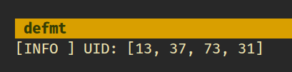

{{#title Как прочитать UID RFID-карты с Raspberry Pi Pico во встраиваемом Rust}}

# Как прочитать UID RFID-карты с Raspberry Pi Pico во встраиваемом Rust

Теперь, когда проводка готова, перейдём к части с кодом. Будем делать просто: сначала обнаружим RFID-карту и прочитаем её UID. Аутентификацию и доступ к данным пока не рассматриваем.

В этом разделе мы выведем UID с помощью отладочного зонда. Логирование выполняется через defmt, а вывод появляется в консоли компьютера через RTT. Если у вас есть отладочный зонд, это самый простой способ вывести и изучить результат.

> [!Important]
> В следующем разделе мы прочитаем тот же UID, но выведем его через USB Serial. Это полезно, если у вас нет отладочного зонда и вы хотите выводить данные в системную консоль. Вы не ограничены этими двумя способами. Можно также вывести UID на OLED-экран.

## Драйвер mfrc522

Для связи с RFID-считывателем RC522 мы будем использовать крейт [mfrc522](https://crates.io/crates/mfrc522). Он предоставляет основные функции, необходимые для обнаружения карт и чтения их UID. Крейт ещё находится в разработке, но для возможностей, которые нам нужны в этой главе, его достаточно.

## Проект из шаблона

Начнём с создания нового проекта из шаблона.

```sh
cargo generate --git https://github.com/ImplFerris/pico2-template.git --tag v0.3.2
```

Когда появится запрос, введите имя проекта, например «print-uid», и выберите «Embassy» в качестве HAL. Обязательно включите «defmt» для логирования.

## Требуемые дополнительные крейты

Добавьте в Cargo.toml необходимые крейты вместе с существующими зависимостями. Набор крейтов зависит от того, как выводятся данные.

```toml
mfrc522 = "0.8.0"
embedded-hal-bus = "0.3.0"
```

Крейт mfrc522 предоставляет драйвер для связи с RFID-считывателем RC522 и отвечает за обнаружение карт и чтение UID. Крейт embedded-hal-bus позволяет совместно использовать шину SPI через обёртку ExclusiveDevice, которая нужна драйверу mfrc522.

## Дополнительные импорты

Добавьте эти импорты в файл main.rs:

```rust
// Для SPI
use embassy_rp::spi::Spi;
use embassy_rp::spi;
use embassy_time::Delay;
use embedded_hal_bus::spi::ExclusiveDevice;

// Для вывода CS
use embassy_rp::gpio::{Level, Output};

// Драйвер для MFRC522
use mfrc522::{Mfrc522, comm::blocking::spi::SpiInterface};
```

## Настройка SPI для RFID-считывателя

Настроим шину SPI и выводы, подключённые к считывателю. В этом примере используется SPI0:

```rust
let miso = p.PIN_0;
let cs_pin = Output::new(p.PIN_1, Level::High);
let clk = p.PIN_2;
let mosi = p.PIN_3;

let mut config = spi::Config::default();
config.frequency = 1000_000;

let spi_bus = Spi::new_blocking(p.SPI0, clk, mosi, miso, config);
```

Мы настраиваем шину SPI на работу с частотой 1 МГц, что обеспечивает надёжную связь с RFID-считывателем. Вывод выбора микросхемы (chip select) стартует в высоком уровне — это состояние покоя для SPI-устройств.

## Получение `SpiDevice` из шины SPI

Драйвер mfrc522 ожидает SpiDevice, а не «голую» шину SPI. Чтобы создать такое устройство, используем крейт embedded-hal-bus:

```rust
let spi = ExclusiveDevice::new(spi_bus, cs_pin, Delay).expect("Failed to get exclusive device");
```

Мы используем ExclusiveDevice, поскольку в нашей схеме на шине SPI только одно устройство. Эта обёртка объединяет шину SPI и вывод CS, автоматически управляя линией chip select при каждой операции чтения или записи. Параметр задержки обеспечивает контроль времени.

## Инициализация mfrc522

Когда устройство SPI готово, можно инициализировать RFID-считыватель.

```rust
let itf = SpiInterface::new(spi);
let mut rfid = Mfrc522::new(itf)
    .init()
    .expect("failed to initialize the RFID reader");
```

## Чтение UID и вывод

Главный цикл постоянно проверяет наличие RFID-карт поблизости. Когда карта обнаружена, мы читаем её UID и выводим его:

```rust
loop {
    if let Ok(atqa) = rfid.reqa() {
        if let Ok(uid) = rfid.select(&atqa) {
            defmt::info!("UID: {:02x}", uid.as_bytes());
            Timer::after_millis(500).await;
        }
    }
}
```

Метод reqa отправляет команду Request, чтобы обнаружить карты поблизости. Когда карта отвечает своим ATQA (Answer To Request), мы вызываем select, чтобы выполнить протокол антиколлизии и получить UID. Байты UID форматируются в шестнадцатеричном виде и отправляются через defmt в консоль RTT.

## Клонируйте существующий проект

Можно клонировать проект, который я создал, и перейти в папку `print-uid`.

```sh
git clone https://github.com/ImplFerris/pico2-embassy-projects
cd pico2-embassy-projects/rfid/print-uid/
```

## Как запустить?

Не забудьте использовать команду `cargo embed --release` для прошивки вместо `cargo flash --release`, если вы используете отладочный зонд. В шаблоне уже настроено открытие RTT при прошивке, поэтому вы должны увидеть вывод defmt.

Теперь поднесите RFID-метку к считывателю. В консоли RTT вы должны увидеть байты UID в шестнадцатеричном формате.


