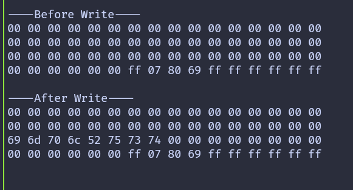

{{#title Запись данных на RFID-метку на Raspberry Pi Pico 2 с Embassy}}

# Запись данных

В предыдущих главах мы сосредоточились на чтении данных с метки. В этой главе мы делаем шаг дальше и записываем данные в память метки.

Мы запишем данные в блок 2 сектора 4. Чтобы хорошо видеть результат операции записи, сначала считаем и выведем содержимое блока до записи, а после завершения записи снова прочитаем тот же сектор.

Запись выполняется функцией `mf_write` из крейта mfrc522. Эта функция записывает ровно 16 байтов, что соответствует размеру одного блока метки MIFARE Classic.

> [!CAUTION]
> Запись в неправильный блок может необратимо изменить ключи аутентификации или биты доступа. Не записывайте в служебные блоки секторов, если не понимаете их структуру полностью.

## Запись блока

Начнём с определения вспомогательной функции, которая выполняет операцию записи. Функция получает UID метки, номер сектора, номер блока относительно сектора, буфер данных на 16 байтов и изменяемую ссылку на RFID-считыватель. Внутри функции вычисляется абсолютный номер блока, и перед записью сектор проходит аутентификацию.

```rust
fn write_block<E, COMM>(
    uid: &mfrc522::Uid,
    sector: u8,
    rel_block: u8,
    data: [u8; 16],
    rfid: &mut Mfrc522<COMM, mfrc522::Initialized>,
) -> Result<(), &'static str>
where
    COMM: mfrc522::comm::Interface<Error = E>,
{
    const AUTH_KEY: [u8; 6] = [0xFF; 6];

    let block_offset = sector * 4;
    let abs_block = block_offset + rel_block;

    rfid.mf_authenticate(uid, block_offset, &AUTH_KEY)
        .map_err(|_| "Auth failed")?;

    rfid.mf_write(abs_block, data).map_err(|_| "Write failed")?;

    Ok(())
}
```

## Подготовка данных

Каждый блок хранит ровно 16 байтов. Когда мы пишем текст или меньшие значения, оставшиеся байты всё равно нужно указать. В этом примере мы записываем строку implRust и дополняем оставшиеся байты значением 0x00.

```rust
let target_sector = 4;
let rel_block = 2;
const DATA: [u8; 16] = [
    b'i', b'm', b'p', b'l', b'R', b'u', b's', b't', // "implRust"
    0x00, 0x00, 0x00, 0x00, 0x00, 0x00, 0x00, 0x00, // Оставшиеся байты — 0x00
];
```

## Главный цикл

Главный цикл следует простой последовательности. После обнаружения и выбора метки считываем и выводим текущее содержимое целевого сектора. Затем записываем новые данные в выбранный блок и снова читаем сектор, чтобы подтвердить изменение. Наконец, переводим метку в состояние HALT и останавливаем шифрование.

Если вы используете USB Serial вместо отладочного зонда, замените `defmt::info!` и `defmt::error!` на `log::info!` и `log::error!`.

```rust

loop {
    if let Ok(atqa) = rfid.reqa() {
        if let Ok(uid) = rfid.select(&atqa) {
            defmt::info!("\r\n----Before Write----\r\n");
            if let Err(e) = read_sector(&uid, target_sector, &mut rfid) {
                defmt::error!("Error reading sector: {:?}", e);
            }

            if let Err(e) = write_block(&uid, target_sector, rel_block, DATA, &mut rfid) {
                defmt::error!("Error writing data: {:?}", e);
            }

            defmt::info!("\r\n----After Write----\r\n");
            if let Err(e) = read_sector(&uid, target_sector, &mut rfid) {
                defmt::error!("Error reading sector: {:?}", e);
            }
            let _ = rfid.hlta();
            let _ = rfid.stop_crypto1();
            Timer::after_millis(500).await;
        }
    }
    Timer::after_millis(100).await;
}
```

## Клонируйте существующий проект

Можно клонировать пример проекта и перейти в папку с примером записи.

```sh
git clone https://github.com/ImplFerris/pico2-embassy-projects
cd pico2-embassy-projects/rfid/write-data/
```

## Результат

Когда программа успешно работает, вывод показывает содержимое блока до и после записи. Вы должны увидеть ASCII-байты implRust в блоке 2, что подтверждает, что операция записи прошла как ожидалось.



## Версия на rp-hal

Если вас интересует версия этого примера на rp-hal, её можно найти в репозитории ниже. Клонируйте репозиторий и перейдите в проект write-data:

```sh
git clone https://github.com/ImplFerris/pico2-rp-projects
cd pico2-rp-projects/rfid/write-data/
```
