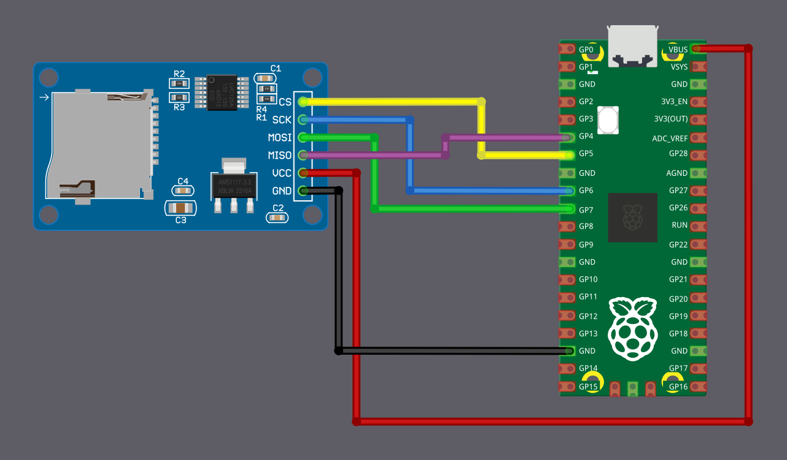

# Подключение считывателя micro SD-карт к Raspberry Pi Pico

В этом разделе мы подключим модуль считывателя microSD-карт к Raspberry Pi Pico в режиме SPI.

## Распиновка microSD-карты в режиме SPI

Мы рассмотрим только саму microSD-карту, так как именно её мы используем. У microSD-карты 8 физических выводов, но в режиме SPI нужны только 6 из них.

Вы могли заметить, что большинство модулей считывателей microSD тоже выводят только 6 контактов. Это потому, что такие модули уже внутри подключены для работы по SPI, а неиспользуемые выводы просто не выведены наружу.

В таблице ниже показано, как выводы microSD-карты соответствуют сигналам SPI.

  
  <table>
    <thead>
      <tr>
        <th>Вывод microSD-карты</th>
        <th>Функция SPI</th>
      </tr>
    </thead>
    <tbody>
      <tr>
        <td>1</td>
        <td>-</td>
      </tr>
      <tr>
        <td>2</td>
        <td>Выбор микросхемы (CS); также называется Card Select</td>
      </tr>
      <tr>
        <td>3</td>
        <td>Вход данных (DI) — соответствует MOSI. Для приёма данных от микроконтроллера.</td>
      </tr>
      <tr>
        <td>4</td>
        <td>VDD — питание (3,3 В)</td>
      </tr>
      <tr>
        <td>5</td>
        <td>Последовательное тактирование (SCK)</td>
      </tr>
      <tr>
        <td>6</td>
        <td>Земля (GND)</td>
      </tr>
      <tr>
        <td>7</td>
        <td>Выход данных (DO) — соответствует MISO. Для передачи данных от microSD-карты к микроконтроллеру.</td>
      </tr>
      <tr>
        <td>8</td>
        <td>-</td>
      </tr>
    </tbody>
  </table>

## Подключение Raspberry Pi Pico к считывателю SD-карт

Выводы GPIO Raspberry Pi Pico рассчитаны на 3,3 В и могут быть необратимо повреждены сигналами 5 В. microSD-карты тоже работают при 3,3 В и могут выйти из строя при подаче более высокого напряжения.

Модули считывателей SD-карт бывают разных конфигураций:

**Модули только на 3,3 В:** такие модули — простые платы-переходники для microSD, рассчитанные на работу непосредственно при 3,3 В. Поскольку и Raspberry Pi Pico, и SD-карта используют одно и то же напряжение, модуль можно подключить без дополнительных схем. Питайте его от вывода `3V3(OUT)` Pico и подключите линии данных SPI напрямую к выводам GPIO Pico. Это самый простой и безопасный вариант при работе с Raspberry Pi Pico.

**Модули на 5 В со стабилизацией напряжения:** некоторые модули SD-карт рассчитаны на питание от 5 В. Такие модули содержат дополнительные компоненты, благодаря которым сама SD-карта всё равно работает при 3,3 В. Некоторые модули более высокого качества также следят за тем, чтобы все сигнальные линии оставались на безопасном уровне 3,3 В.

Если модуль на 5 В спроектирован правильно, его можно использовать с Raspberry Pi Pico. Однако не все модули на 5 В корректно работают с уровнями сигналов. Поэтому перед подключением к Pico всегда проверяйте описание модуля и документацию.

### Модуль, используемый в этом руководстве

Модуль SD-карты, который используется в этом руководстве, рассчитан на питание от 5 В и выдаёт сигналы 3,3 В, поэтому его безопасно использовать с Raspberry Pi Pico.

Питайте модуль от вывода VBUS Pico, который выдаёт 5 В, когда Pico питается по USB. Не питайте такой модуль от вывода 3,3 В Pico, так как он может работать ненадёжно.

> [!Caution]
> Всегда проверяйте, что ваш модуль SD-карты выдаёт сигналы 3,3 В, прежде чем подключать его к Pico. Если не уверены, используйте модуль только на 3,3 В, чтобы не повредить Pico.

### Схема подключения

<table>
  <thead>
    <tr>
      <th>Вывод Pico</th>
      <th style="width: 250px; margin: 0 auto;">Провод</th>
      <th>Вывод SD-карты</th>
    </tr>
  </thead>
  <tbody>
    <tr>
      <td>GPIO 4 (RX)</td>
      <td style="text-align: center; vertical-align: middle; padding: 0;">
        

          

          

        

      </td>
      <td>MISO</td>
    </tr>
    <tr>
      <td>GPIO 5</td>
      <td style="text-align: center; vertical-align: middle; padding: 0;">
        

          

          

        

      </td>
      <td>CS</td>
    </tr>
    <tr>
      <td>GPIO 6</td>
      <td style="text-align: center; vertical-align: middle; padding: 0;">
        

          

          

        

      </td>
      <td>SCK</td>
    </tr>
    <tr>
      <td>GPIO 7 (TX)</td>
      <td style="text-align: center; vertical-align: middle; padding: 0;">
        

          

          

        

      </td>
      <td>MOSI</td>
    </tr>
        <tr>
      <td>VBUS</td>
      <td style="text-align: center; vertical-align: middle; padding: 0;">
        

          

          

        

      </td>
      <td>VCC</td>
    </tr>
    <tr>
      <td>GND</td>
      <td style="text-align: center; vertical-align: middle; padding: 0;">
        

          

          

        

      </td>
      <td>GND</td>
    </tr>
  </tbody>
</table>
 

