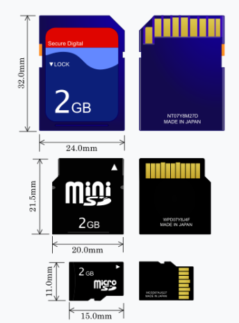
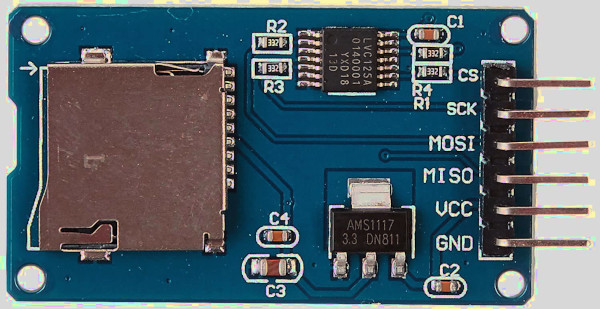

# SD-карта (SDC/MMC)

Рано или поздно вам может понадобиться хранить данные, которые не помещаются во флеш-памяти микроконтроллера. Это могут быть журналы датчиков, конфигурационные файлы, игровые ресурсы или что-то другое, что должно сохраняться после отключения питания. Один из самых практичных способов — использовать SD-карту. В этом разделе мы научимся работать с модулем SD-карты на Raspberry Pi Pico.

## MMC (MultiMediaCard)

MultiMediaCard (MMC) появилась как один из ранних видов флеш-памяти, предшественник SD-карты. Её часто использовали в видеокамерах, цифровых фотоаппаратах и портативных музыкальных плеерах.

Как и современная флеш-память, MMC хранит данные в виде электрического заряда в ячейках флеш-памяти. Это сильно отличается от оптических носителей, таких как CD или DVD, которые хранят данные в виде физических меток, считываемых лазером.

Хотя карты MMC сегодня почти вышли из употребления, они по-прежнему важны, потому что SD-карты унаследовали многие идеи от MMC.

## SD-карта (Secure Digital)

Карта Secure Digital, обычно называемая SD-картой, построена на идеях MMC и развила их. SD-карты стали чрезвычайно популярны, и сейчас их используют в фотоаппаратах, встраиваемых системах и одноплатных компьютерах. Существует более компактный вариант — microSD, который обычно применяют в проектах на микроконтроллерах.

Источник изображения: на основе <a href="https://en.wikipedia.org/wiki/File:SD_Cards.svg">SD card</a> от <a href="https://commons.wikimedia.org/wiki/User:Tkgd2007">Tkgd2007</a>, распространяется по лицензиям GFDL и CC BY-SA 3.0, 2.5, 2.0, 1.0.

Внутри SD-карты читают и записывают данные блоками фиксированного размера, обычно 512 байтов. Поэтому доступ к данным осуществляется блоками, а не отдельными байтами. Над этими блоками работают файловые системы, например FAT, которые управляют тем, как файлы сохраняются и извлекаются.

## Требования к оборудованию

Мы будем использовать модуль адаптера micro SD-карты. Найти его можно, введя в поиске «Micro SD Card Reader Module» или «Micro SD Card Adapter».

И, конечно, вам понадобится microSD-карта. Карта должна быть отформатирована в FAT32. В зависимости от вашего компьютера может понадобиться отдельный адаптер SD или USB для форматирования карты, так как не у всех ноутбуков есть слот для microSD.

## Ссылки

- Я настоятельно рекомендую посмотреть доклад Джонатана Палланта [на Euro Rust 2024](https://www.youtube.com/watch?v=-ewuFNKIAVI) о написании драйвера SD-карты на Rust. Драйвер, который мы будем использовать, написал именно он (изначально он создавал его, чтобы запускать MS-DOS на ARM). Он не предназначен для производственных систем.
- Если хотите понять, как всё устроено внутри в режиме SPI, можно обратиться к статье: [How to Use MMC/SDC](http://elm-chan.org/docs/mmc/mmc_e.html) (на английском языке).
