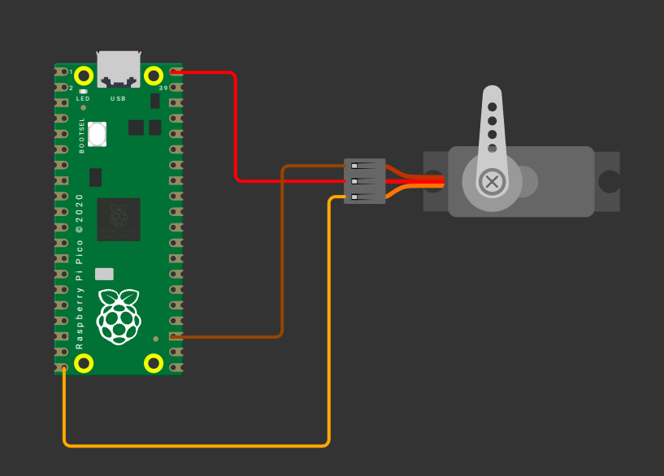

# Сервопривод с Raspberry Pi Pico 2 (RP2350)

Необходимое напряжение питания и ширина импульсов могут различаться в зависимости от сервопривода, поэтому всегда лучше сверяться с даташитом или техническими характеристиками изделия. Сервопривод, который использую я, работает в диапазоне от 4,8 до 6 В, поэтому я буду питать его напряжением 5 В.

1. Земля (GND): подключите вывод GND сервопривода (обычно коричневый провод, хотя может отличаться) к любому выводу земли Pico 2.
2. Питание (VCC): подключите вывод VCC сервопривода (обычно красный провод) к выводу питания 5 В Pico 2 (VBUS).
3. Сигнал (PWM): подключите управляющий (сигнальный) вывод сервопривода к GPIO15 Pico 2, настроенному для ШИМ. Обычно это оранжевый провод (может отличаться).

<table style="margin-bottom:20px">
  <thead>
    <tr>
      <th>Вывод Pico</th>
      <th style="width: 250px; margin: 0 auto;">Провод</th>
      <th>Сервопривод</th>
      <th>Примечания</th>
    </tr>
  </thead>
  <tbody>
    <tr>
      <td>VBUS</td>
      <td style="text-align: center; vertical-align: middle; padding: 0;">
        

          

          

        

      </td>
      <td>Питание (красный провод)</td>
      <td>Подаёт питание 5 В на сервопривод.</td>
    </tr>
    <tr>
      <td>GND</td>
      <td style="text-align: center; vertical-align: middle; padding: 0;">
        

          

          

        

      </td>
      <td>Земля (коричневый провод)</td>
      <td>Подключается к земле.</td>
    </tr>
    <tr>
      <td>GPIO 15</td>
      <td style="text-align: center; vertical-align: middle; padding: 0;">
        

          

          

        

      </td>
      <td>Сигнал (оранжевый/жёлтый провод)</td>
      <td>Получает сигнал ШИМ для управления положением сервопривода.</td>
    </tr>
  </tbody>
</table>

