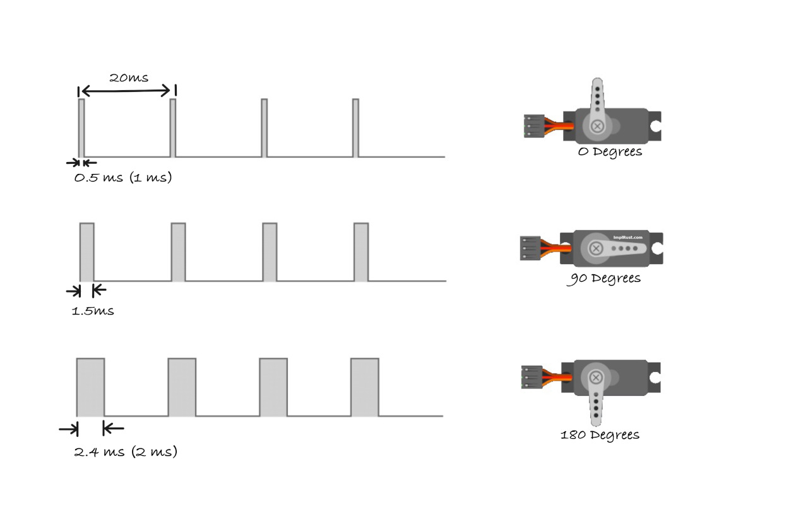

# Как работает управление сервоприводом

Сервопривод использует сигналы ШИМ (широтно-импульсной модуляции), чтобы управлять своим положением. Ширина каждого импульса сообщает сервоприводу, на какой угол повернуться, а постоянное повторение этого импульса удерживает его в этом положении.

## Основной принцип

Сервоприводы работают на частоте 50 Гц, то есть ожидают управляющий импульс каждые 20 миллисекунд. Внутри каждого цикла длительностью 20 мс положение сервопривода определяется тем, сколько времени сигнал остаётся в высоком состоянии.

Представьте это так: каждые 20 мс вы посылаете сервоприводу короткую команду. Длина этой команды говорит ему, куда повернуться.

## Ширина импульса

Положение сервопривода задаётся тем, как долго импульс сигнала остаётся в высоком состоянии. Короткий импульс переводит его в минимальное положение (обычно 0°), средний импульс — в центральное положение (обычно 90°), а длинный импульс — в максимальное положение (обычно 180°).

### Стандарт и реальность

Часто встречаются «стандартные» значения: импульс 1,0 мс для 0°, 1,5 мс для 90° и 2,0 мс для 180°. Однако дешёвые сервоприводы редко точно следуют этим цифрам. Производственные отклонения означают, что у каждого сервопривода свои характеристики.

Например, мой сервопривод требовал 0,5 мс для минимального положения, 1,5 мс для центра и 2,4 мс для максимального положения. Это совершенно нормально и ожидаемо.

Опубликованные значения ширины импульсов нужно считать отправной точкой, а не абсолютными величинами. Всегда тестируйте и калибруйте конкретный сервопривод. Логический анализатор или осциллограф помогут, но подойдёт и простой метод проб и ошибок. Примеры в этом руководстве используют значения, которые подошли для моего сервопривода, поэтому для вашего их, возможно, придётся подправить.

## Расчёт коэффициента заполнения

Коэффициент заполнения — это процент времени, в течение которого сигнал остаётся в высоком состоянии в каждом 20-миллисекундном цикле. Понимание этого помогает правильно настроить ШИМ в коде.

### Примеры расчётов

**Для импульса 0,5 мс (положение 0°) коэффициент заполнения вычисляется так:**

Импульс 0,5 мс означает, что сигнал находится в «высоком» состоянии 0,5 миллисекунды в каждом 20-миллисекундном цикле. Сервопривод воспринимает это как команду перейти в положение 0 градусов.

\\[
\text{Duty Cycle (\%)} = \\frac{0.5 \text{ms}}{20 \text{ms}} \\times 100 = 2.5\\%
\\]

Это значит, что только в течение 2,5 % каждого 20-миллисекундного цикла сигнал остаётся «высоким», заставляя сервопривод повернуться в положение 0 градусов.

**Для импульса 1,5 мс (положение 90°) получаем:**

Импульс 1,5 мс означает, что сигнал находится в «высоком» состоянии 1,5 миллисекунды в 20-миллисекундном цикле. Сервопривод переходит в нейтральное положение, примерно 90 градусов (среднее положение).

\\[
\text{Duty Cycle (\%)} = \\frac{1.5 \text{ms}}{20 \text{ms}} \\times 100 = 7.5\\%
\\]

Здесь сигнал остаётся «высоким» 7,5 % цикла, что устанавливает сервопривод в положение 90 градусов (нейтральное).

**Для импульса 2,4 мс (положение 180°) получаем:**

Импульс 2,4 мс означает, что сигнал находится в «высоком» состоянии 2,4 миллисекунды в 20-миллисекундном цикле. Сервопривод перейдёт в максимальное положение, обычно 180 градусов (полный поворот в одну сторону).

\\[
\text{Duty Cycle (\%)} = \\frac{2.4 \text{ms}}{20 \text{ms}} \\times 100 = 12\\%
\\]

В этом случае сигнал «высокий» 12 % цикла, что заставляет сервопривод повернуться на 180 градусов.

### Ссылка

- [Управление сервоприводом с помощью ШИМ — в стиле Wokwi](https://blog.wokwi.com/learn-servo-motor-using-wokwi-logic-analyzer/) (на английском языке)
