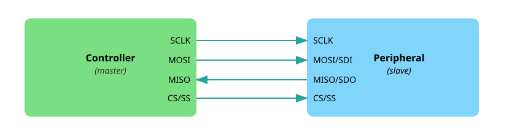

# Последовательный периферийный интерфейс (SPI)

В этом разделе мы узнаем, что такое SPI и как использовать шины связи SPI на Raspberry Pi Pico.

## Что такое SPI?

SPI расшифровывается как Serial Peripheral Interface (последовательный периферийный интерфейс). Это один из самых распространённых способов, которым микроконтроллеры обмениваются данными с такими устройствами, как дисплеи, датчики и SD-карты. Технически это последовательный, полнодуплексный и синхронный интерфейс. Но что означают эти термины?

- **Последовательный** (serial) означает, что данные передаются по одному биту, один за другим, по одной линии данных. Это отличается от параллельной связи, при которой несколько битов передаются одновременно по нескольким линиям.

- **Полнодуплексный** (full duplex) означает, что два устройства могут отправлять и принимать данные одновременно. Оба устройства могут передавать данные друг другу, не дожидаясь, пока другое закончит. Это отличается от полудуплексного режима, где устройства должны работать по очереди: одно отправляет, пока другое принимает.

- **Синхронный** (synchronous) означает, что оба устройства используют общий тактовый сигнал. Этот тактовый сигнал точно задаёт, когда отправляется и считывается каждый бит данных, поэтому обе стороны остаются согласованными во время обмена.

## Контроллер и периферия

SPI использует модель «контроллер — периферия» (раньше её называли «ведущий — ведомый», master-slave). Контроллер — это устройство, которое начинает обмен и формирует тактовый сигнал. Периферия — это устройство, которое отвечает контроллеру.

В нашем случае Raspberry Pi Pico выступает в роли контроллера, а такие устройства, как дисплеи, датчики или SD-карты, — в роли периферии.

<em>Рисунок: одна шина SPI с контроллером и одной периферией</em>

Обычно соединение использует четыре линии:

- Линия SCK (Serial Clock) несёт тактовый сигнал, который формирует контроллер. Этот сигнал синхронизирует контроллер и устройство во время передачи данных.

- Линия MOSI (Master Out, Slave In) используется для отправки данных от контроллера к устройству. В некоторых даташитах эта линия может обозначаться как SDO (Serial Data Out).

- Линия MISO (Master In, Slave Out) передаёт данные от устройства к контроллеру. В зависимости от устройства её также могут называть SDI (Serial Data In).

- Наконец, линия CS (Chip Select) используется контроллером, чтобы выбрать, с каким устройством он хочет обмениваться данными. У каждого подключённого устройства обычно есть собственная линия CS. Когда контроллер переводит линию CS устройства в низкий уровень (активный), устройство становится активным и готовым к обмену. В некоторой старой документации эту линию могут называть SS (Slave Select).

<em>Рисунок: одна шина SPI с контроллером и несколькими периферийными устройствами</em>

### Режимы SPI

SPI поддерживает четыре режима, которые нумеруются от 0 до 3. Они определяют, когда данные считываются и записываются, в зависимости от уровня простоя тактового сигнала и фронта.

Пока не стоит слишком углубляться в детали. Режим 0 — самый распространённый и подходит для большинства устройств.

## Почему SPI?

SPI — отличный выбор, когда нужна быстрая и надёжная связь между микроконтроллером и периферийным устройством. Он заметно быстрее I²C или UART, прост в использовании и позволяет одновременно передавать и принимать данные (полный дуплекс). Поэтому он идеально подходит для высокоскоростных устройств, таких как дисплеи или SD-карты.

Пока есть достаточно выводов GPIO и не нужно подключать большое количество устройств, SPI обычно лучший инструмент для такой задачи.

## Ресурсы

Для более подробных технических сведений обратитесь к следующим материалам:

- [Serial Peripheral Interface (SPI) от Sparkfun](https://learn.sparkfun.com/tutorials/serial-peripheral-interface-spi/all) (на английском языке)
- [Основы протокола связи SPI](https://www.circuitbasics.com/basics-of-the-spi-communication-protocol/) (на английском языке)
