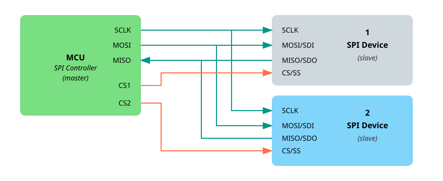

# Использование SPI в экосистеме embedded Rust

В предыдущем разделе мы узнали, что такое SPI и как работает модель «контроллер — периферия». Теперь посмотрим, как эти понятия применяются в экосистеме embedded Rust.

Экосистема embedded Rust построена на модульности и повторном использовании. Это значит, что код, написанный для одного микроконтроллера, можно перенести на другой с минимальными изменениями. Одна из ключевых причин такой гибкости — трейты, которые определяет крейт embedded-hal.

## SPI в embedded-hal

Крейт embedded-hal определяет стандартные трейты для работы с SPI, чтобы драйверы и библиотеки можно было писать в обобщённом виде. Для SPI важны два трейта:

- SpiBus: представляет полный контроль над шиной SPI, включая линии SCK, MOSI и MISO. Его должен реализовать крейт HAL микроконтроллера. Например, крейт esp-hal реализует SpiBus. Если вам интересно, можно посмотреть реализацию [здесь](https://github.com/esp-rs/esp-hal/blob/de67c3101346cdbe030ffa1bb95b13943ee8d790/esp-hal/src/spi/master.rs#L2703).

- SpiDevice: представляет доступ к одному устройству SPI, которое может делить шину с другими. Он берёт на себя управление линией выбора микросхемы (CS) и гарантирует, что устройство выбрано перед обменом и освобождено после него.

## Драйверы, не зависящие от платформы

Представьте, что вы пишете драйвер для датчика или дисплея, который общается по SPI. Вы не хотите привязывать свой код к конкретному микроконтроллеру, например Raspberry Pi Pico или ESP32. Вместо этого можно написать драйвер в обобщённом виде, используя трейты embedded-hal.

Пока ваш драйвер зависит только от трейтов SpiDevice или SpiBus, он может работать на любой платформе, которая предоставляет реализацию этих трейтов, например на STM32, nRF или ESP32.

## Совместное использование шины SPI

Во многих проектах несколько устройств SPI используют одну и ту же шину. Например, к одним и тем же линиям MOSI, MISO и SCK могут быть подключены дисплей, SD-карта и датчик температуры. Разделяет их только линия выбора микросхемы (CS).

<em>Рисунок: одна шина SPI с контроллером и несколькими периферийными устройствами</em>

Если отдать полный контроль над шиной SPI одному драйверу (через SpiBus), остальные не смогут её использовать. Поэтому нам нужен способ безопасно разделять шину SPI между несколькими устройствами.

Именно для этого существует SpiDevice: он позволяет каждому драйверу использовать только свою линию CS, оставаясь при этом на общей шине.

На практике это означает, что каждому драйверу нужно передавать структуру, которая реализует SpiDevice, а не всю шину целиком.

## Как получить SpiDevice?

Мы сказали, что каждому драйверу следует передавать реализацию SpiDevice, а не полную шину SpiBus. Но нужно ли самим писать эту структуру SpiDevice?

На самом деле нет. Хотя написать собственную реализацию можно, это обычно не нужно, а правильно сделать её непросто, особенно когда нескольким устройствам нужно согласовывать доступ к шине.

Здесь пригодится крейт embedded-hal-bus. Он предоставляет готовые обёртки, которые реализуют трейт SpiDevice за вас. Эти обёртки берут на себя доступ к шине, управление выбором микросхемы и при необходимости синхронизацию между устройствами.

- Если ваш проект использует только одно устройство SPI и не нужно совместное использование, можно взять структуру `ExclusiveDevice` — она даёт одному устройству эксклюзивный доступ к шине.

- Если же в проекте несколько устройств SPI на одной шине, можно выбрать одну из реализаций совместного доступа, например `AtomicDevice` или `CriticalSectionDevice`. Они управляют доступом к шине так, что каждое устройство получает свою очередь, не мешая остальным.

Эти структуры позволяют сосредоточиться на использовании или написании драйверов, не беспокоясь о низкоуровневой координации и шаблонном коде.

## Ресурсы

- [Документация embedded-hal по SPI](https://docs.rs/embedded-hal/latest/embedded_hal/spi/index.html): подробное описание того, как устроены трейты SPI и как их предполагается использовать на разных платформах.
