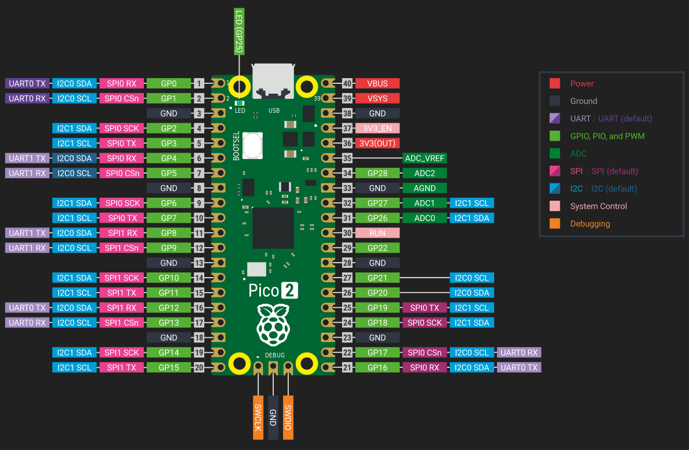

{{#title Настройка периферии SPI на Raspberry Pi Pico 2 с Embassy и rp-hal}}

# Периферия SPI в RP2350

В RP2350 есть два контроллера SPI, которые называются SPI0 и SPI1. Оба — периферия общего назначения, доступная для использования в приложениях. Эти контроллеры обеспечивают гибкие возможности последовательной связи для подключения внешних устройств, таких как датчики, дисплеи, SD-карты и другие периферийные устройства SPI.

Каждый модуль SPI поддерживает стандартную работу по SPI, включая режимы мастера и ведомого, полнодуплексные передачи и обычные сигналы SPI: SCLK, MOSI, MISO и выбор микросхемы (chip select).

Более подробные и точные сведения можно найти на 1046-й странице даташита RP2350: https://pip-assets.raspberrypi.com/categories/1214-rp2350/documents/RP-008373-DS-2-rp2350-datasheet.pdf?disposition=inline#page=1047

## Выводы GPIO

Raspberry Pi Pico 2 выводит на свой разъём GPIO две шины SPI: SPI0 и SPI1. Каждая шина SPI использует четыре сигнала: тактирование (SCK), передачу (MOSI), приём (MISO) и выбор микросхемы (CS).



На приведённой схеме выводы SPI выделены розовым цветом.

### Варианты выводов SPI0

| MISO (RX) | CS      | SCK     | MOSI (TX) |
| --------- | ------- | ------- | --------- |
| GPIO 0    | GPIO 1  | GPIO 2  | GPIO 3    |
| GPIO 4    | GPIO 5  | GPIO 6  | GPIO 7    |
| GPIO 16   | GPIO 17 | GPIO 18 | GPIO 19   |

### Варианты выводов SPI1

| MISO (RX) | CS      | SCK     | MOSI (TX) |
| --------- | ------- | ------- | --------- |
| GPIO 8    | GPIO 9  | GPIO 10 | GPIO 11   |
| GPIO 12   | GPIO 13 | GPIO 14 | GPIO 15   |

## Использование SPI в Embassy

Embassy предоставляет два способа использовать SPI. Первый — асинхронный, при котором передачи можно ожидать (await) без блокировки исполнителя. Второй — блокирующий, который ведёт себя ближе к традиционным HAL и часто проще для небольших примеров или разовых передач.

### Асинхронный режим

В асинхронном режиме SPI под капотом использует DMA. Нужно предоставить каналы DMA, а все передачи выполняются с помощью `.await`. Это полезно, когда передачи SPI — часть большого асинхронного приложения, и вы не хотите блокировать другие задачи.

```rust
let miso = p.PIN_12;
let mosi = p.PIN_11;
let clk = p.PIN_10;

let mut spi_bus = Spi::new(p.SPI1, clk, mosi, miso, p.DMA_CH0, p.DMA_CH1, spi::Config::default());

let tx_buf = [1_u8, 2, 3, 4, 5, 6];
let mut rx_buf = [0_u8; 6];
spi_bus.transfer(&mut rx_buf, &tx_buf).await.unwrap();
info!("{:?}", rx_buf);
```

Здесь данные записываются из `tx_buf`, а данные, полученные от периферии, сохраняются в `rx_buf`. Вызов `transfer` возвращает управление только после завершения транзакции SPI.

### Блокирующий режим

Блокирующий SPI проще: вызовы возвращаются только после завершения передачи, и не требуется ни DMA, ни асинхронный контекст.

```rust
let miso = p.PIN_12;
let mosi = p.PIN_11;
let clk = p.PIN_10;

let mut config = spi::Config::default();
let mut spi_bus = Spi::new_blocking(p.SPI1, clk, mosi, miso, config);

spi_bus.blocking_transfer_in_place(&mut buf).unwrap();
```

## Использование SPI в rp-hal

В rp-hal сначала нужно настроить выводы в режим функции SPI, затем создаётся периферия SPI и инициализируется с нужной тактовой частотой и режимом SPI.

```rust
 // Эти выводы неявно используются драйвером SPI, если они в правильном режиме
let spi_mosi = pins.gpio7.into_function::<hal::gpio::FunctionSpi>();
let spi_miso = pins.gpio4.into_function::<hal::gpio::FunctionSpi>();
let spi_sclk = pins.gpio6.into_function::<hal::gpio::FunctionSpi>();
let spi_bus = hal::spi::Spi::<_, _, _, 8>::new(pac.SPI0, (spi_mosi, spi_miso, spi_sclk));

// Заменяем неинициализированный драйвер SPI на инициализированный
let mut spi_bus = spi_bus.init(
    &mut pac.RESETS,
    clocks.peripheral_clock.freq(),
    16.MHz(),
    embedded_hal::spi::MODE_0,
);

// Записываем 0, возвращаемое значение игнорируем
if spi_bus.write(&[0]).is_ok() {
    // Запись по SPI прошла успешно
};
```

## Пример использования драйвера

Обычно вы не будете работать с SPI напрямую. Вместо этого вы передаёте устройство SPI драйверу. Обычно это означает, что сначала создаётся шина SPI, а затем она оборачивается в `ExclusiveDevice` из крейта `embedded-hal-bus`.

```rust
let clk = p.PIN_14;
let mosi = p.PIN_15;

let spi_bus = Spi::new_blocking_txonly(p.SPI1, clk, mosi, SpiConfig::default());
let spi_dev = ExclusiveDevice::new_no_delay(spi_bus, cs_pin).expect("Failed to get exclusive device");

// Создаём экземпляр дисплея для одной светодиодной матрицы 8x8 (без последовательного соединения)
let mut display = SingleMatrix::from_spi(spi_dev).expect("display count 1 should not panic");
```
