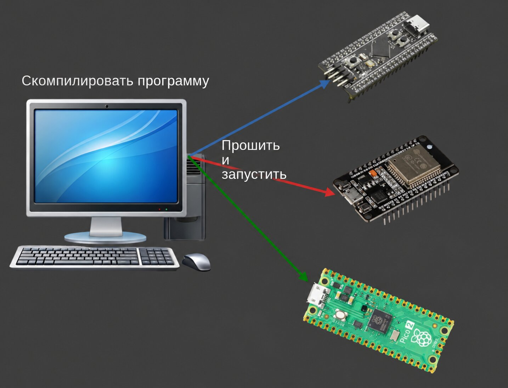

{{#title Кросс-компиляция для embedded Rust и Raspberry Pi Pico 2 | impl Rust для RP2350}}

# Кросс-компиляция

Вероятно, вы уже знакомы с кросс-компиляцией. В этом разделе мы разберём, как она работает и что означают такие понятия, как target triple (тройка целевой платформы). Проще говоря, кросс-компиляция — это сборка программ для машины, отличной от той, на которой вы работаете.

Можно писать код на одном компьютере и создавать программы, которые будут работать на совсем другом. Например, можно работать в Linux и собирать файлы .exe для Windows. Можно даже собирать программы для голого железа (bare-metal) микроконтроллеров, таких как RP2350, ESP32 или STM32.

> **Коротко**
>
> При сборке бинарного файла для Pico 2 нужно использовать в качестве цели либо `thumbv8m.main-none-eabihf`, либо `riscv32imac-unknown-none-elf`.
>
> `cargo build --target thumbv8m.main-none-eabihf`
>
> Цель также можно задать в `.cargo/config.toml`, чтобы не вводить её каждый раз.



## Сборка для вашей системы

Допустим, мы работаем на машине с Linux. Когда вы запускаете обычную команду сборки, Rust компилирует код для текущей платформы, в данном случае для Linux:

```sh
cargo build
```

Проверить, какой тип бинарного файла был создан, можно с помощью команды file:

```sh
file ./target/debug/pico-from-scratch
```

Вы получите примерно такой вывод. Он говорит о том, что это 64-битный ELF-файл, динамически скомпонованный и собранный для Linux.

```sh
./target/debug/pico-from-scratch: ELF 64-bit LSB pie executable, x86-64, version 1 (SYSV), dynamically linked, interpreter /lib64/ld-linux-x86-64.so.2, Build...
```

## Кросс-компиляция для Windows

Теперь представим, что нужно собрать бинарный файл для Windows, не выходя из Linux. Здесь и пригодится кросс-компиляция.

Сначала нужно сообщить Rust о целевой платформе. Это нужно сделать только один раз:

```sh
rustup target add x86_64-pc-windows-gnu
```

Эта команда добавляет поддержку генерации 64-битных бинарных файлов Windows с помощью тулчейна GNU (MinGW).

Теперь соберите проект снова, но на этот раз укажите цель:

```sh
cargo build --target x86_64-pc-windows-gnu
```

Вот и всё. Rust создаст бинарный файл .exe для Windows, хотя вы по-прежнему работаете в Linux. Выходной файл будет находиться в `target/x86_64-pc-windows-gnu/debug/pico-from-scratch.exe`.

Тип файла можно проверить так:

```sh
file target/x86_64-pc-windows-gnu/debug/pico-from-scratch.exe
```

Вывод будет примерно таким: 64-битный файл PE32+ для Windows.

```sh
target/x86_64-pc-windows-gnu/debug/pico-from-scratch.exe: PE32+ executable (console) x86-64, for MS Windows
```

## Что такое target triple?

Что же означает эта строка `x86_64-pc-windows-gnu`?

Это называется target triple (тройка целевой платформы), и она точно сообщает компилятору, какой результат вам нужен. Обычно она следует такому формату:

```html
`<architecture>-<vendor>-<os>-<abi>`
```

Но шаблон не всегда соблюдается. Иногда части ABI не будет. В других случаях может отсутствовать даже поставщик (vendor) или и поставщик, и ABI. Структура может быть запутанной, и исключений много. Если хотите разобраться во всех особенностях и граничных случаях, посмотрите статью «What the Hell Is a Target Triple?» (на английском языке), ссылка на которую приведена в списке литературы.

Разберём, что на самом деле означает эта тройка:

- **Архитектура (x86_64)**: это 64-битная x86, тип процессора, который используется в большинстве современных ПК. Её также называют AMD64 или x64.

- **Поставщик (pc)**: по сути, это заполнитель. В большинстве случаев он не очень важен. Если речь идёт о macOS, поставщиком будет «apple».

- **ОС (windows)**: сообщает Rust, что мы хотим собрать программу для Windows.

- **ABI (gnu)**: эта часть говорит Rust, что для сборки бинарного файла нужно использовать тулчейн GNU.

## Ссылки

- [Поддержка платформ](https://doc.rust-lang.org/beta/rustc/platform-support.html) (на английском языке)
- [Кросс-компиляция](https://rust-lang.github.io/rustup/cross-compilation.html) (на английском языке)
- [What the Hell Is a Target Triple?](https://mcyoung.xyz/2025/04/14/target-triples/) (на английском языке)
