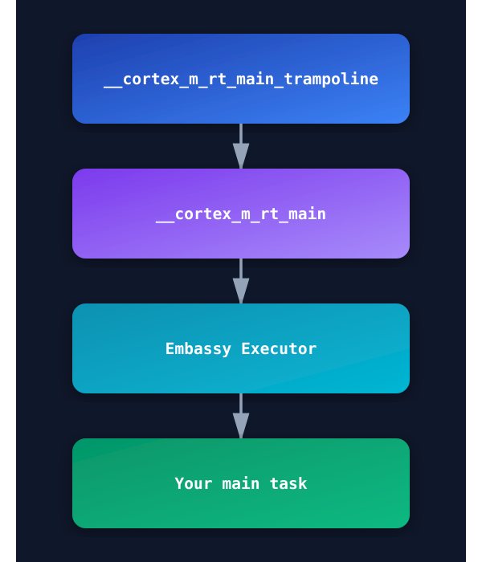

{{#title Атрибут no_main и точка входа в embedded Rust для Raspberry Pi Pico 2}}

# no_main

Если на этом этапе попробовать собрать проект, вы получите ошибку о том, что функции main нужна стандартная библиотека. Что?! (Я удержался от соблазна вставить сюда мем с Мистером Бином, потому что не всем нравятся мемы.) Что же делать? Откуда вообще начинается программа?

Во встраиваемых системах мы не используем обычный `fn main`, который опирается на стандартную библиотеку. Вместо этого нужно сообщить Rust, что мы предоставим собственную точку входа. Для этого используется атрибут `no_main`.

Атрибут `#![no_main]` указывает, что программа не будет использовать стандартную точку входа (`fn main`).

В начало файла `src/main.rs` добавьте эту строку:

```rs
#![no_main]
```

## Объявление точки входа

Теперь, когда мы отказались от стандартной точки входа, нужно указать Rust, с какой функции начинать. Каждый крейт HAL в экосистеме embedded Rust предоставляет специальный макрос-атрибут, который позволяет пометить точку входа. Этот макрос инициализирует и настраивает всё, что нужно для микроконтроллера.

Если бы мы использовали rp-hal, для чипа RP2350 можно было бы взять `rp235x_hal::entry`. Однако мы будем использовать Embassy (крейт embassy-rp). Embassy предоставляет макрос `embassy_executor::main`, который настраивает асинхронную среду выполнения для задач и вызывает нашу функцию main.

> Исполнитель Embassy (Embassy Executor) — это исполнитель async/await, созданный для встраиваемых систем, вместе с поддержкой прерываний и таймеров. Чтобы глубже понять, как работает Embassy, можно прочитать официальную [книгу Embassy](https://embassy.dev/book) (на английском языке).

### Среда выполнения Cortex-M

Если заглянуть в макрос [`embassy_executor::main`](https://github.com/embassy-rs/embassy/blob/2c1c5232e8767887cbad5f28abf9a39ae78dd6c4/embassy-executor-macros/src/lib.rs#L69), видно, что он использует другой макрос в зависимости от архитектуры. Поскольку Pico 2 — это Cortex-M, используется `cortex_m_rt::entry`. Он приходит из крейта `cortex_m_rt`, который предоставляет стартовый код и минимальную среду выполнения для микроконтроллеров Cortex-M.

<a href="./images/embassy-entry-point.svg"></a>

Если выполнить `cargo expand` в проекте быстрого старта, можно увидеть, как раскрывается макрос, и полный поток выполнения. Если идти по этой цепочке до конца, программа начинается с функции `__cortex_m_rt_main_trampoline`. Эта функция вызывает `__cortex_m_rt_main`, которая настраивает исполнитель Embassy и запускает нашу функцию main.

Чтобы всё это работало, нужно добавить в проект крейты `cortex-m` и `cortex-m-rt`. Обновим файл `Cargo.toml`:

```toml
cortex-m = { version = "0.7.7" }
cortex-m-rt = "0.7.5"
```

Теперь можно добавить крейт исполнителя embassy:

```toml
embassy-executor = { version = "0.9", features = [
  "arch-cortex-m",
  "executor-thread",
] }
```

Затем в `main.rs` задайте точку входа так:

```rust
use embassy_executor::Spawner;

#[embassy_executor::main]
async fn main(_spawner: Spawner) {}
```

Мы изменили сигнатуру функции. Функция должна принимать `Spawner` как аргумент, чтобы удовлетворить требованиям embassy, а сама функция теперь помечена как `async`.

## Уже близко?

Ура! Теперь попробуйте собрать проект — он должен скомпилироваться успешно.

Сгенерированный бинарный файл можно проверить командой file:

```sh
file target/thumbv8m.main-none-eabihf/debug/pico-from-scratch
```

Вы увидите что-то вроде этого:

```sh
target/thumbv8m.main-none-eabihf/debug/pico-from-scratch: ELF 32-bit LSB executable, ARM, EABI5 version 1 (GNU/Linux), statically linked, with debug_info, not stripped
```

Как видите, бинарный файл собран для 32-битной ARM. Значит, базовая настройка для Pico работает.

Но уже близко? Пока нет. Мы прошли половину пути: теперь у нас есть корректный бинарный файл для Pico, но перед запуском на реальном железе нужно сделать ещё кое-что.

**Ресурсы:**

- [Официальная документация Rust](https://doc.rust-lang.org/reference/crates-and-source-files.html?highlight=no_main#the-no_main-attribute) (на английском языке)
- [Writing an OS in Rust, раздел о точке входа](https://os.phil-opp.com/freestanding-rust-binary/#overwriting-the-entry-point) (на английском языке)
