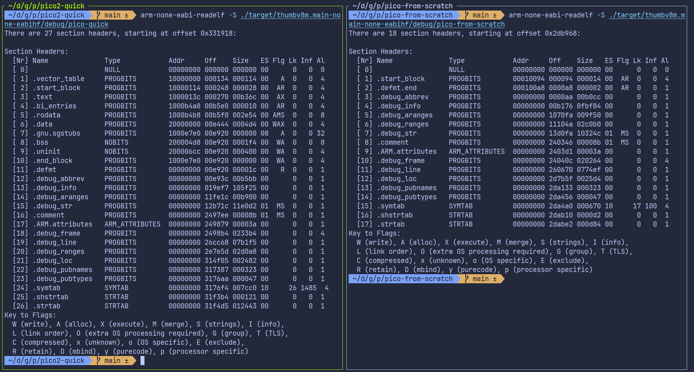
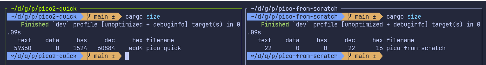

# Скрипт компоновщика

Программа теперь собирается успешно. Однако при попытке прошить её на Pico может появиться ошибка такого вида:

```sh
ERROR: File to load contained an invalid memory range 0x00010000-0x000100aa
```

## Сравнение нашего проекта с проектом быстрого старта

Чтобы понять, почему прошивка не удаётся, посмотрим на скомпилированную программу с помощью инструмента `arm-none-eabi-readelf`. Он показывает, как компилятор и компоновщик разместили программу в памяти.

Я взял бинарный файл из проекта быстрого старта и сравнил его с бинарным файлом, который наш проект выдаёт в текущем состоянии.

<div class="image-with-caption" style="text-align:center; display:inline-block;">
    
    <div class="caption" style="font-size:0.9em; color:#555; margin-top:6px;">Быстрый старт и наш проект</div>
</div>

Не нужно понимать каждую деталь этого вывода. Важно лишь заметить, что два бинарных файла выглядят очень по-разному, хотя наш код на Rust почти такой же.

Главное отличие в том, что в нашем проекте не хватает некоторых важных секций: `.text`, `.rodata`, `.data` и `.bss`. Обычно их создаёт компоновщик:

- `.text`: здесь находятся сами инструкции программы (код)
- `.rodata`: данные только для чтения, например константы
- `.data`: инициализированные глобальные и статические переменные
- `.bss`: неинициализированные глобальные и статические переменные

Сравнить их можно и командой `cargo size` из набора инструментов [cargo-binutils](https://github.com/rust-embedded/cargo-binutils).

<div class="image-with-caption" style="text-align:center; display:inline-block;">
    
    <div class="caption" style="font-size:0.9em; color:#555; margin-top:6px;">cargo size: быстрый старт и наш проект</div>
</div>

**Компоновщик (linker):**

Обычно этим занимается компоновщик. Его задача — взять все части нашей программы, например скомпилированный код, код библиотек, стартовый код и данные, и объединить их в один исполняемый файл, который устройство может действительно запустить. Он также решает, куда помещать каждую часть программы в памяти: где будет код и где — глобальные переменные.

Однако компоновщик не знает автоматически структуру памяти RP2350. Нужно сообщить ему, как расположены флеш-память и ОЗУ. Это делается с помощью скрипта компоновщика. Если скрипт отсутствует или неверен, компоновщик не разместит наш код в правильных областях памяти, что и приводит к ошибке прошивки, которую мы видим.

### Скрипт компоновщика

Скрипт компоновщика писать самим мы не будем. Крейт `cortex-m-rt` уже предоставляет основной скрипт (`link.x`), но он знает только о ядре Cortex-M. Он ничего не знает о конкретном микроконтроллере, который мы используем. У каждого микроконтроллера свой объём флеш-памяти, свой объём ОЗУ и своя структура памяти, а `cortex-m-rt` не может угадать эти значения.

Поэтому `cortex-m-rt` ожидает, что пользователь или крейт поддержки платы (board support crate) предоставит небольшой скрипт компоновщика под названием `memory.x`. Этот файл описывает структуру памяти целевого устройства.

В `memory.x` мы должны определить области памяти, которые есть у устройства. Минимум нужны две области: одна с именем `FLASH` и одна с именем `RAM`. Секции `.text` и `.rodata` программы размещаются в области `FLASH`. Секции `.bss` и `.data`, а также куча (heap) размещаются в области `RAM`.

Для RP2350 даташит (глава 2.2, Карта адресов) указывает, что флеш-память начинается с адреса `0x10000000`, а SRAM — с адреса `0x20000000`. Поэтому наш файл `memory.x` будет выглядеть примерно так:

```text
MEMORY {
    FLASH : ORIGIN = 0x10000000, LENGTH = 2048K

    RAM : ORIGIN = 0x20000000, LENGTH = 512K
    SRAM4 : ORIGIN = 0x20080000, LENGTH = 4K
    SRAM5 : ORIGIN = 0x20081000, LENGTH = 4K
    ...
    ...
}
...
...
```

Для RP2350 в `memory.x` нужны и другие настройки. Писать их вручную не нужно. Вместо этого возьмём [файл из репозитория примеров embassy-rp](https://github.com/embassy-rs/embassy/blob/a6d392b24c5f010a8b5b2a00326c04b05a4ab0f0/examples/rp235x/memory.x) и поместим его в корень проекта.

## Опция кодогенерации для компоновщика

Одного файла `memory.x` в папке проекта недостаточно. Также нужно убедиться, что компоновщик действительно использует скрипт, предоставляемый `cortex-m-rt`.

Для этого мы говорим Cargo передать компоновщику скрипт `link.x`. Передать аргумент в rustc можно несколькими способами: через `.cargo/config.toml` или через файл сборки `build.rs`. В быстром старте мы использовали `build.rs`, а сейчас применим подход с `.cargo/config.toml`. В этом файле обновите секцию target следующим образом:

```toml
[target.thumbv8m.main-none-eabihf]
runner = "picotool load -u -v -x -t elf" # Эту строку мы уже добавили
rustflags = ["-C", "link-arg=-Tlink.x"]  # Это новая строка
```

## Запускаем на Pico

Когда всё настроено, можно прошить программу на Pico:

```sh
cargo run --release
```

Фух... Мы взяли обычный проект на Rust и превратили его в прошивку no_std для Pico. Наконец-то можно увидеть, как мигает светодиод.

## Ресурсы

- [Everything You Never Wanted To Know About Linker Script](https://mcyoung.xyz/2021/06/01/linker-script/) (на английском языке)
