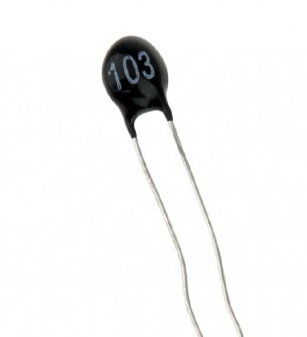

# Термистор

Термистор — это резистор, сопротивление которого меняется с температурой. Когда температура растёт или падает, сопротивление меняется предсказуемым образом. Название «термистор» образовано от слов «thermal» (тепловой) и «resistor» (резистор).

С точки зрения микроконтроллера термистор — это просто ещё один резистор, подключённый к выводу АЦП. АЦП ничего не знает о температуре. Он измеряет только напряжение. Всё остальное мы делаем в коде.

## NTC и PTC

Есть два распространённых типа термисторов.

У термистора NTC сопротивление ниже при более высокой температуре. Это самый распространённый тип для измерения температуры во встраиваемых системах.

У термистора PTC сопротивление выше при более высокой температуре. Такие термисторы обычно используют для защиты или ограничения тока, а не для точного измерения.

В этой главе мы будем работать с термистором NTC.

## Ссылки

- [Основы термисторов](https://www.teamwavelength.com/thermistor-basics/) (на английском языке)
- [Thermistors](https://www.electronics-tutorials.ws/io/thermistors.html) (на английском языке)
