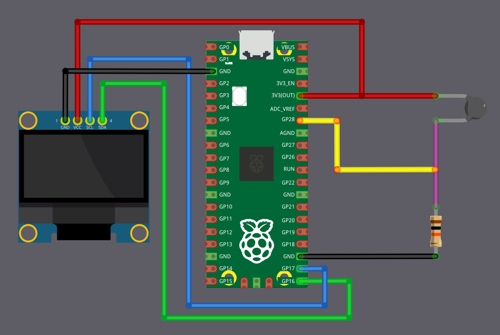

# Вывод температуры на OLED с помощью embedded Rust на Raspberry Pi Pico

В этой главе мы будем считывать температуру с термистора и выводить её на OLED-экран.

К этому моменту вы уже должны знать, как использовать OLED-дисплей с Raspberry Pi Pico. Вместо того чтобы выводить значения в консоль, сделаем всё интереснее и покажем их на аппаратном дисплее.

## Требования к оборудованию

- Термистор NTC 103: 10 кОм, эпоксидный диск 5 мм
- OLED-дисплей (0,96 дюйма, I2C/IIC, 4 вывода, разрешение 128x64, микросхема SSD1306)
- Резистор 10 кОм: вместе с термистором образует делитель напряжения
- Перемычки

## Схема подключения OLED и термистора к Raspberry Pi Pico

### Подключение термистора

Мы подключим термистор как делитель напряжения и подадим выход делителя на вывод АЦП Pico. Здесь термистор выступает в роли R1 и подключён к питанию 3,3 В, поэтому значение АЦП уменьшается при росте температуры (поведение NTC).

<table>
  <thead>
    <tr>
      <th>Вывод Pico</th>
      <th style="width: 250px; margin: 0 auto;">Провод</th>
      <th>Компонент</th>
    </tr>
  </thead>
  <tbody>
    <tr>
      <td>3.3&nbsp;V</td>
      <td style="text-align: center; vertical-align: middle; padding: 0;">
        

          

          

        

      </td>
      <td>Один вывод термистора</td>
    </tr>
    <tr>
      <td>GPIO&nbsp;28 (ADC2)</td>
      <td style="text-align: center; vertical-align: middle; padding: 0;">
        

          

          

        

      </td>
      <td>Точка соединения термистора и резистора 10&nbsp;кОм</td>
    </tr>
    <tr>
      <td>Резистор 10&nbsp;кОм</td>
      <td style="text-align: center; vertical-align: middle; padding: 0;">
        

          

          

        

      </td>
      <td>Другой вывод термистора</td>
    </tr>
    <tr>
      <td>GND</td>
      <td style="text-align: center; vertical-align: middle; padding: 0;">
        

          

          

        

      </td>
      <td>Другой вывод резистора 10&nbsp;кОм</td>
    </tr>
  </tbody>
</table>

### Подключение OLED (I2C)

OLED-дисплей подключается по I2C. SDA подключён к GPIO&nbsp;16, а SCL — к GPIO&nbsp;17.

<table>
  <thead>
    <tr>
      <th>Вывод Pico</th>
      <th style="width: 250px; margin: 0 auto;">Провод</th>
      <th>Вывод OLED</th>
    </tr>
  </thead>
  <tbody>
    <tr>
      <td>GND</td>
      <td style="text-align: center; vertical-align: middle; padding: 0;">
        

          

          

        

      </td>
      <td>GND</td>
    </tr>
    <tr>
      <td>3.3&nbsp;V</td>
      <td style="text-align: center; vertical-align: middle; padding: 0;">
        

          

          

        

      </td>
      <td>VCC</td>
    </tr>
    <tr>
      <td>GPIO&nbsp;16</td>
      <td style="text-align: center; vertical-align: middle; padding: 0;">
        

          

          

        

      </td>
      <td>SDA</td>
    </tr>
    <tr>
      <td>GPIO&nbsp;17</td>
      <td style="text-align: center; vertical-align: middle; padding: 0;">
        

          

          

        

      </td>
      <td>SCL</td>
    </tr>
  </tbody>
</table>
