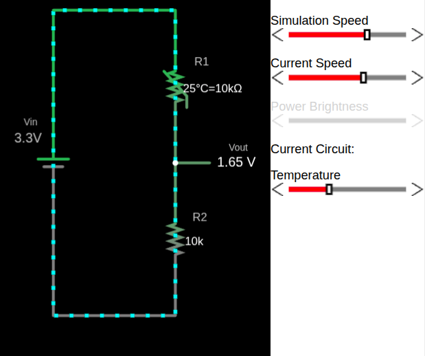
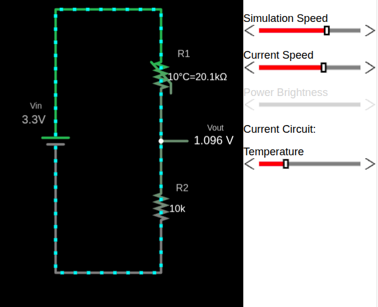
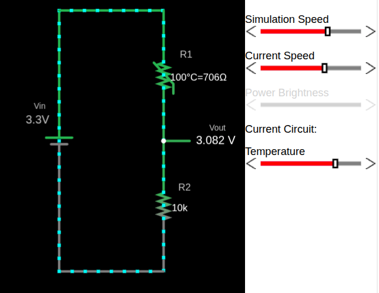

# NTC и делитель напряжения

Чтобы понять, как ведёт себя термистор NTC в делителе напряжения, я создал простую симуляцию в Falstad. На схеме термистор изображён как резистор, сопротивление которого меняется с температурой.

Файл с созданной мной схемой, [voltage-divider-thermistor.circuitjs.txt](./voltage-divider-thermistor.circuitjs.txt), можно импортировать на сайт Falstad и поэкспериментировать самостоятельно. Внизу страницы также есть встроенный симулятор, так что можно воспользоваться любым вариантом.

В этой конфигурации термистор NTC расположен в верхней части делителя напряжения (R1), а внизу — постоянный резистор (R2). Когда температура меняется, сопротивление термистора меняется, и это напрямую влияет на выходное напряжение делителя.

> [!Important]
> Если поменять местами термистор и постоянный резистор, поведение выходного напряжения инвертируется.
> Если поставить термистор как R2 вместо R1, рост температуры приведёт к уменьшению \\( V_{out} \\).

### Термистор при 25 °C

При 25 °C сопротивление термистора составляет 10 кОм, и выходное напряжение (\\( V_{out} \\)) равно 1,65 В.

## Термистор при 10 °C

Сопротивление термистора возрастает, и выходное напряжение (\\( V_{out} \\)) становится ниже.

## Термистор при 100 °C

Сопротивление термистора уменьшается из-за его отрицательного температурного коэффициента. Это приводит к росту выходного напряжения.

## Симулятор делителя напряжения с NTC-термистором

    
🌡️ Симулятор делителя напряжения с NTC-термистором

    

        <canvas id="thermistorSimCanvas" class="thermistor-sim-canvas" width="370" height="500"></canvas>
        

            <label class="thermistor-sim-label">🌡️ Температура</label>
            

                <input type="range" class="thermistor-sim-slider" id="thermistorSimTemp" min="0" max="100" value="25">
                25 °C
            

            
25 °C

        

    

