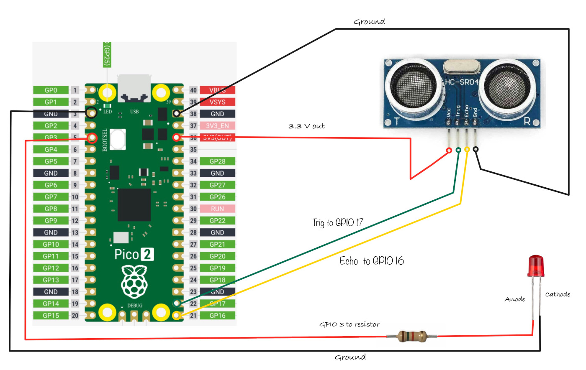

# Схема для HC-SR04+

Пропустите этот шаг, если вы используете вариант HC-SR04, рассчитанный только на 5 В.

Подключение Pico и ультразвукового датчика:

<table>
  <thead>
    <tr>
      <th>Вывод Pico</th>
      <th style="height: 4px; width: 250px; margin: 0 auto;">Провод</th>
      <th>Вывод HC-SR04+</th>
    </tr>
  </thead>
  <tbody>
    <tr>
      <td>3.3 V</td>
      <td style="text-align: center; vertical-align: middle; padding: 0;">
        

          

          

        

      </td>
      <td>VCC</td>
    </tr>
    <tr>
      <td>GPIO 17</td>
      <td style="text-align: center; vertical-align: middle; padding: 0;">
        

          

          

        

      </td>
      <td>Trig</td>
    </tr>
    <tr>
      <td>GPIO 16</td>
      <td style="text-align: center; vertical-align: middle; padding: 0;">
        

          

          

        

      </td>
      <td>Echo</td>
    </tr>
    <tr>
      <td>GND</td>
      <td style="text-align: center; vertical-align: middle; padding: 0;">
        

          

          

        

      </td>
      <td>GND</td>
    </tr>
  </tbody>
</table>

- **VCC**: подключите вывод VCC HC-SR04+ к выводу 3.3 V на Pico.
- **Trig**: подключите к GPIO 17 на Pico, чтобы запускать ультразвуковые импульсы.
- **Echo**: подключите к GPIO 16 на Pico; этот вывод посылает импульс, когда обнаруживает отражённый сигнал, а длина импульса показывает, сколько времени сигналу понадобилось, чтобы вернуться.
- **GND**: подключите к выводу земли на Pico.
- **LED**: подключите анод (длинную ножку) светодиода к GPIO 3.

Подключение Pico и светодиода:

<table>
  <thead>
    <tr>
      <th>Вывод Pico</th>
      <th style="width: 250px; margin: 0 auto;">Провод</th>
      <th>Компонент</th>
    </tr>
  </thead>
  <tbody>
    <tr>
      <td>GPIO 3</td>
      <td style="text-align: center; vertical-align: middle; padding: 0;">
        

          

          

        

      </td>
      <td>Резистор</td>
    </tr>
    <tr>
      <td>Резистор</td>
      <td style="text-align: center; vertical-align: middle; padding: 0;">
        

          

          

        

      </td>
      <td>Анод (длинная ножка) светодиода</td>
    </tr>
    <tr>
      <td>GND</td>
      <td style="text-align: center; vertical-align: middle; padding: 0;">
        

          

          

        

      </td>
      <td>Катод (короткая ножка) светодиода</td>
    </tr>
  </tbody>
</table>

