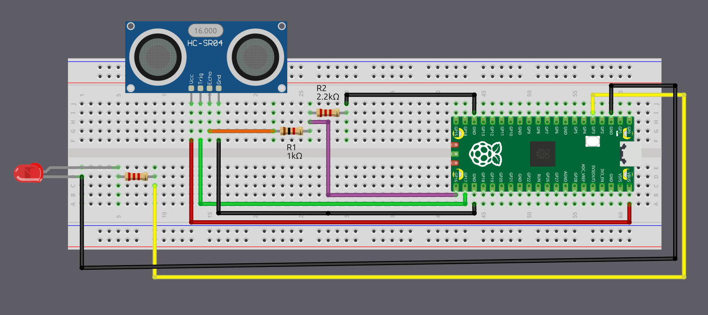

# Подключение HC-SR04 к Pico 2 с помощью делителя напряжения

Если вы используете обычный HC-SR04, как я, вам понадобится создать делитель напряжения для вывода Echo. В этом разделе мы разберём, как собрать схему. Однако если вам повезло и вы купили HC-SR04 Plus, можно перейти к следующей странице. Схема станет намного проще, потому что датчик можно питать от 3,3 В вместо 5 В.

## Распространённые комбинации резисторов

Ниже приведены некоторые пары резисторов, которые можно использовать, чтобы снизить сигнал Echo HC-SR04 примерно до 3,3 В. R1 — резистор, подключённый к выводу Echo, а R2 — резистор, подключённый к земле.

| R1 (к Echo)    | R2 (к GND)     | Выходное напряжение |
|----------------|----------------|---------------------|
| 330 Ω          | 470 Ω          | 2.94 V              |
| 330 Ω          | 680 Ω          | 3.37 V              |
| 470 Ω          | 680 Ω          | 2.96 V              |
| 680 Ω          | 1 kΩ           | 2.98 V              |
| 1 kΩ           | 1.8 kΩ         | 3.21 V              |
| 1 kΩ           | 2 kΩ           | 3.33 V              |
| 1 kΩ           | 2.2 kΩ         | 3.44 V              |
| 1.5 kΩ         | 2.2 kΩ         | 2.97 V              |
| 2.2 kΩ         | 3.3 kΩ         | 3.00 V              |
| 3.3 kΩ         | 4.7 kΩ         | 2.94 V              |
| 4.7 kΩ         | 6.8 kΩ         | 2.96 V              |
| 6.8 kΩ         | 10 kΩ          | 2.98 V              |
| 22 kΩ          | 33 kΩ          | 3.00 V              |
| 33 kΩ          | 47 kΩ          | 2.94 V              |
| 47 kΩ          | 68 kΩ          | 2.96 V              |

Можно выбрать любую пару резисторов из таблицы, потому что все они снижают сигнал Echo 5 В до безопасного уровня около 3,3 В. На практике лучше использовать номиналы, которые уже есть в вашем наборе.

## Подключение Raspberry Pi Pico 2 и ультразвукового датчика

<table>
  <thead>
    <tr>
      <th>Вывод Pico 2</th>
      <th style="height: 4px; width: 250px; margin: 0 auto;">Провод</th>
      <th>Вывод HC-SR04</th>
    </tr>
  </thead>
  <tbody>
    <tr>
      <td>VBUS (Pin 40)</td>
      <td style="text-align: center; vertical-align: middle; padding: 0;">
        

          

          

        

      </td>
      <td>VCC</td>
    </tr>
    <tr>
      <td>GPIO 17</td>
      <td style="text-align: center; vertical-align: middle; padding: 0;">
        

          

          

        

      </td>
      <td>Trig</td>
    </tr>
    <tr>
      <td>GPIO 16 (через делитель напряжения)</td>
      <td style="text-align: center; vertical-align: middle; padding: 0;">
        

          

          

        

      </td>
      <td>Echo (через делитель 1 кОм/2,2 кОм)</td>
    </tr>
    <tr>
      <td>GND</td>
      <td style="text-align: center; vertical-align: middle; padding: 0;">
        

          

          

        

      </td>
      <td>GND</td>
    </tr>
  </tbody>
</table>

- **VCC**: подключите вывод VCC HC-SR04 к VBUS (Pin 40) на Pico 2. HC-SR04 требует питания 5 В, а VBUS выдаёт 5 В от USB-соединения.
- **Trig**: подключите к GPIO 17 на Pico 2, чтобы запускать ультразвуковые импульсы.
- **Echo**: подключите к GPIO 16 на Pico 2 через делитель напряжения (резистор 1 кОм от вывода Echo, резистор 2 кОм или 2,2 кОм до земли). Точка соединения резисторов подключается к GPIO 16. Этот делитель понижает сигнал Echo 5 В примерно до 3,4 В, защищая выводы GPIO Pico на 3,3 В.
- **GND**: подключите к любому выводу земли на Pico 2.

## Подключение Pico 2 и светодиода

<table>
  <thead>
    <tr>
      <th>Вывод Pico 2</th>
      <th style="width: 250px; margin: 0 auto;">Провод</th>
      <th>Компонент</th>
    </tr>
  </thead>
  <tbody>
    <tr>
      <td>GPIO 3</td>
      <td style="text-align: center; vertical-align: middle; padding: 0;">
        

          

          

        

      </td>
      <td>Резистор (220 Ω–330 Ω)</td>
    </tr>
    <tr>
      <td>Резистор</td>
      <td style="text-align: center; vertical-align: middle; padding: 0;">
        

          

          

        

      </td>
      <td>Анод (длинная ножка) светодиода</td>
    </tr>
    <tr>
      <td>GND</td>
      <td style="text-align: center; vertical-align: middle; padding: 0;">
        

          

          

        

      </td>
      <td>Катод (короткая ножка) светодиода</td>
    </tr>
  </tbody>
</table>
